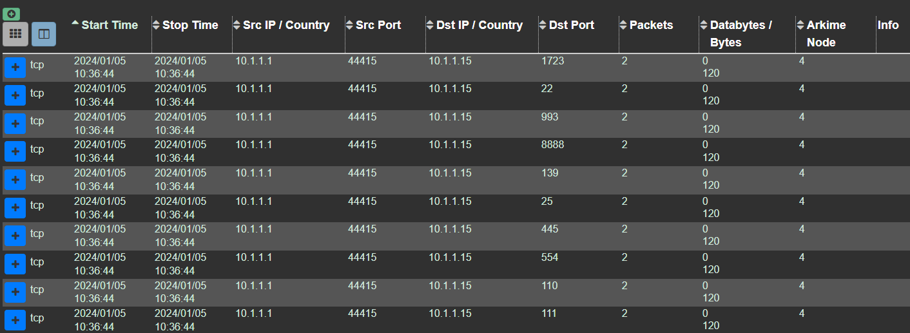

# Brutal Tank Lab

# Context

Lab link: [https://cyberdefenders.org/blueteam-ctf-challenges/brutal-tank/](https://cyberdefenders.org/blueteam-ctf-challenges/brutal-tank/)

Suggested tools: Arkime, Wireshark

# Scenario

Your expertise as a Cybersecurity Incident Responder is urgently needed following a severe incident at our industrial facility. An attacker appears to have successfully breached our network and significantly damaged our Programmable Logic Controller (PLC), responsible for regulating the pressurized airflow. This breach led to the destruction of one air tank and the damage to another. Thankfully, our network TAPs captured the critical moments of this attack, which have been logged in our ARKIME packet capture and search system. You are tasked with determining the events that led to the PLC compromise and identifying the attacker's entry point. Your findings will be crucial in reinforcing our network defenses and preventing such breaches in the future.

# Questions

Q1- Knowing which machines the attacker targets helps understand their motives and goals. What is the IP address of the machine targeted by the attacker?

Answer: `10.1.1.15`

Reason: The port scan from `10.1.1.1` (fixed source port `44415`) swept a wide range of common service ports against `10.1.1.15` at `2024-01-05 10:36:44 UTC`, including `22`, `25`, `110`, `111`, `139`, `445`, `554`, `993`, `1723`, and `8888`. Following the scan, `10.1.1.1` moved to sustained HTTP activity against `10.1.1.15:80` starting around `2024-01-05 10:40:11 UTC`, including repeated `AJAX` requests and a large `3,529`-packet session at `10:40:22`–`10:42:21` pulling resources like `/p/ICO_check...` and `/p/oss.png`. This consistent focus on `10.1.1.15` across both the reconnaissance scan and the follow-on web traffic identifies it as the attacker's target.




Q2- The role and importance of the targeted device within the industrial facility infrastructure dictate the potential impact of the attack. What's the name of the device being attacked? (Format: Manufacturer Product)

Answer: Siemens LOGO!

Reason: The HTTP response body captured from `10.1.1.15` at `2024-01-05 10:40:22 UTC` includes an HTML page with the title tag `<title>LOGO! Login</title>`, identifying the web management interface running on the targeted device as a `Siemens LOGO!` programmable logic controller.


Q3- Accessing specific memory locations can lead to information disclosure about the PLC's state or configuration. Which memory locations were read by the attacker? Provide the byte address only in decimal format.

Answer: `1064`

Reason: A `tshark` filter against the fields `s7comm.param.item.address.byte` and `s7comm.param.item.address.bit` across the exported session shows the attacker issued five separate `Read Var` requests, all targeting the same byte address `1064`, sweeping bit positions `0` through `4` within that byte. The requests ran from `10.1.1.1` to `10.1.1.15` starting at `2024-01-05 10:38:50.100708 UTC` through `10:38:50.106326 UTC`.

```bash
# After exporting one of the sessions from Arkime
$ tshark -r 3@240105-8RD2utarxcBNdpw-1dSHjIK1.pcap -t ad -T fields -e "s7comm.param.item.address.byte" -e "s7comm.param.item.address.bit" | sort -u

1064    0
1064    1
1064    2
1064    3
1064    4

$ tshark -r 3@240105-8RD2utarxcBNdpw-1dSHjIK1.pcap -t ad -Y "s7comm.param.item.address.byte == 1064"  
   15 2024-01-05 10:38:50.100708     10.1.1.1 → 10.1.1.15    S7COMM 85 ROSCTR:[Job     ] Function:[Read Var]
   16 2024-01-05 10:38:50.102139     10.1.1.1 → 10.1.1.15    S7COMM 85 ROSCTR:[Job     ] Function:[Read Var]
   17 2024-01-05 10:38:50.103520     10.1.1.1 → 10.1.1.15    S7COMM 85 ROSCTR:[Job     ] Function:[Read Var]
   18 2024-01-05 10:38:50.104802     10.1.1.1 → 10.1.1.15    S7COMM 85 ROSCTR:[Job     ] Function:[Read Var]
   19 2024-01-05 10:38:50.106326     10.1.1.1 → 10.1.1.15    S7COMM 85 ROSCTR:[Job     ] Function:[Read Var]
```

Q4- The URL path can sometimes indicate the potential attack vector the attacker is trying to exploit. What URL path was the attacker targeting to gain unauthorized access?

Answer: `logo_login.shtm`

Reason: An Arkime search for `ip.src == 10.1.1.1 && ip.dst == 10.1.1.15 && http.method == "POST"` isolated a single large HTTP session, `3,529 packets`, `2024-01-05 10:40:22 - 10:42:21 UTC`. Its URI list includes `10.1.1.15/logo_login.shtm?lApp-Language=1`, the login page for the `LOGO!` web interface, alongside related paths like `logo_system_01.shtm` and `logo_variable_01.shtm` that also carry a `Security-Hint` parameter. Since the request method filtered on was `POST` and `logo_login.shtm` is the only authentication-related endpoint in the list, it is the path the attacker targeted to attempt unauthorized access.


Q5- We need to determine whether the attacker was successful. What is the security hint of the attacker's successful login session?

Answer: `9E2D4B28BDCCE7C1BACFC0E7E51C55F7` 

Reason: Within the same large HTTP session (`10.1.1.1:40424 -> 10.1.1.15:80`, `2024-01-05 10:40:22 - 10:42:21 UTC`) that carried the `POST` to `logo_login.shtm`, subsequent requests to `logo_system_01.shtm` and `logo_variable_01.shtm` both carried the query parameter `Security-Hint=9E2D4B28BDCCE7C1BACFC0E7E51C55F7`. Since those are authenticated configuration/variable pages only reachable after a successful login, the presence of this token confirms the attacker's login attempt succeeded and this was the resulting session identifier.

Q6- One of the features of the web interface is the ability to set I/O point states. What is the first command the attacker sent to set the states of these I/O points?

Answer: `SETVARS:local=v0,Q..1:1-1,01;v1,Q..1:2-1,00;v2,Q..1:3-1,00;v3,Q..1:4-1,00`

Reason: A grep across the exported HTTP session for `SETVARS` returned seven matching commands, each a `POST` to `/AJAX` carrying a `SETVARS:local=` body setting multiple `Q` (output) point states to `0` or `1`. The first one in sequence, at frame `1810`, `2024-01-05 10:41:06.814395 UTC`, set `v0` through `v3` across four I/O points, with `v0` turned on (`01`) and the rest off (`00`). This confirms the attacker moved from reading PLC state to actively writing output states shortly after the authenticated login.

```bash
$ tshark -r http_session.pcap -V | grep -i setvars              
    SETVARS:_local_=v0,Q..1:1-1,01;v1,Q..1:2-1,00;v2,Q..1:3-1,00;v3,Q..1:4-1,00
    SETVARS:_local_=v0,Q..1:1-1,00;v1,Q..1:2-1,01;v2,Q..1:3-1,01
    SETVARS:_local_=v0,Q..1:1-1,00;v1,Q..1:2-1,00;v2,Q..1:3-1,01
    SETVARS:_local_=v0,Q..1:1-1,00;v1,Q..1:2-1,00;v2,Q..1:3-1,00
    SETVARS:_local_=v0,Q..1:1-1,01;v1,Q..1:2-1,00;v2,Q..1:3-1,00
    SETVARS:_local_=v0,Q..1:1-1,01;v1,Q..1:2-1,01;v2,Q..1:3-1,00
    SETVARS:_local_=v0,Q..1:1-1,01;v1,Q..1:2-1,01;v2,Q..1:3-1,01
                                                                                                                                         
$ tshark -r http_session.pcap -t ad -Y "frame.number==1810"
 1810 2024-01-05 10:41:06.814395     10.1.1.1 → 10.1.1.15    HTTP 675 [TCP Spurious Retransmission] POST /AJAX HTTP/1.1  (text/plain)
```

Q7- What is the last command the attacker used to read the states of the I/O points?

Answer: `GETVARS:local=v0,Q..1:1-1;v1,Q..1:2-1;v2,Q..1:3-1`

Reason: A grep across the session for `GETVARS` returned `351` matching commands, all `POST` requests to `/AJAX` querying `Q` (output) point states. The last one in sequence, at frame `3023`, `2024-01-05 10:41:49.020101 UTC`, requested the states of three I/O points (`v0`, `v1`, `v2`). The high volume of `GETVARS` calls alongside the `SETVARS` writes suggests the attacker was repeatedly polling output states, likely to confirm each write actually took effect on the PLC.

```bash
$ tshark -r http_session.pcap -V | grep -i getvars | tail -n 1
    GETVARS:_local_=v0,Q..1:1-1;v1,Q..1:2-1;v2,Q..1:3-1

$ tshark -r http_session.pcap -V | grep -i getvars | wc -l
351

$ tshark -r http_session.pcap -t ad -Y "frame.number==3023"
 3023 2024-01-05 10:41:49.020101     10.1.1.1 → 10.1.1.15    HTTP 651 [TCP Spurious Retransmission] POST /AJAX HTTP/1.1  (text/plain)
```

Q8- Following up on the previous questions, what is the MITRE ICS ID of the technique the attacker used?

Answer: T0806

Reason: `T0806` is Brute Force I/O, the ATT&CK for ICS technique covering repeated manipulation of I/O points to cause unsafe or damaging states. This matches the attacker's behavior from `2024-01-05 10:41:06 UTC` onward, repeated `SETVARS` writes to the `Q` output points (starting with the frame `1810` command toggling `v0`-`v3`) interleaved with `351` `GETVARS` polling reads confirming each change, consistent with forcing output states through repeated, direct manipulation rather than a single authorized configuration change.

# Attack Chain

| Time (UTC) | Stage | Detail | MITRE |
| --- | --- | --- | --- |
| `2024-01-05 10:36:44` | Discovery | `10.1.1.1` (fixed src port `44415`) port-scanned `10.1.1.15` and `10.1.1.11` across common service ports (`22`,`25`,`110`,`111`,`139`,`445`,`554`,`993`,`1723`,`8888`), met with `RST` responses confirming closed ports. | N/A |
| `2024-01-05 10:38:50` | Collection | `10.1.1.1` sent five `S7COMM` `Read Var` requests to `10.1.1.15:102`, reading bits `0`-`4` of data block byte `DB1.DBX1064`, checking PLC I/O status flags. | N/A |
| `2024-01-05 10:40:22` | Initial Access | `10.1.1.1` sent a `POST` to `10.1.1.15/logo_login.shtm`, successfully authenticating and receiving session token `Security-Hint=9E2D4B28BDCCE7C1BACFC0E7E51C55F7`. | N/A |
| `2024-01-05 10:41:06` | Impact | First `SETVARS` command via `POST /AJAX` set PLC output points: `v0,Q..1:1-1,01;v1,Q..1:2-1,00;v2,Q..1:3-1,00;v3,Q..1:4-1,00`. | `T0806` |
| `2024-01-05 10:41:49` | Impact | Last `GETVARS` command (of `351` total) confirmed output point states `v0,v1,v2` after repeated write/verify cycles against the PLC's I/O points. | `T0806` |

## Attack Tree

```bash
[Stage 1 — Reconnaissance]
└── `10.1.1.1` port scan (src port `44415`) ← `2024-01-05 10:36:44 UTC`
    ├── target `10.1.1.15` (Siemens LOGO! PLC) — ports `22,25,110,111,139,445,554,993,1723,8888` → `RST`
    └── target `10.1.1.11` — same port sweep, no further activity observed

[Stage 2 — PLC State Collection]
└── `S7COMM` `Read Var` to `10.1.1.15:102` ← `2024-01-05 10:38:50 UTC`
    └── `DB1.DBX1064` bits `0`-`4` read, one request per bit

[Stage 3 — Web Interface Access]
└── `POST /logo_login.shtm` to `10.1.1.15:80` ← `2024-01-05 10:40:22 UTC`
    └── login succeeds, session token `Security-Hint=9E2D4B28BDCCE7C1BACFC0E7E51C55F7`
        └── authenticated pages accessed: `logo_system_01.shtm`, `logo_variable_01.shtm`

[Stage 4 — I/O Manipulation]
└── `POST /AJAX` commands, same session ← `2024-01-05 10:41:06-10:41:49 UTC`
    ├── `SETVARS` writes to `Q` output points (first: `v0,01;v1,00;v2,00;v3,00`)
    └── `GETVARS` polling reads (`351` total, last: `v0;v1;v2`) ← verifying each write
```

# Artifacts

| Category | Type | Value |
| --- | --- | --- |
| Network | Attacker IP | `10.1.1.1` |
|  | Target IP | `10.1.1.15` |
|  | Secondary scanned IP | `10.1.1.11` |
|  | Attacker source port | `44415` |
| Target Device | Manufacturer / Product | `Siemens LOGO!` |
| Web Interface | Login path | `logo_login.shtm` |
|  | Session token parameter | `Security-Hint` |
|  | Session token value | `9E2D4B28BDCCE7C1BACFC0E7E51C55F7` |
|  | Command endpoint | `/AJAX` |
| PLC Memory | Byte address read | `1064` |
|  | Bits read | `0-4` |
| Command | First `SETVARS` | `SETVARS:local=v0,Q..1:1-1,01;v1,Q..1:2-1,00;v2,Q..1:3-1,00;v3,Q..1:4-1,00` |
|  | Last `GETVARS` | `GETVARS:local=v0,Q..1:1-1;v1,Q..1:2-1;v2,Q..1:3-1` |
|  | `GETVARS` count | `351` |
| MITRE | Technique ID | `T0806` |

# Lab Insights

- **Session-based aggregation hides activity until you read the metadata, not just the bytes:** Every reconnaissance and I/O-manipulation session in this lab carried zero or near-zero `Databytes`, Arkime's session summary alone (packet/byte counts) looked unremarkable. The real signal was in TCP flags (`RST`), fixed-vs-varying port patterns, and URI/command content, reinforcing that triage tools built for scale are a starting filter, not a substitute for opening the session.
- **Legacy ICS web interfaces trade modern web security for minimal footprint:** The PLC's `.shtm`/SSI-based pages, plaintext HTTP, and URL-embedded session tokens (`Security-Hint`) all stem from the same design constraint, a resource-limited embedded device built on older conventions rather than a modern hardened web stack. That tradeoff is exactly what let the entire login and I/O-manipulation chain be read in plaintext off the wire.
- **Read-before-write is a reconnaissance pattern, not just noise:** The attacker's `S7COMM` bit reads and the `GETVARS` polling calls weren't incidental, they bracketed every `SETVARS` write, confirming state before and after each change. Recognizing "check, change, verify" as a behavioral signature helps separate deliberate manipulation from background/benign polling traffic in future ICS captures.
- **Physical impact in ICS attacks often traces back to a handful of plain-language commands:** Despite the proprietary-sounding protocols involved, the actual damaging actions were two simple, readable commands (`SETVARS`/`GETVARS`) sent over ordinary HTTP. The MITRE ICS mapping (`T0806`, Brute Force I/O) reflects that the technique was less about protocol sophistication and more about direct, repeated manipulation of exposed I/O points once authentication was bypassed.